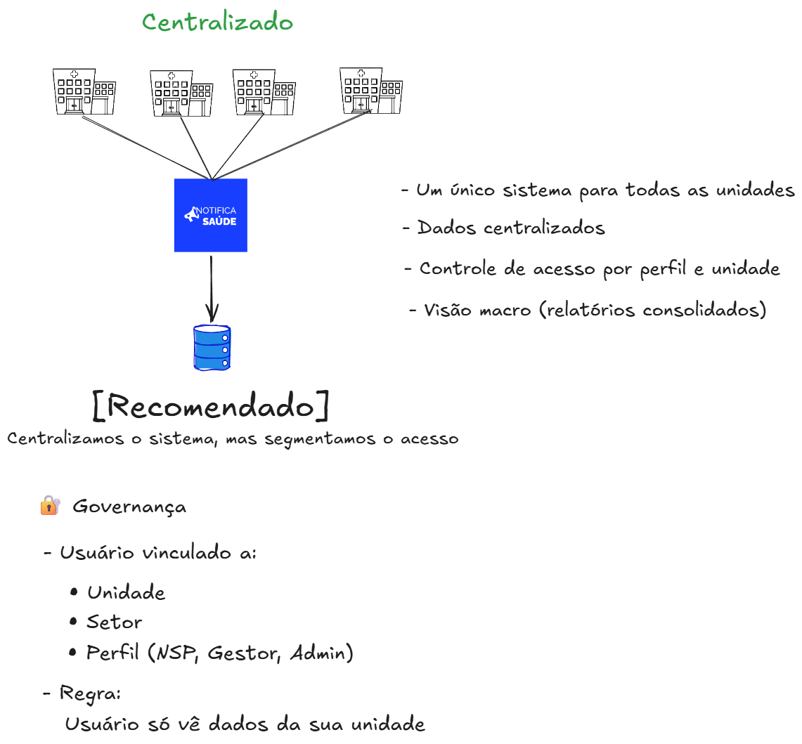
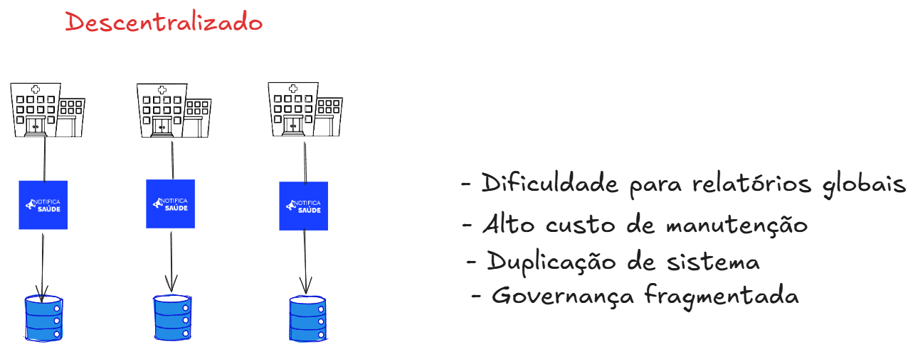

<h1 align="center">ADR-0008 — Adotar Arquitetura Centralizada</h1>

<strong>Mantenedores:</strong> Gustavo Henrique, Kauan Cardoso, Sophya Ribeiro, Brenno, Catarina, Eduardo

??? note "Histórico de Alterações"

    | Versão | Data | Justificativa | Responsável |
    | --- | --- | --- | --- |
    | 1.0 | 17/03/2026 | Registro da decisão de arquitetura. | Fabio Ramos |
    | 1.1 | 18/10/2026 | Migração do registro do repositório de documentação descontinuado para o MkDocs. | Sophya Ribeiro |

Aceita Data da decisão: 17/03/2026 <a href="../">Voltar para a lista de ADRs</a>

## Status

Aceita

---

## Contexto

Durante o levantamento e validação dos requisitos do sistema NotificaSaúde, surgiu a necessidade de definir a estratégia de implantação da solução entre múltiplas unidades de saúde.

Inicialmente, considerava-se um modelo descentralizado, no qual cada unidade (hospital/setor) possuiria sua própria instância do sistema, com base de dados isolada.

No entanto, após alinhamento com os stakeholders, identificou-se a necessidade de:

- Obter uma visão macro dos incidentes em todas as unidades
- Facilitar a geração de relatórios consolidados
- Garantir governança centralizada dos dados
- Reduzir custos operacionais e de manutenção
- Assegurar rastreabilidade e histórico unificado das notificações (conforme RN-02 e RN-10)

### Opções Consideradas

Para orientar a decisão, foi elaborado um esboço comparativo das duas abordagens arquiteturais, apresentado e validado junto aos stakeholders:

#### Opção 1 — Arquitetura Centralizada ✅ Recomendada

> Um único sistema compartilhado entre todas as unidades, com base de dados centralizada e controle de acesso por unidade, setor e perfil de usuário.

| Aspecto | Descrição |
|---|---|
| Instâncias | Uma única instância do sistema |
| Banco de dados | Centralizado e compartilhado |
| Isolamento | Lógico (multi-tenant por unidade) |
| Controle de acesso | Por unidade, setor e perfil |
| Visão de dados | Macro — relatórios consolidados |

#### Opção 2 — Arquitetura Descentralizada

> Uma instância do sistema por unidade de saúde, com bases de dados isoladas e gestão independente.

| Aspecto | Descrição |
|---|---|
| Instâncias | Uma por unidade de saúde |
| Banco de dados | Isolado por unidade |
| Isolamento | Físico (instâncias separadas) |
| Controle de acesso | Gerenciado localmente por unidade |
| Visão de dados | Fragmentada — sem consolidação nativa |

---

## Decisão

Adotar uma **arquitetura centralizada** para o sistema NotificaSaúde.

O sistema será único e compartilhado entre todas as unidades de saúde, com:

- Base de dados centralizada
- Controle de acesso baseado em:
  - Unidade de saúde
  - Setor
  - Perfil de usuário (Notificante, NSP, Gestor de Área, Administrador)
- Isolamento lógico dos dados por unidade (multi-tenant lógico)

> **Princípio:** _Centralizamos o sistema, mas segmentamos o acesso._

---

## Consequências

### ✅ Positivas

- Visão consolidada dos dados (relatórios macro)
- Melhor suporte à tomada de decisão institucional
- Redução de custos de infraestrutura e manutenção
- Facilidade de evolução e deploy do sistema (uma única aplicação)
- Garantia de rastreabilidade global das notificações
- Melhor alinhamento com requisitos de auditoria e governança
- Possibilidade de integração futura com sistemas externos (ex: NOTIVISA)

### ⚠️ Negativas

- Maior complexidade no controle de acesso e segregação de dados
- Necessidade de implementar corretamente o isolamento lógico entre unidades
- Maior impacto em caso de indisponibilidade do sistema (ponto único de falha)
- Exigência de maior cuidado com segurança da informação (LGPD)

### 🔴 Riscos e Mitigações

| Risco | Mitigação |
|---|---|
| Vazamento de dados entre unidades | Implementação de RBAC + associação obrigatória de usuário a unidade/setor |
| Sobrecarga do sistema | Dimensionamento adequado de infraestrutura + monitoramento |
| Indisponibilidade (ponto único de falha) | Estratégias de alta disponibilidade e backup |
| Não conformidade com LGPD | Logs de acesso, auditoria e filtros baseados em contexto do usuário |

---

## Alternativas Consideradas

### Arquitetura Descentralizada

Apesar de oferecer maior autonomia para cada unidade, essa abordagem foi descartada devido a:

- Dificuldade de consolidar dados e gerar relatórios globais
- Maior custo de manutenção (múltiplas instâncias)
- Duplicação de esforço de evolução e suporte
- Governança fragmentada
- Complexidade para integração entre unidades

---

> **Conclusão:** A arquitetura centralizada atende melhor aos objetivos estratégicos do NotificaSaúde, principalmente no que se refere à governança, análise consolidada de dados e escalabilidade operacional.
