<h1 align="center">Especificação de Arquitetura de Software</h1>

<strong>Mantenedores:</strong> Gustavo Henrique, Kauan Cardoso, Sophya Ribeiro, Brenno, Catarina, Eduardo

??? note "Histórico de Alterações"

    | Versão | Data | Justificativa | Responsável |
    | --- | --- | --- | --- |
    | 1.0 | 18/03/2026 | Criação do documento. | Fabio Ramos |
    | 2.0 | 19/03/2026 | Atualização para a implantação em homologação. | Fabio Ramos |
    | 2.1 | 23/03/2026 | Ajuste das referências à ferramenta Structurizr, corrigindo a digitação. | Lucas Gonçalves Cordeiro |
    | 2.2 | 24/03/2026 | Substituição das imagens renderizadas de PNG para SVG. | Fabio Ramos |
    | 2.3 | 26/03/2026 | Renomeação do documento para seguir o padrão definido em GCS. | Fabio Ramos |
    | 3.0 | 11/05/2026 | Atualização da arquitetura e criação dos diagramas de implantação. | Lucas Gonçalves Cordeiro |
    | 3.1 | 10/06/2026 | Inclusão do histórico de versões, de acordo com o histórico de commits. | Lucas Gonçalves Cordeiro |
    | 3.2 | 18/10/2026 | Migração do documento do repositório de documentação descontinuado para o MkDocs, com os diagramas de implantação na seção 3.5. | Sophya Ribeiro |

## Sumário

- [1. Introdução](#introducao)
- [2. Escopo](#escopo)
- [3. Representação arquitetural](#representacao)
    - [3.1. Nível 1 – Diagrama de Contexto](#contexto)
    - [3.2. Nível 2 – Diagrama de Container](#container)
    - [3.3. Nível 3 – Diagrama de Componentes](#componentes)
    - [3.4. Nível 4 – Código](#codigo)
    - [3.5. Diagramas suplementares – Diagrama de Implantação](#implantacao)

---

## 1. Introdução { #introducao }

Este documento tem como objetivo descrever a arquitetura do sistema **NotificaSaúde**, seguindo o modelo de visualização arquitetural de software C4 (BROWN, s.d.).

O modelo C4 foi escolhido pela equipe por oferecer uma forma progressiva e hierárquica de comunicar a arquitetura do sistema, partindo de uma visão de alto nível compreensível por todos os stakeholders — incluindo os proponentes e a equipe de saúde — até o detalhamento técnico dos componentes internos necessário para o desenvolvimento. Essa abordagem facilita tanto as revisões com os proponentes quanto a integração de novos membros à equipe, sem exigir familiaridade prévia com notações mais complexas como UML estrutural. Além disso, a notação C4 é diretamente suportada pela ferramenta Structurizr DSL, utilizada pela equipe para manter os diagramas versionados junto ao projeto.

**Referência:** BROWN, Simon. *The C4 model for visualising software architecture – Context, Containers, Components, and Code*. Disponível em: [https://c4model.com/](https://c4model.com/){ target="_blank" }.

---

## 2. Escopo { #escopo }

Este documento auxilia os envolvidos no projeto a compreender os aspectos arquiteturais do sistema necessários para desenvolver uma solução que atenda às necessidades dos proponentes, além de auxiliar equipes futuras no entendimento do projeto.

### 2.1. Restrições do sistema

As seguintes decisões e restrições arquiteturais foram definidas e registradas como [ADRs](adr/index.md) (*Architecture Decision Records*):

**React + TypeScript no frontend ([ADR-0005](adr/0005-usar-react-typescript-no-frontend.md)):** A interface web do NotificaSaúde é desenvolvida em React com TypeScript. A escolha considera a necessidade de formulários acessíveis e intuitivos para diferentes perfis de usuário, a reutilização de componentes e a segurança de manutenção proporcionada pela tipagem estática.

**Arquitetura cliente-servidor com API REST ([ADR-0006](adr/0006-adotar-arquitetura-cliente-servidor-rest.md)):** O sistema adota uma arquitetura cliente-servidor, com frontend e backend como aplicações independentes em repositórios separados, comunicando-se via API REST com autenticação JWT. Essa decisão substituiu a abordagem monolítica inicialmente considerada, favorecendo a separação de responsabilidades e o desenvolvimento paralelo entre as equipes.

**Arquitetura centralizada com isolamento lógico ([ADR-0008](adr/0008-adotar-arquitetura-centralizada.md)):** O NotificaSaúde opera como um sistema único e compartilhado entre todas as unidades de saúde, com base de dados centralizada e controle de acesso por unidade, setor e perfil de usuário (RBAC). Essa decisão viabiliza a visão consolidada dos incidentes, relatórios macro e governança centralizada, em contraposição ao modelo descentralizado, que dificultaria a consolidação de dados.

**Multi-tenancy com `tenant_id` e PostgreSQL ([ADR-0009](adr/0009-adotar-multitenancy-com-postgresql.md)):** O isolamento lógico entre unidades de saúde é implementado por meio de uma coluna `tenant_id` presente em todas as entidades de domínio. O PostgreSQL foi adotado como banco de dados em substituição ao SQLite, que não atende aos requisitos de concorrência, controle de acesso e alta disponibilidade do ambiente institucional (RF-5.1.1).

**Express.js com TypeScript no backend ([ADR-0010](adr/0010-adotar-backend-expressjs.md)):** O backend é implementado com Express.js e TypeScript, organizado em camadas explícitas (`routes/`, `services/`, `repositories/`). A escolha equilibra simplicidade operacional, alinhamento com o ecossistema TypeScript do frontend e controle suficiente para implementar RBAC, multi-tenancy e auditoria.

**Prisma como ORM ([ADR-0011](adr/0011-adotar-orm-prisma.md)):** O Prisma é adotado como camada de acesso a dados, com o `schema.prisma` como fonte única de verdade do modelo de dados. Migrações versionadas e tipos TypeScript gerados automaticamente reduzem erros de mapeamento e facilitam a evolução do schema ao longo do piloto.

---

## 3. Representação arquitetural { #representacao }

O modelo C4 considera as estruturas estáticas de um sistema de software em termos de containers (aplicativos, armazenamentos de dados, microsserviços etc.), componentes e código. Também considera as pessoas que usam os sistemas de software construídos.

### 3.1. Nível 1 – Diagrama de Contexto { #contexto }

O diagrama de contexto apresenta o NotificaSaúde e sua relação com os cinco perfis de usuário e o sistema externo NOTIVISA, da ANVISA. É importante destacar que o **Notificante** — que pode ser qualquer pessoa com conhecimento do incidente, incluindo pacientes e acompanhantes — acessa o formulário de registro **sem necessidade de autenticação**, conforme exigido pela RN-03 e pela RN-04. Os demais atores (Profissional NSP, Gestor de Área, Administrador da Instituição e Administrador do Sistema) acessam o sistema mediante autenticação por login e senha (RN-01). A integração com o NOTIVISA está prevista como evolução futura do sistema.

<figure class="ns-diagrama" markdown>
[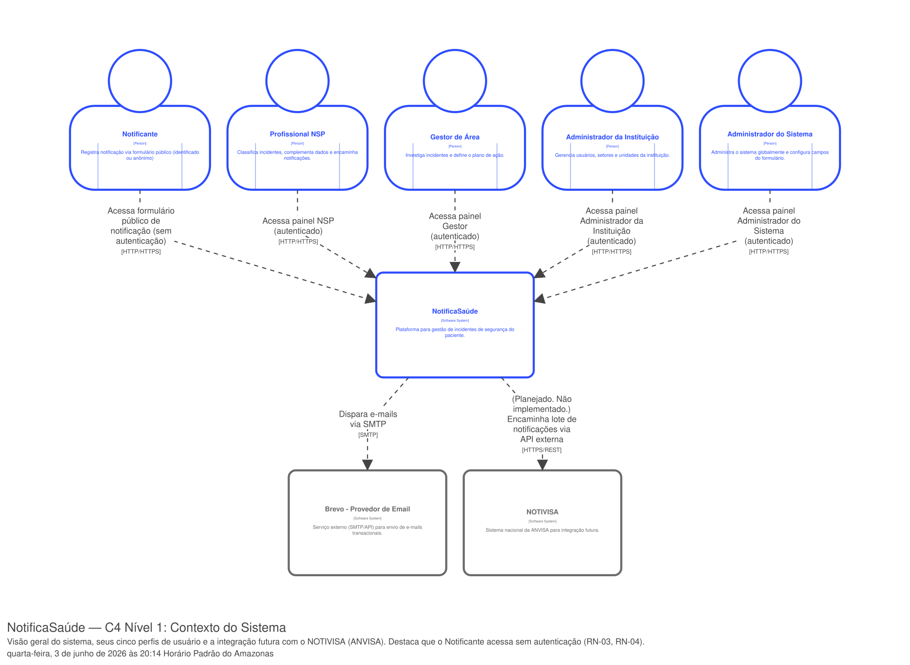](../../assets/arquitetura/diagramas/Diagrama_Contexto.svg){ target="_blank" title="Abrir o diagrama em tamanho real" }
{ .ns-diagrama__legenda }
</figure>

> Clique no diagrama para abrir em tamanho real. Diagrama gerado com Structurizr DSL. Arquivo fonte: `structurizr/workspace.dsl`, na raiz deste repositório.

### 3.2. Nível 2 – Diagrama de Container { #container }

O diagrama de container detalha os três containers que compõem o NotificaSaúde, conforme as decisões arquiteturais registradas nas ADRs:

- **Aplicação Web (Frontend):** SPA desenvolvida em React + TypeScript ([ADR-0005](adr/0005-usar-react-typescript-no-frontend.md)), responsável pela interface responsiva para todos os perfis de usuário. Inclui o formulário público de notificação de incidentes, o painel do NSP, o painel do Gestor de Área, o painel administrativo e as telas de relatórios. Compatível com Chrome, Safari e Microsoft Edge (RF-5.4.1).
- **API Backend:** Aplicação Node.js com Express.js e TypeScript ([ADR-0010](adr/0010-adotar-backend-expressjs.md)), exposta como API REST ([ADR-0006](adr/0006-adotar-arquitetura-cliente-servidor-rest.md)). Implementa RBAC por perfil de usuário (RN-01), isolamento multi-tenant por `tenant_id` ([ADR-0009](adr/0009-adotar-multitenancy-com-postgresql.md)) e auditoria completa de modificações (RN-02). Mantém rotas públicas para o registro de notificações, que não exigem autenticação (RN-03, RN-04), separadas das rotas protegidas por JWT.
- **Banco de Dados:** Instância PostgreSQL 16 ([ADR-0009](adr/0009-adotar-multitenancy-com-postgresql.md)), com isolamento lógico entre unidades de saúde garantido por `tenant_id` e índices compostos `(tenantId, id)` em todas as tabelas de domínio.

A comunicação entre o Frontend e a API Backend ocorre exclusivamente via HTTPS com JSON. Requisições ao formulário público não carregam token; requisições às demais rotas carregam `Authorization: Bearer <JWT>`. O acesso ao banco de dados é mediado exclusivamente pelo Prisma ORM ([ADR-0011](adr/0011-adotar-orm-prisma.md)).

<figure class="ns-diagrama" markdown>
[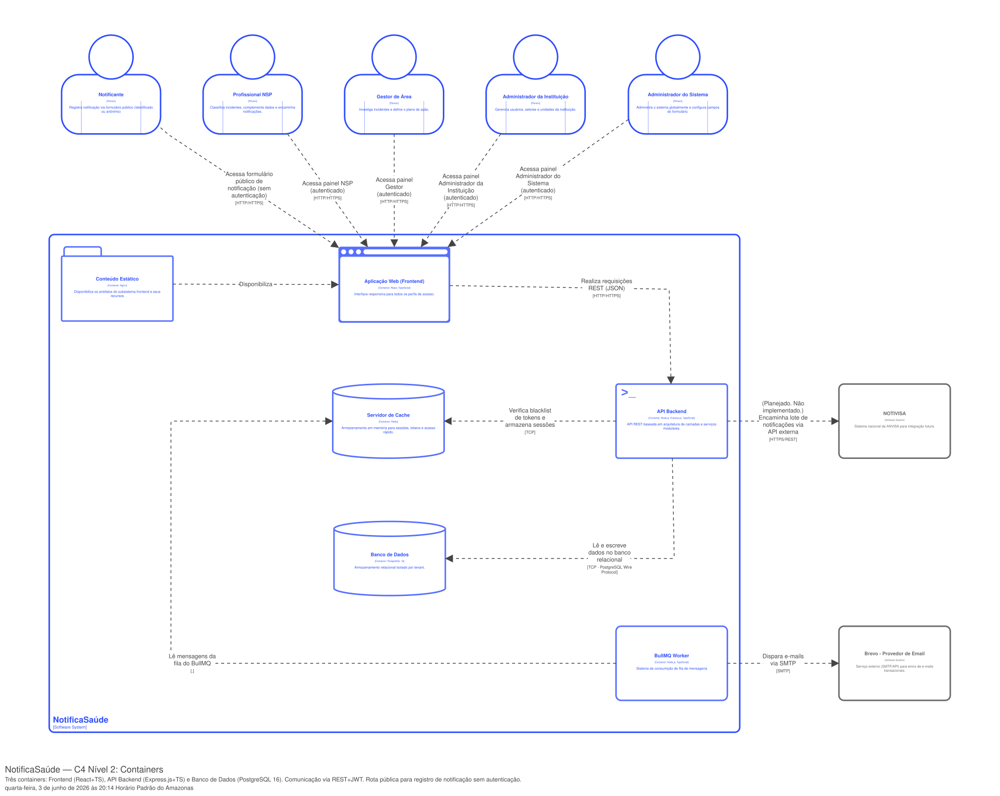](../../assets/arquitetura/diagramas/Diagrama_Container.svg){ target="_blank" title="Abrir o diagrama em tamanho real" }
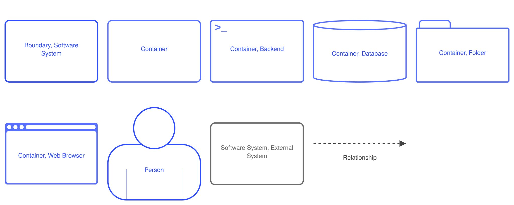{ .ns-diagrama__legenda }
</figure>

> Clique no diagrama para abrir em tamanho real. Diagrama gerado com Structurizr DSL. Arquivo fonte: `structurizr/workspace.dsl`, na raiz deste repositório.

### 3.3. Nível 3 – Diagrama de Componentes { #componentes }

O diagrama de componentes detalha a organização interna do container **API Backend**, seguindo a estrutura de camadas definida na [ADR-0010](adr/0010-adotar-backend-expressjs.md). Os componentes estão organizados em cinco grupos:

**Middlewares:** Implementam as preocupações transversais de segurança. O `publicGateway` é o ponto de entrada para rotas públicas — sem autenticação —, aplicando apenas rate limiting e validação de schema via Zod (RN-03, RN-04). O `authMiddleware` valida o JWT Bearer e popula o contexto da requisição com os dados do usuário. O `tenantMiddleware` injeta o `tenant_id` no ciclo da requisição, garantindo que nenhuma operação de domínio prossiga sem o contexto do tenant resolvido ([ADR-0009](adr/0009-adotar-multitenancy-com-postgresql.md)). O `rbacMiddleware` valida o perfil do usuário contra os perfis autorizados para cada rota (RN-01). O `errorHandler` padroniza todas as respostas de erro.

**Routes:** Responsabilidade única de receber a requisição HTTP, acionar o serviço correspondente e devolver a resposta. Nenhuma regra de negócio reside nessa camada. A rota `public/notificacao.routes` (`POST /public/notificacoes`) é a única rota sem autenticação obrigatória, em conformidade com os requisitos de notificação anônima (RN-04, US-1.1).

**Services:** Contêm todas as regras de negócio do sistema. Cada service é responsável por um agregado do domínio e orquestra as transições de estado, as validações de pré-condição e as chamadas ao `AuditService` após qualquer modificação (RN-02). O `NotificacaoService` gerencia o ciclo de vida completo da notificação, incluindo a criação pública sem identificação obrigatória do notificante. O `CampoFormularioService` gerencia o formulário dinâmico em escopo global, sem `tenant_id`, acessível apenas ao Administrador do Sistema.

**Repositories:** Camada de acesso a dados. Todos os repositórios concretos estendem a `TenantRepository`, classe base abstrata que injeta automaticamente o `tenant_id` em toda query de domínio ([ADR-0009](adr/0009-adotar-multitenancy-com-postgresql.md)). A única exceção é o `CampoFormularioRepository`, que opera sem filtro de `tenant_id` por design — os campos do formulário são globais a todas as unidades.

**Camada Prisma:** O `PrismaClient` (instância singleton) é a única interface com o PostgreSQL. O `schema.prisma` é a fonte única de verdade do modelo de dados, com `tenant_id` e índice composto `@@index([tenantId, id])` em todas as entidades de domínio.

<figure class="ns-diagrama" markdown>
[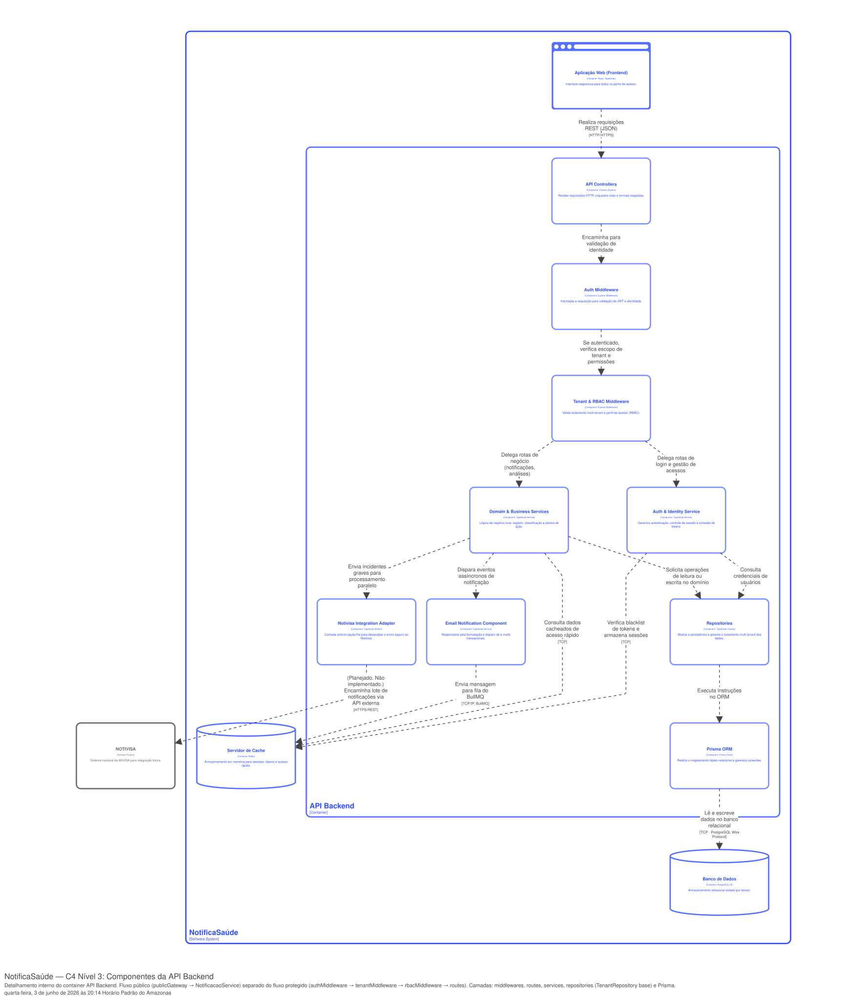](../../assets/arquitetura/diagramas/Diagrama_Componentes_Backend.svg){ target="_blank" title="Abrir o diagrama em tamanho real" }
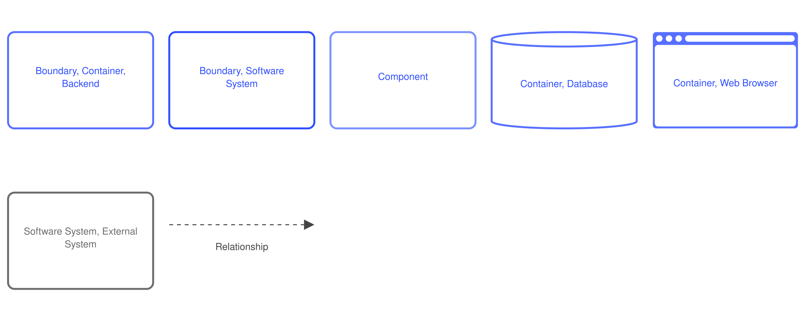{ .ns-diagrama__legenda }
</figure>

O diagrama abaixo apresenta a organização interna do container **Aplicação Web (Frontend)**.

<figure class="ns-diagrama" markdown>
[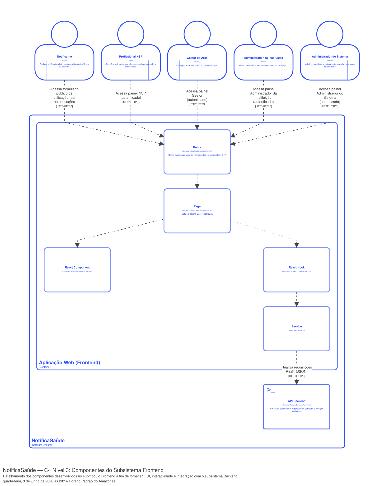](../../assets/arquitetura/diagramas/Diagrama_Componentes_Frontend.svg){ target="_blank" title="Abrir o diagrama em tamanho real" }
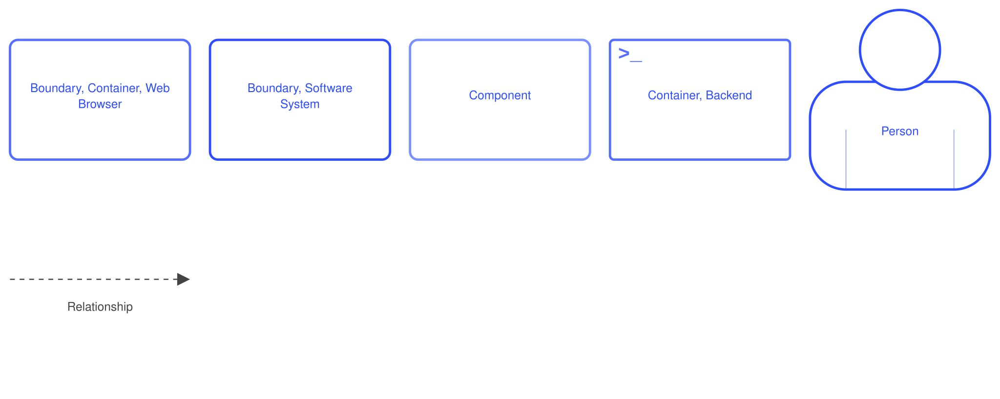{ .ns-diagrama__legenda }
</figure>

> Clique no diagrama para abrir em tamanho real. Diagrama gerado com Structurizr DSL. Arquivo fonte: `structurizr/workspace.dsl`, na raiz deste repositório.

### 3.4. Nível 4 – Código { #codigo }

O modelo de domínio completo do NotificaSaúde, com as entidades persistentes do sistema e seus relacionamentos, está documentado na [Especificação do Modelo de Domínio](../banco-de-dados/modelo-dominio.md). O modelo lógico do banco de dados está na [Especificação do Modelo Lógico](../banco-de-dados/modelo-logico.md).

### 3.5. Diagramas suplementares – Diagrama de Implantação { #implantacao }

O NotificaSaúde adota arquitetura cliente-servidor ([ADR-0006](adr/0006-adotar-arquitetura-cliente-servidor-rest.md)); portanto, o diagrama de implantação é obrigatório. O sistema é composto por dois repositórios independentes (`notifica-saude-frontend` e `notifica-saude-backend`), com deploys separados, conforme a diretriz de manter a implantação simples estabelecida na [ADR-0006](adr/0006-adotar-arquitetura-cliente-servidor-rest.md). A implantação utiliza Docker ([ADR-0007](adr/0007-adotar-docker-para-deploy.md)).

#### Ambiente de desenvolvimento — Backend

<figure class="ns-diagrama" markdown>
[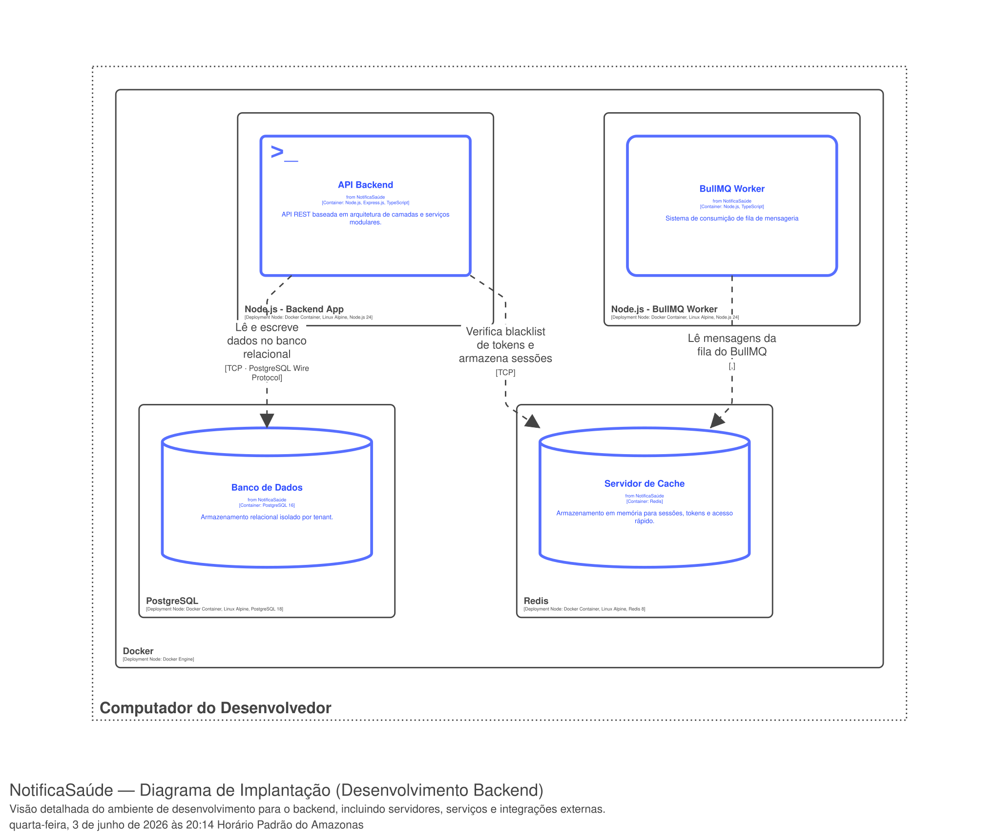](../../assets/arquitetura/diagramas/Diagrama_Implantacao_Desenvolvimento_Backend.svg){ target="_blank" title="Abrir o diagrama em tamanho real" }
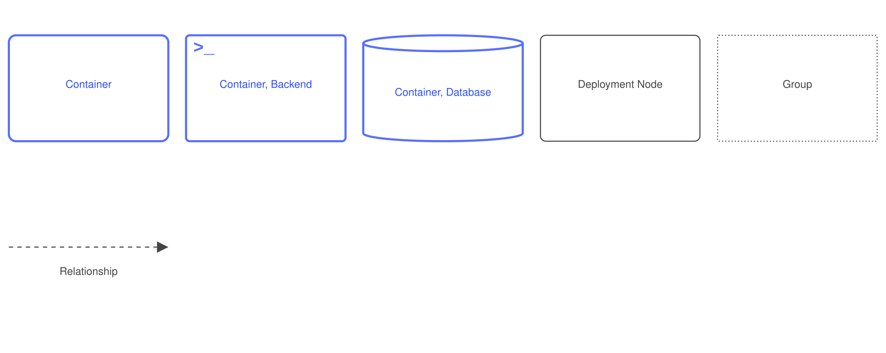{ .ns-diagrama__legenda }
</figure>

#### Ambiente de desenvolvimento — Frontend

<figure class="ns-diagrama" markdown>
[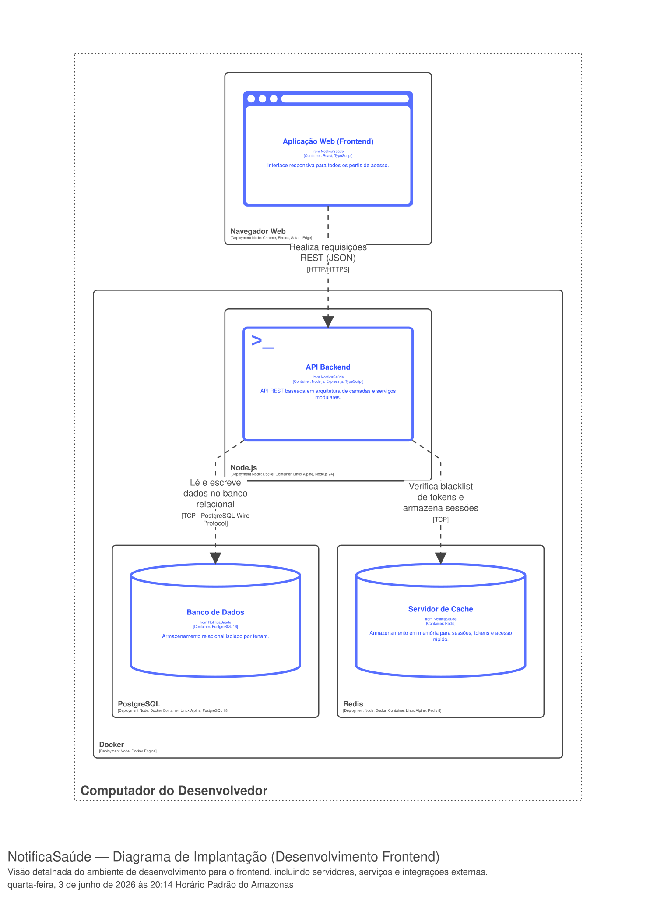](../../assets/arquitetura/diagramas/Diagrama_Implantacao_Desenvolvimento_Frontend.svg){ target="_blank" title="Abrir o diagrama em tamanho real" }
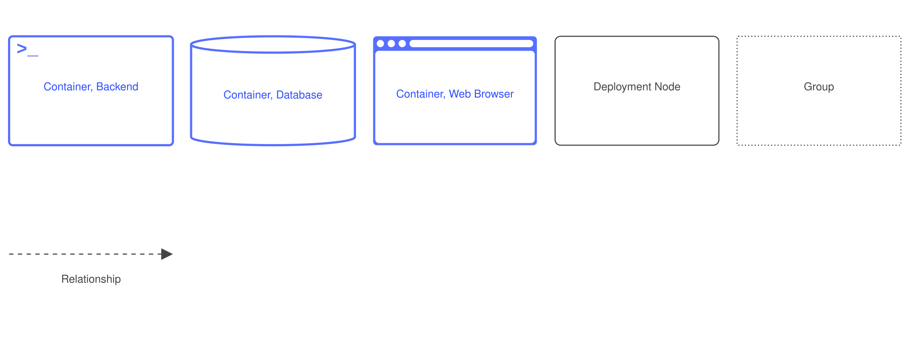{ .ns-diagrama__legenda }
</figure>

#### Ambiente de homologação

<figure class="ns-diagrama" markdown>
[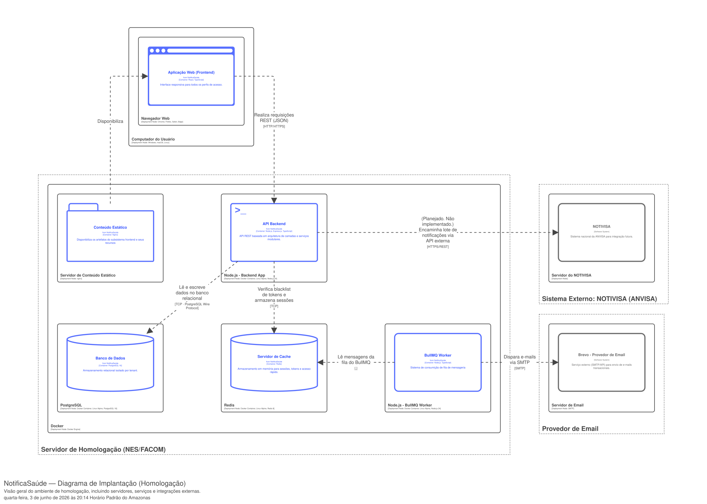](../../assets/arquitetura/diagramas/Diagrama_Implantacao_Homologacao.svg){ target="_blank" title="Abrir o diagrama em tamanho real" }
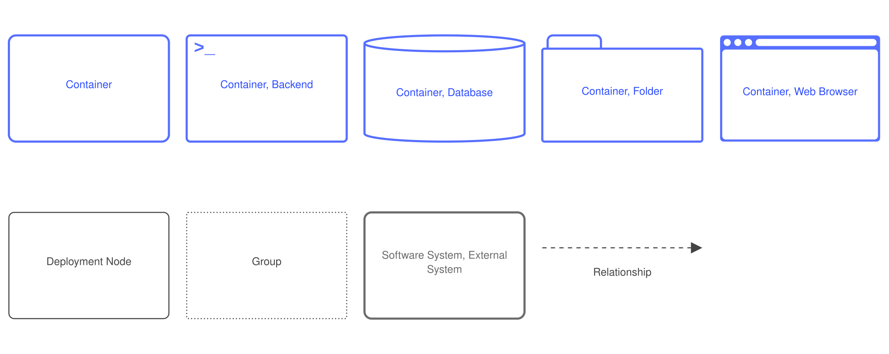{ .ns-diagrama__legenda }
</figure>

> Clique no diagrama para abrir em tamanho real. Diagrama gerado com Structurizr DSL. Arquivo fonte: `structurizr/workspace.dsl`, na raiz deste repositório.
