<h1 align="center">Especificação do Modelo de Domínio</h1>

<strong>Mantenedores:</strong> Gustavo Henrique, Kauan Cardoso, Sophya Ribeiro, Brenno, Catarina, Eduardo

??? note "Histórico de Alterações"

    | Versão | Data | Justificativa | Responsável |
    | --- | --- | --- | --- |
    | 2.3 | 02/06/2026 | Correção dos enums para refletir o `schema.prisma`, novos enums e expansão da classificação (Sprint 3). | Fabio Ramos |
    | 2.4 | 18/10/2026 | Migração do documento do repositório de documentação descontinuado para o MkDocs. | Sophya Ribeiro |
    | 3.0 | 18/10/2026 | Atualização conforme o `schema.prisma` mais recente do backend (branch `develop`): oito status da notificação (RN-08), análise com conteúdo em JSONB, ações do plano de ação (US-5.1 e US-5.2), marca de dado do notificante (RN-27) e dicionário de dados completo. | Sophya Ribeiro |

O modelo de domínio apresenta as entidades persistentes do NotificaSaúde, seus atributos, enumerações e relacionamentos. Ele corresponde ao nível 4 (código) da [Especificação de Arquitetura de Software](../arquitetura/especificacao-arquitetura.md#codigo). O detalhamento das tabelas, com tipos, chaves e valores padrão, está na [Especificação do Modelo Lógico](modelo-logico.md).

!!! info "Fonte"
    Gerado a partir do `prisma/schema.prisma` da branch `develop` do repositório `notifica-saude-backend` (última alteração do schema em 01/10/2026, commit `faa5224`).

!!! warning "O que o schema ainda não cobre"
    O backend ainda não tem persistência para o andamento e a efetividade das ações nem para os anexos de evidência (US-5.3 a US-5.7). Cada ação guarda um único responsável (nome e setor), e o status da ação segue o enum `StatusAcaoCorretiva` (`PENDENTE`, `EM_ANDAMENTO`, `CONCLUIDA`, `CANCELADA`), diferente das situações previstas na [Especificação de Requisitos](../../requisitos/especificacao-requisitos.md) (Em andamento, Parcialmente concluído, Concluído, Atrasada e Cancelada).

??? info "Notas de versão"

    **Versão 3.0 (schema de 01/10/2026)**

    - `StatusNotificacao`: inclusão de `EM_ANALISE`, `EM_ACAO` e `CONCLUIDA`, completando os oito status da RN-08.
    - `CampoFormulario`: inclusão de `dado_notificante`, que marca os campos de identificação do notificante (RN-27).
    - `Investigacao`: `gestor_area_id` passa a `autor_id` (quem iniciou a análise, RN-28); `analise` e `causa_raiz` dão lugar a `conteudo` (JSONB) com o formulário de análise; datas passam a `timestamptz`.
    - `PlanoAcao`: `descricao` e `prazo` passam a ser opcionais e sem uso (container das ações).
    - `AcaoCorretiva`: reestruturada com os campos da US-5.1 e da US-5.2 (número sequencial, rascunho, local, responsável, previsões, recurso e custo, aprovação, comprovação, resultado esperado, verificação e indicador) e relação com `Setor`.

    **Versão 2.3 e anteriores**

    - Enums da classificação (`TipoNeverEvent`, `EnvolvidoIncidente`, `CategoriaIncidente`, `ProtocoloInvestigacao`), status do plano e da ação e `EntidadeRelacional`.
    - Código sequencial da notificação por unidade (`codigo` e `ultimo_codigo_notificacao`).
    - Campos relacionais no formulário dinâmico (`entidade_relacional`, `valor_entidade_id`, `valor_entidade_label`).
    - Entidades `Estado` e `Municipio`, seções do formulário, `tooltip` nas opções e `label_original` nas respostas.

## Diagrama de Domínio

Atributos com `?` são opcionais e com `List` guardam uma lista de valores. A enumeração `TipoNeverEvent` aparece resumida no diagrama; a lista completa está em [Enumerações](#enumeracoes).

```mermaid
classDiagram

    class PerfilUsuario {
        <<enumeration>>
        NOTIFICANTE
        NSP
        GESTOR_AREA
        ADMINISTRADOR
    }
    class StatusNotificacao {
        <<enumeration>>
        NOVA
        CLASSIFICADA
        ANALISADA
        ENCAMINHADA_SETOR
        ARQUIVADA
        EM_ANALISE
        EM_ACAO
        CONCLUIDA
    }
    class TipoIncidente {
        <<enumeration>>
        NEAR_MISS
        CIRCUNSTANCIA_NOTIFICAVEL
        EVENTO_ADVERSO
        INCIDENTE_SEM_DANO
    }
    class TipoNeverEvent {
        <<enumeration>>
        ALTA_LIBERACAO_PACIENTE_INCAPAZ_PESSOA_NAO_AUTORIZADA
        CONTAMINACAO_O2_GASES_MEDICINAIS
        DESAPARECIMENTO_CORPO_RECEM_NASCIDO_OBITO
        EXODONTIA_DENTE_ERRADO
        GAS_ERRADO_O2_GASES_MEDICINAIS
        INSEMINACAO_FERTILIZACAO_ESPERMA_OVULO_ERRADO
        LESAO_GRAVE_QUEDA_DURANTE_CUIDADOS
        LESAO_PRESSAO_ESTAGIO_3
        +22 valores
    }
    class EnvolvidoIncidente {
        <<enumeration>>
        PROFISSIONAL_SAUDE
        PACIENTE
        FAMILIAR_ACOMPANHANTE
        EQUIPAMENTO
        DISPOSITIVO_MEDICO
        MEDICAMENTO
        SISTEMA
        AMBIENTE_FISICO
        OUTRO
    }
    class CategoriaIncidente {
        <<enumeration>>
        ERRO_MEDICACAO
        FALHA_IDENTIFICACAO
        QUEDA
        LESAO_PRESSAO
        INFECCAO_ASSISTENCIA
        PROCEDIMENTO_CIRURGICO
        EQUIPAMENTO_DISPOSITIVO
        FALHA_DIAGNOSTICO
        +4 valores
    }
    class GrauDano {
        <<enumeration>>
        LEVE
        MODERADO
        GRAVE
        OBITO
        NEVER_EVENT
    }
    class ProtocoloInvestigacao {
        <<enumeration>>
        INVESTIGACAO_DIRETA
        INVESTIGACAO_SISTEMICA_PROFUNDA
    }
    class StatusPlanoAcao {
        <<enumeration>>
        PENDENTE
        EM_ANDAMENTO
        CONCLUIDO
        CANCELADO
    }
    class StatusAcaoCorretiva {
        <<enumeration>>
        PENDENTE
        EM_ANDAMENTO
        CONCLUIDA
        CANCELADA
    }
    class TipoCampo {
        <<enumeration>>
        TEXTO
        NUMERO
        DATA
        AREA
        EMAIL
        TELEFONE
        ARQUIVO
        BOOLEAN
        +4 valores
    }
    class EntidadeRelacional {
        <<enumeration>>
        ESTADO
        MUNICIPIO
        SETOR
        UnidadeSaude
    }
    class UnidadeSaude {
        +String id
        +Int codigo
        +Int ultimo_codigo_notificacao
        +String nome
        +String cnpj
        +Boolean ativa
        +Int estado_id
        +Int municipio_id
        +DateTime created_at
        +DateTime updated_at
    }
    class Setor {
        +String id
        +String unidade_id
        +String nome
        +Boolean ativo
        +DateTime created_at
        +DateTime updated_at
    }
    class Usuario {
        +String id
        +String tenant_id
        +String unidade_id
        +String? setor_id
        +String nome
        +String email
        +String senha_hash
        +PerfilUsuario perfil
        +Boolean ativo
        +DateTime created_at
        +DateTime updated_at
    }
    class CampoFormulario {
        +String id
        +String secao
        +String label
        +TipoCampo tipo
        +EntidadeRelacional? entidade_relacional
        +Boolean obrigatorio
        +Int ordem
        +Boolean ativo
        +String? placeholder
        +Boolean dado_notificante
        +DateTime created_at
        +DateTime updated_at
    }
    class OpcaoCampo {
        +String id
        +String campo_id
        +String valor
        +String? tooltip
        +Int ordem
    }
    class RespostaCampo {
        +String id
        +String notificacao_id
        +String campo_id
        +String label_original
        +String? valor_texto
        +String? valor_opcao_id
        +String? valor_entidade_id
        +String? valor_entidade_label
        +DateTime created_at
    }
    class Notificacao {
        +String id
        +Int codigo
        +String tenant_id
        +String unidade_id
        +String setor_id
        +String? notificante_id
        +DateTime data_incidente
        +DateTime data_registro
        +String? descricao
        +Boolean anonima
        +StatusNotificacao status
        +DateTime created_at
        +DateTime updated_at
    }
    class Classificacao {
        +String id
        +String notificacao_id
        +String profissional_nsp_id
        +TipoIncidente? tipo_incidente
        +TipoNeverEvent? tipo_especifico
        +CategoriaIncidenteList tipos_incidentes
        +EnvolvidoIncidenteList envolvidos
        +GrauDano? grau_dano
        +String? observacoes
        +String? outro_envolvido
        +String? outro_tipo_incidente
        +ProtocoloInvestigacao? protocolo_investigacao
        +Boolean rascunho
        +DateTime data_classificacao
        +DateTime? data_validade
        +DateTime created_at
        +DateTime updated_at
    }
    class Encaminhamento {
        +String id
        +String notificacao_id
        +String setor_destino_id
        +String responsavel_nsp_id
        +String? mensagem
        +DateTime data_envio
        +DateTime created_at
    }
    class Investigacao {
        +String id
        +String notificacao_id
        +String autor_id
        +DateTime data_inicio
        +DateTime? data_conclusao
        +Json conteudo
        +DateTime created_at
        +DateTime updated_at
    }
    class PlanoAcao {
        +String id
        +String investigacao_id
        +String? descricao
        +DateTime? prazo
        +StatusPlanoAcao status
        +DateTime created_at
        +DateTime updated_at
    }
    class AcaoCorretiva {
        +String id
        +String plano_acao_id
        +Int numero
        +Boolean rascunho
        +String? descricao
        +String? local
        +String? responsavel_setor_id
        +String? responsavel_nome
        +DateTime? previsao_inicio
        +DateTime? previsao_conclusao
        +Boolean necessita_recurso
        +String? recurso_descricao
        +Decimal? custo_estimado
        +Boolean necessita_aprovacao
        +String? aprovacao_descricao
        +String? forma_comprovacao
        +String? resultado_esperado
        +String? metodo_verificacao
        +DateTime? data_verificacao
        +Boolean gera_indicador
        +String? indicador_descricao
        +StatusAcaoCorretiva status
        +DateTime created_at
        +DateTime updated_at
    }
    class HistoricoModificacao {
        +String id
        +String notificacao_id
        +String usuario_id
        +String campo_alterado
        +String? valor_anterior
        +String? valor_novo
        +DateTime data_alteracao
    }
    class Estado {
        +Int id
        +String nome
        +String uf
    }
    class Municipio {
        +Int id
        +Int estado_id
        +String nome
    }

    Estado "1" --> "N" UnidadeSaude : estado_id
    Municipio "1" --> "N" UnidadeSaude : municipio_id
    UnidadeSaude "1" --> "N" Setor : unidade_id
    UnidadeSaude "1" --> "N" Usuario : unidade_id
    Setor "0..1" --> "N" Usuario : setor_id
    CampoFormulario "1" --> "N" OpcaoCampo : campo_id
    Notificacao "1" --> "N" RespostaCampo : notificacao_id
    CampoFormulario "1" --> "N" RespostaCampo : campo_id
    OpcaoCampo "0..1" --> "N" RespostaCampo : valor_opcao_id
    UnidadeSaude "1" --> "N" Notificacao : unidade_id
    Setor "1" --> "N" Notificacao : setor_id
    Usuario "0..1" --> "N" Notificacao : notificante_id
    Notificacao "1" --> "0..1" Classificacao : notificacao_id
    Usuario "1" --> "N" Classificacao : profissional_nsp_id
    Notificacao "1" --> "0..1" Encaminhamento : notificacao_id
    Setor "1" --> "N" Encaminhamento : setor_destino_id
    Usuario "1" --> "N" Encaminhamento : responsavel_nsp_id
    Notificacao "1" --> "0..1" Investigacao : notificacao_id
    Usuario "1" --> "N" Investigacao : autor_id
    Investigacao "1" --> "0..1" PlanoAcao : investigacao_id
    PlanoAcao "1" --> "N" AcaoCorretiva : plano_acao_id
    Setor "0..1" --> "N" AcaoCorretiva : responsavel_setor_id
    Notificacao "1" --> "N" HistoricoModificacao : notificacao_id
    Usuario "1" --> "N" HistoricoModificacao : usuario_id
    Estado "1" --> "N" Municipio : estado_id
    Usuario ..> PerfilUsuario
    CampoFormulario ..> TipoCampo
    CampoFormulario ..> EntidadeRelacional
    Notificacao ..> StatusNotificacao
    Classificacao ..> TipoIncidente
    Classificacao ..> TipoNeverEvent
    Classificacao ..> CategoriaIncidente
    Classificacao ..> EnvolvidoIncidente
    Classificacao ..> GrauDano
    Classificacao ..> ProtocoloInvestigacao
    PlanoAcao ..> StatusPlanoAcao
    AcaoCorretiva ..> StatusAcaoCorretiva
```

## Agregados do Domínio

| Agregado | Raiz | Entidades internas |
| --- | --- | --- |
| Notificação | `Notificacao` | `RespostaCampo`, `Classificacao`, `Encaminhamento`, `Investigacao`, `PlanoAcao`, `AcaoCorretiva`, `HistoricoModificacao` |
| Formulário | `CampoFormulario` | `OpcaoCampo` |
| Organização | `UnidadeSaude` | `Setor`, `Usuario` |
| Localização | `Estado` | `Municipio` |

## Enumerações { #enumeracoes }

| Enumeração | Valores |
| --- | --- |
| `PerfilUsuario` | `NOTIFICANTE`, `NSP`, `GESTOR_AREA`, `ADMINISTRADOR` |
| `StatusNotificacao` | `NOVA`, `CLASSIFICADA`, `ANALISADA`, `ENCAMINHADA_SETOR`, `ARQUIVADA`, `EM_ANALISE`, `EM_ACAO`, `CONCLUIDA` |
| `TipoIncidente` | `NEAR_MISS`, `CIRCUNSTANCIA_NOTIFICAVEL`, `EVENTO_ADVERSO`, `INCIDENTE_SEM_DANO` |
| `TipoNeverEvent` | `ALTA_LIBERACAO_PACIENTE_INCAPAZ_PESSOA_NAO_AUTORIZADA`, `CONTAMINACAO_O2_GASES_MEDICINAIS`, `DESAPARECIMENTO_CORPO_RECEM_NASCIDO_OBITO`, `EXODONTIA_DENTE_ERRADO`, `GAS_ERRADO_O2_GASES_MEDICINAIS`, `INSEMINACAO_FERTILIZACAO_ESPERMA_OVULO_ERRADO`, `LESAO_GRAVE_QUEDA_DURANTE_CUIDADOS`, `LESAO_PRESSAO_ESTAGIO_3`, `LESAO_PRESSAO_ESTAGIO_4`, `LESAO_PRESSAO_NAO_CLASSIFICAVEL`, `OBITO_QUEDA_DURANTE_CUIDADOS`, `OBITO_INTRAOPERATORIO_POS_OPERATORIO_ASA_CLASSE_1`, `OBITO_LESAO_GRAVE_FUGA_PACIENTE`, `OBITO_LESAO_GRAVE_CHOQUE_ELETRICO`, `OBITO_LESAO_GRAVE_OBJETO_METALICO_RESSONANCIA_MAGNETICA`, `OBITO_LESAO_GRAVE_CONTENCAO_FISICA_GRADES`, `OBITO_LESAO_GRAVE_QUEIMADURA`, `OBITO_LESAO_GRAVE_PERDA_AMOSTRA_BIOLOGICA`, `OBITO_LESAO_GRAVE_RECEM_NASCIDO_PARTO_BAIXO_RISCO`, `OBITO_LESAO_GRAVE_FALHA_EXAMES_LABORATORIAIS`, `OBITO_LESAO_GRAVE_FALHA_EXAMES_RADIOLOGICOS`, `OBITO_LESAO_MATERNA_PARTO_BAIXO_RISCO`, `PROCEDIMENTO_CIRURGICO_LOCAL_ERRADO`, `PROCEDIMENTO_CIRURGICO_LADO_ERRADO`, `PROCEDIMENTO_CIRURGICO_PACIENTE_ERRADO`, `QUEDA_RECEM_NASCIDO_PARTO`, `CIRURGIA_ERRADA_PACIENTE`, `RETENCAO_CORPO_ESTRANHO_APOS_CIRURGIA`, `SUICIDIO_TENTATIVA_DANO_AUTO_INFLIGIDO`, `TROCA_BEBES` |
| `EnvolvidoIncidente` | `PROFISSIONAL_SAUDE`, `PACIENTE`, `FAMILIAR_ACOMPANHANTE`, `EQUIPAMENTO`, `DISPOSITIVO_MEDICO`, `MEDICAMENTO`, `SISTEMA`, `AMBIENTE_FISICO`, `OUTRO` |
| `CategoriaIncidente` | `ERRO_MEDICACAO`, `FALHA_IDENTIFICACAO`, `QUEDA`, `LESAO_PRESSAO`, `INFECCAO_ASSISTENCIA`, `PROCEDIMENTO_CIRURGICO`, `EQUIPAMENTO_DISPOSITIVO`, `FALHA_DIAGNOSTICO`, `COMUNICACAO`, `TRANSFUSAO_SANGUINEA`, `DOCUMENTACAO_PRONTUARIO`, `OUTRO` |
| `GrauDano` | `LEVE`, `MODERADO`, `GRAVE`, `OBITO`, `NEVER_EVENT` |
| `ProtocoloInvestigacao` | `INVESTIGACAO_DIRETA`, `INVESTIGACAO_SISTEMICA_PROFUNDA` |
| `StatusPlanoAcao` | `PENDENTE`, `EM_ANDAMENTO`, `CONCLUIDO`, `CANCELADO` |
| `StatusAcaoCorretiva` | `PENDENTE`, `EM_ANDAMENTO`, `CONCLUIDA`, `CANCELADA` |
| `TipoCampo` | `TEXTO`, `NUMERO`, `DATA`, `AREA`, `EMAIL`, `TELEFONE`, `ARQUIVO`, `BOOLEAN`, `SELECT`, `MULTISELECT`, `RADIO`, `CHECKBOX` |
| `EntidadeRelacional` | `ESTADO`, `MUNICIPIO`, `SETOR`, `UnidadeSaude` |
