<h1 align="center">Especificação do Modelo Lógico</h1>

<p align="center"><strong>Mantenedores:</strong> Gustavo Henrique, Kauan Cardoso, Sophya Ribeiro, Brenno, Catarina, Eduardo</p>

??? note "Histórico de Alterações"

    | Versão | Data | Justificativa | Responsável |
    | --- | --- | --- | --- |
    | 2.2 | 08/06/2026 | Atualização do modelo com as alterações da Sprint 3 (código sequencial da notificação, campos relacionais e expansão da classificação). | Fabio Ramos |
    | 2.3 | 22/06/2026 | Renomeação de "DER" para "Diagrama Lógico / Modelo Lógico", conforme solicitado na banca. | Fabio Ramos |
    | 2.4 | 18/10/2026 | Migração do documento do repositório de documentação descontinuado para o MkDocs. | Sophya Ribeiro |
    | 3.0 | 18/10/2026 | Atualização conforme o `schema.prisma` mais recente do backend (branch `develop`): oito status da notificação (RN-08), análise com conteúdo em JSONB, ações do plano de ação (US-5.1 e US-5.2), marca de dado do notificante (RN-27) e dicionário de dados completo. | Sophya Ribeiro |

| Baseado em | Banco | ORM | Decisões de arquitetura |
| --- | --- | --- | --- |
| `schema.prisma` | PostgreSQL | Prisma | [ADR-0008](../arquitetura/adr/0008-adotar-arquitetura-centralizada.md) · [ADR-0016](../arquitetura/adr/0016-adotar-multitenancy.md) · [ADR-0021](../arquitetura/adr/0021-adotar-postgresql-como-sgbd-com-multitenancy.md) |

!!! info "Fonte"
    Gerado a partir do `prisma/schema.prisma` da branch `develop` do repositório `notifica-saude-backend` (última alteração do schema em 01/10/2026, commit `faa5224`).

!!! warning "O que o schema ainda não cobre"
    O backend ainda não tem persistência para o andamento e a efetividade das ações nem para os anexos de evidência (US-5.3 a US-5.7). Cada ação guarda um único responsável (nome e setor), e o status da ação segue o enum `StatusAcaoCorretiva` (`PENDENTE`, `EM_ANDAMENTO`, `CONCLUIDA`, `CANCELADA`), diferente das situações previstas na [Especificação de Requisitos](../../requisitos/especificacao-requisitos.md) (Em andamento, Parcialmente concluído, Concluído, Atrasada e Cancelada).

??? info "Notas de versão"

    **Versão 3.0 (schema de 01/10/2026)**

    - `StatusNotificacao`: inclusão de `EM_ANALISE`, `EM_ACAO` e `CONCLUIDA`, completando os oito status da RN-08.
    - `CampoFormulario`: inclusão de `dado_notificante`, que marca os campos de identificação do notificante (RN-27).
    - `Investigacao`: `gestor_area_id` passa a `autor_id` (quem iniciou a análise, RN-28); `analise` e `causa_raiz` dão lugar a `conteudo` (JSONB) com o formulário de análise; datas passam a `timestamptz`.
    - `PlanoAcao`: `descricao` e `prazo` passam a ser opcionais e sem uso (container das ações).
    - `AcaoCorretiva`: reestruturada com os campos da US-5.1 e da US-5.2 (número sequencial, rascunho, local, responsável, previsões, recurso e custo, aprovação, comprovação, resultado esperado, verificação e indicador) e relação com `Setor`.

    **Versão 2.3 e anteriores**

    - Enums da classificação (`TipoNeverEvent`, `EnvolvidoIncidente`, `CategoriaIncidente`, `ProtocoloInvestigacao`), status do plano e da ação e `EntidadeRelacional`.
    - Código sequencial da notificação por unidade (`codigo` e `ultimo_codigo_notificacao`).
    - Campos relacionais no formulário dinâmico (`entidade_relacional`, `valor_entidade_id`, `valor_entidade_label`).
    - Entidades `Estado` e `Municipio`, seções do formulário, `tooltip` nas opções e `label_original` nas respostas.

## Visão Geral

O **NotificaSaúde** utiliza uma arquitetura **multi-tenant com isolamento lógico por unidade de saúde**: cada unidade de saúde funciona como um tenant do sistema.

Relacionamentos principais:

```
UNIDADE_SAUDE
 ├── SETOR
 │     └── USUARIO
 │
 └── NOTIFICACAO
        ├── RESPOSTA_CAMPO
        ├── CLASSIFICACAO
        ├── ENCAMINHAMENTO
        ├── INVESTIGACAO
        │     └── PLANO_ACAO
        │           └── ACAO_CORRETIVA
        └── HISTORICO_MODIFICACAO
```

O registro das notificações usa um **formulário dinâmico configurável** (`CAMPO_FORMULARIO`, `OPCAO_CAMPO` e `RESPOSTA_CAMPO`), de escopo global, sem `tenant_id`.

## Diagrama Lógico

Os rótulos das relações indicam a coluna de chave estrangeira. Colunas marcadas como "opcional" aceitam nulo.

```mermaid
erDiagram

    UNIDADE_SAUDE {
        uuid id PK
        int codigo UK
        int ultimo_codigo_notificacao
        string nome
        string cnpj UK
        boolean ativa
        int estado_id FK
        int municipio_id FK
        timestamptz created_at
        timestamptz updated_at
    }

    SETOR {
        uuid id PK
        uuid unidade_id FK
        string nome
        boolean ativo
        timestamptz created_at
        timestamptz updated_at
    }

    USUARIO {
        uuid id PK
        uuid tenant_id FK
        uuid unidade_id FK
        uuid setor_id FK "opcional"
        string nome
        string email UK
        string senha_hash
        enum perfil "PerfilUsuario"
        boolean ativo
        timestamptz created_at
        timestamptz updated_at
    }

    CAMPO_FORMULARIO {
        uuid id PK
        string secao
        string label
        enum tipo "TipoCampo"
        enum entidade_relacional "EntidadeRelacional · opcional"
        boolean obrigatorio
        int ordem
        boolean ativo
        string placeholder "opcional"
        boolean dado_notificante
        timestamptz created_at
        timestamptz updated_at
    }

    OPCAO_CAMPO {
        uuid id PK
        uuid campo_id FK
        string valor
        string tooltip "opcional"
        int ordem
    }

    RESPOSTA_CAMPO {
        uuid id PK
        uuid notificacao_id FK
        uuid campo_id FK
        string label_original
        text valor_texto "opcional"
        uuid valor_opcao_id FK "opcional"
        uuid valor_entidade_id "opcional"
        text valor_entidade_label "opcional"
        timestamptz created_at
    }

    NOTIFICACAO {
        uuid id PK
        int codigo
        uuid tenant_id FK
        uuid unidade_id FK
        uuid setor_id FK
        uuid notificante_id FK "opcional"
        date data_incidente
        timestamptz data_registro
        text descricao "opcional"
        boolean anonima
        enum status "StatusNotificacao"
        timestamptz created_at
        timestamptz updated_at
    }

    CLASSIFICACAO {
        uuid id PK
        uuid notificacao_id FK, UK
        uuid profissional_nsp_id FK
        enum tipo_incidente "TipoIncidente · opcional"
        enum tipo_especifico "TipoNeverEvent · opcional"
        enum tipos_incidentes "CategoriaIncidente · lista"
        enum envolvidos "EnvolvidoIncidente · lista"
        enum grau_dano "GrauDano · opcional"
        text observacoes "opcional"
        string outro_envolvido "opcional"
        string outro_tipo_incidente "opcional"
        enum protocolo_investigacao "ProtocoloInvestigacao · opcional"
        boolean rascunho
        timestamptz data_classificacao
        timestamptz data_validade "opcional"
        timestamptz created_at
        timestamptz updated_at
    }

    ENCAMINHAMENTO {
        uuid id PK
        uuid notificacao_id FK, UK
        uuid setor_destino_id FK
        uuid responsavel_nsp_id FK
        text mensagem "opcional"
        timestamptz data_envio
        timestamptz created_at
    }

    INVESTIGACAO {
        uuid id PK
        uuid notificacao_id FK, UK
        uuid autor_id FK
        timestamptz data_inicio
        timestamptz data_conclusao "opcional"
        jsonb conteudo
        timestamptz created_at
        timestamptz updated_at
    }

    PLANO_ACAO {
        uuid id PK
        uuid investigacao_id FK, UK
        text descricao "opcional"
        date prazo "opcional"
        enum status "StatusPlanoAcao"
        timestamptz created_at
        timestamptz updated_at
    }

    ACAO_CORRETIVA {
        uuid id PK
        uuid plano_acao_id FK
        int numero
        boolean rascunho
        text descricao "opcional"
        string local "opcional"
        uuid responsavel_setor_id FK "opcional"
        string responsavel_nome "opcional"
        date previsao_inicio "opcional"
        date previsao_conclusao "opcional"
        boolean necessita_recurso
        text recurso_descricao "opcional"
        decimal custo_estimado "opcional"
        boolean necessita_aprovacao
        text aprovacao_descricao "opcional"
        text forma_comprovacao "opcional"
        text resultado_esperado "opcional"
        text metodo_verificacao "opcional"
        date data_verificacao "opcional"
        boolean gera_indicador
        text indicador_descricao "opcional"
        enum status "StatusAcaoCorretiva"
        timestamptz created_at
        timestamptz updated_at
    }

    HISTORICO_MODIFICACAO {
        uuid id PK
        uuid notificacao_id FK
        uuid usuario_id FK
        string campo_alterado
        text valor_anterior "opcional"
        text valor_novo "opcional"
        timestamptz data_alteracao
    }

    ESTADO {
        int id PK
        string nome
        varchar uf UK
    }

    MUNICIPIO {
        int id PK
        int estado_id FK
        string nome
    }

    ESTADO ||--o{ UNIDADE_SAUDE : "estado_id"
    MUNICIPIO ||--o{ UNIDADE_SAUDE : "municipio_id"
    UNIDADE_SAUDE ||--o{ SETOR : "unidade_id"
    UNIDADE_SAUDE ||--o{ USUARIO : "unidade_id"
    SETOR |o--o{ USUARIO : "setor_id"
    CAMPO_FORMULARIO ||--o{ OPCAO_CAMPO : "campo_id"
    NOTIFICACAO ||--o{ RESPOSTA_CAMPO : "notificacao_id"
    CAMPO_FORMULARIO ||--o{ RESPOSTA_CAMPO : "campo_id"
    OPCAO_CAMPO |o--o{ RESPOSTA_CAMPO : "valor_opcao_id"
    UNIDADE_SAUDE ||--o{ NOTIFICACAO : "unidade_id"
    SETOR ||--o{ NOTIFICACAO : "setor_id"
    USUARIO |o--o{ NOTIFICACAO : "notificante_id"
    NOTIFICACAO ||--o| CLASSIFICACAO : "notificacao_id"
    USUARIO ||--o{ CLASSIFICACAO : "profissional_nsp_id"
    NOTIFICACAO ||--o| ENCAMINHAMENTO : "notificacao_id"
    SETOR ||--o{ ENCAMINHAMENTO : "setor_destino_id"
    USUARIO ||--o{ ENCAMINHAMENTO : "responsavel_nsp_id"
    NOTIFICACAO ||--o| INVESTIGACAO : "notificacao_id"
    USUARIO ||--o{ INVESTIGACAO : "autor_id"
    INVESTIGACAO ||--o| PLANO_ACAO : "investigacao_id"
    PLANO_ACAO ||--o{ ACAO_CORRETIVA : "plano_acao_id"
    SETOR |o--o{ ACAO_CORRETIVA : "responsavel_setor_id"
    NOTIFICACAO ||--o{ HISTORICO_MODIFICACAO : "notificacao_id"
    USUARIO ||--o{ HISTORICO_MODIFICACAO : "usuario_id"
    ESTADO ||--o{ MUNICIPIO : "estado_id"
```



## Status da notificação

A coluna `notificacao.status` usa o enum `StatusNotificacao`, com os oito status do ciclo de vida do incidente (RN-08 e [épico 6](../../requisitos/especificacao-requisitos.md)):

| Valor no banco | Status exibido |
| --- | --- |
| `NOVA` | Novo |
| `CLASSIFICADA` | Classificado |
| `ENCAMINHADA_SETOR` | Encaminhado |
| `EM_ANALISE` | Em análise |
| `ANALISADA` | Analisado |
| `EM_ACAO` | Em ação |
| `CONCLUIDA` | Concluído |
| `ARQUIVADA` | Arquivado |

!!! note "Ordem dos valores"
    A ordem física do enum no banco não segue o fluxo, porque `EM_ANALISE`, `EM_ACAO` e `CONCLUIDA` foram acrescentados depois. Nunca ordene consultas pela coluna `status`.

## Regras de Persistência

### Campos dinâmicos

```
TEXTO / NUMERO / DATA / AREA / EMAIL / TELEFONE / BOOLEAN
→ valor_texto

SELECT / RADIO
→ valor_opcao_id

MULTISELECT / CHECKBOX
→ múltiplos registros em RESPOSTA_CAMPO (um por opção selecionada)

ENTIDADE RELACIONAL (campo com entidade_relacional definido)
→ valor_entidade_id + valor_entidade_label (snapshot do nome no envio)
```

- `label_original` guarda o rótulo do campo no momento do preenchimento. As notificações históricas devem ser exibidas com esse valor, nunca com o rótulo atual do campo.
- Campos cujo `entidade_relacional` aponta para `ESTADO`, `MUNICIPIO`, `SETOR` ou `UnidadeSaude` carregam suas opções das tabelas do domínio.
- `dado_notificante = true` marca os campos de identificação do notificante (nome e contato). O sigilo da RN-27 filtra por essa coluna, e não pelo texto da seção, que pode ser renomeado.
- Campos do formulário nunca são excluídos: são ocultados com `ativo = false`, preservando as respostas já registradas (RN-09).

### Análise do incidente

A tabela `INVESTIGACAO` guarda apenas o que o sistema consulta ou autoriza: a notificação (relação 1 para 0..1), o autor da análise (`autor_id`, que garante a autoria exclusiva enquanto ela está em andamento, RN-28) e as datas de início e conclusão. O conteúdo do formulário de análise fica na coluna `conteudo` (JSONB), cuja estrutura é validada pelo backend.

### Plano de ação

- `PLANO_ACAO` é um container das ações, ligado à análise (1 para 0..1). As colunas `descricao` e `prazo` são resquício da versão 2.1 e não são usadas.
- Cada linha de `ACAO_CORRETIVA` é uma ação do plano, com `numero` sequencial por plano (`@@unique([plano_acao_id, numero])`).
- `rascunho = true` indica uma ação ainda não especificada por completo, como as criadas a partir das recomendações da análise. Por isso as colunas obrigatórias aceitam nulo no banco, e a obrigatoriedade é garantida pelo backend quando `rascunho = false`.

| Grupo (US-5.1) | Colunas |
| --- | --- |
| O que, onde e quem (CA03) | `descricao`, `local`, `responsavel_setor_id`, `responsavel_nome`, `previsao_inicio`, `previsao_conclusao` |
| Recurso (CA04) | `necessita_recurso`, `recurso_descricao`, `custo_estimado` |
| Aprovação (CA05) | `necessita_aprovacao`, `aprovacao_descricao` |
| Comprovação e verificação (CA06 a CA08) | `forma_comprovacao`, `resultado_esperado`, `metodo_verificacao`, `data_verificacao` |
| Indicador (CA09) | `gera_indicador`, `indicador_descricao` |

## Regras Arquiteturais

### Multi-tenancy

```
tenant_id = unidade_id
```

O `tenant_id` é mantido explícito em `USUARIO` e `NOTIFICACAO` para a segurança das consultas, o desempenho dos índices e o isolamento lógico entre unidades.

### Auditoria

`HISTORICO_MODIFICACAO` é imutável: não tem `updated_at` e nunca é excluído (RN-02). Alterações em campos dinâmicos usam a convenção:

```
campo_alterado = "resposta_campo:<label_original>"
```

Exemplo: `resposta_campo:Setor onde ocorreu`.

### Exclusão de notificações

Notificações nunca são excluídas fisicamente; o encerramento sem tratamento usa o status `ARQUIVADA` (RN-09).

## Dicionário de dados

### Localização

#### `ESTADO`

| Coluna | Tipo | Chave | Obrigatória | Padrão |
| --- | --- | --- | :---: | --- |
| `id` | int | PK | Sim | — |
| `nome` | string | — | Sim | — |
| `uf` | varchar | UK | Sim | — |

#### `MUNICIPIO`

| Coluna | Tipo | Chave | Obrigatória | Padrão |
| --- | --- | --- | :---: | --- |
| `id` | int | PK | Sim | — |
| `estado_id` | int | FK | Sim | — |
| `nome` | string | — | Sim | — |

### Multi-tenancy

#### `UNIDADE_SAUDE`

| Coluna | Tipo | Chave | Obrigatória | Padrão |
| --- | --- | --- | :---: | --- |
| `id` | uuid | PK | Sim | `uuid()` |
| `codigo` | int | UK | Sim | `autoincrement()` |
| `ultimo_codigo_notificacao` | int | — | Sim | `0` |
| `nome` | string | — | Sim | — |
| `cnpj` | string | UK | Sim | — |
| `ativa` | boolean | — | Sim | `true` |
| `estado_id` | int | FK | Sim | — |
| `municipio_id` | int | FK | Sim | — |
| `created_at` | timestamptz | — | Sim | `now()` |
| `updated_at` | timestamptz | — | Sim | — |

#### `SETOR`

| Coluna | Tipo | Chave | Obrigatória | Padrão |
| --- | --- | --- | :---: | --- |
| `id` | uuid | PK | Sim | `uuid()` |
| `unidade_id` | uuid | FK | Sim | — |
| `nome` | string | — | Sim | — |
| `ativo` | boolean | — | Sim | `true` |
| `created_at` | timestamptz | — | Sim | `now()` |
| `updated_at` | timestamptz | — | Sim | — |

Unicidade composta: `(unidade_id, nome)`.

### Identidade e acesso

#### `USUARIO`

| Coluna | Tipo | Chave | Obrigatória | Padrão |
| --- | --- | --- | :---: | --- |
| `id` | uuid | PK | Sim | `uuid()` |
| `tenant_id` | uuid | FK | Sim | — |
| `unidade_id` | uuid | FK | Sim | — |
| `setor_id` | uuid | FK | Não | — |
| `nome` | string | — | Sim | — |
| `email` | string | UK | Sim | — |
| `senha_hash` | string | — | Sim | — |
| `perfil` | enum `PerfilUsuario` | — | Sim | — |
| `ativo` | boolean | — | Sim | `true` |
| `created_at` | timestamptz | — | Sim | `now()` |
| `updated_at` | timestamptz | — | Sim | — |

### Formulário dinâmico

#### `CAMPO_FORMULARIO`

| Coluna | Tipo | Chave | Obrigatória | Padrão |
| --- | --- | --- | :---: | --- |
| `id` | uuid | PK | Sim | `uuid()` |
| `secao` | string | — | Sim | `"GERAL"` |
| `label` | string | — | Sim | — |
| `tipo` | enum `TipoCampo` | — | Sim | — |
| `entidade_relacional` | enum `EntidadeRelacional` | — | Não | — |
| `obrigatorio` | boolean | — | Sim | `false` |
| `ordem` | int | — | Sim | — |
| `ativo` | boolean | — | Sim | `true` |
| `placeholder` | string | — | Não | — |
| `dado_notificante` | boolean | — | Sim | `false` |
| `created_at` | timestamptz | — | Sim | `now()` |
| `updated_at` | timestamptz | — | Sim | — |

#### `OPCAO_CAMPO`

| Coluna | Tipo | Chave | Obrigatória | Padrão |
| --- | --- | --- | :---: | --- |
| `id` | uuid | PK | Sim | `uuid()` |
| `campo_id` | uuid | FK | Sim | — |
| `valor` | string | — | Sim | — |
| `tooltip` | string | — | Não | — |
| `ordem` | int | — | Sim | — |

#### `RESPOSTA_CAMPO`

| Coluna | Tipo | Chave | Obrigatória | Padrão |
| --- | --- | --- | :---: | --- |
| `id` | uuid | PK | Sim | `uuid()` |
| `notificacao_id` | uuid | FK | Sim | — |
| `campo_id` | uuid | FK | Sim | — |
| `label_original` | string | — | Sim | — |
| `valor_texto` | text | — | Não | — |
| `valor_opcao_id` | uuid | FK | Não | — |
| `valor_entidade_id` | uuid | — | Não | — |
| `valor_entidade_label` | text | — | Não | — |
| `created_at` | timestamptz | — | Sim | `now()` |

### Núcleo do domínio

#### `NOTIFICACAO`

| Coluna | Tipo | Chave | Obrigatória | Padrão |
| --- | --- | --- | :---: | --- |
| `id` | uuid | PK | Sim | `uuid()` |
| `codigo` | int | — | Sim | — |
| `tenant_id` | uuid | FK | Sim | — |
| `unidade_id` | uuid | FK | Sim | — |
| `setor_id` | uuid | FK | Sim | — |
| `notificante_id` | uuid | FK | Não | — |
| `data_incidente` | date | — | Sim | — |
| `data_registro` | timestamptz | — | Sim | `now()` |
| `descricao` | text | — | Não | — |
| `anonima` | boolean | — | Sim | `false` |
| `status` | enum `StatusNotificacao` | — | Sim | `NOVA` |
| `created_at` | timestamptz | — | Sim | `now()` |
| `updated_at` | timestamptz | — | Sim | — |

Unicidade composta: `(unidade_id, codigo)`.

#### `CLASSIFICACAO`

| Coluna | Tipo | Chave | Obrigatória | Padrão |
| --- | --- | --- | :---: | --- |
| `id` | uuid | PK | Sim | `uuid()` |
| `notificacao_id` | uuid | FK, UK | Sim | — |
| `profissional_nsp_id` | uuid | FK | Sim | — |
| `tipo_incidente` | enum `TipoIncidente` | — | Não | — |
| `tipo_especifico` | enum `TipoNeverEvent` | — | Não | — |
| `tipos_incidentes` | enum `CategoriaIncidente`[] | — | Não | — |
| `envolvidos` | enum `EnvolvidoIncidente`[] | — | Não | — |
| `grau_dano` | enum `GrauDano` | — | Não | — |
| `observacoes` | text | — | Não | — |
| `outro_envolvido` | string | — | Não | — |
| `outro_tipo_incidente` | string | — | Não | — |
| `protocolo_investigacao` | enum `ProtocoloInvestigacao` | — | Não | — |
| `rascunho` | boolean | — | Sim | `true` |
| `data_classificacao` | timestamptz | — | Sim | `now()` |
| `data_validade` | timestamptz | — | Não | — |
| `created_at` | timestamptz | — | Sim | `now()` |
| `updated_at` | timestamptz | — | Sim | — |

#### `ENCAMINHAMENTO`

| Coluna | Tipo | Chave | Obrigatória | Padrão |
| --- | --- | --- | :---: | --- |
| `id` | uuid | PK | Sim | `uuid()` |
| `notificacao_id` | uuid | FK, UK | Sim | — |
| `setor_destino_id` | uuid | FK | Sim | — |
| `responsavel_nsp_id` | uuid | FK | Sim | — |
| `mensagem` | text | — | Não | — |
| `data_envio` | timestamptz | — | Sim | `now()` |
| `created_at` | timestamptz | — | Sim | `now()` |

#### `INVESTIGACAO`

| Coluna | Tipo | Chave | Obrigatória | Padrão |
| --- | --- | --- | :---: | --- |
| `id` | uuid | PK | Sim | `uuid()` |
| `notificacao_id` | uuid | FK, UK | Sim | — |
| `autor_id` | uuid | FK | Sim | — |
| `data_inicio` | timestamptz | — | Sim | `now()` |
| `data_conclusao` | timestamptz | — | Não | — |
| `conteudo` | jsonb | — | Sim | `"{}"` |
| `created_at` | timestamptz | — | Sim | `now()` |
| `updated_at` | timestamptz | — | Sim | — |

#### `PLANO_ACAO`

| Coluna | Tipo | Chave | Obrigatória | Padrão |
| --- | --- | --- | :---: | --- |
| `id` | uuid | PK | Sim | `uuid()` |
| `investigacao_id` | uuid | FK, UK | Sim | — |
| `descricao` | text | — | Não | — |
| `prazo` | date | — | Não | — |
| `status` | enum `StatusPlanoAcao` | — | Sim | `PENDENTE` |
| `created_at` | timestamptz | — | Sim | `now()` |
| `updated_at` | timestamptz | — | Sim | — |

#### `ACAO_CORRETIVA`

| Coluna | Tipo | Chave | Obrigatória | Padrão |
| --- | --- | --- | :---: | --- |
| `id` | uuid | PK | Sim | `uuid()` |
| `plano_acao_id` | uuid | FK | Sim | — |
| `numero` | int | — | Sim | — |
| `rascunho` | boolean | — | Sim | `true` |
| `descricao` | text | — | Não | — |
| `local` | string | — | Não | — |
| `responsavel_setor_id` | uuid | FK | Não | — |
| `responsavel_nome` | string | — | Não | — |
| `previsao_inicio` | date | — | Não | — |
| `previsao_conclusao` | date | — | Não | — |
| `necessita_recurso` | boolean | — | Sim | `false` |
| `recurso_descricao` | text | — | Não | — |
| `custo_estimado` | decimal | — | Não | — |
| `necessita_aprovacao` | boolean | — | Sim | `false` |
| `aprovacao_descricao` | text | — | Não | — |
| `forma_comprovacao` | text | — | Não | — |
| `resultado_esperado` | text | — | Não | — |
| `metodo_verificacao` | text | — | Não | — |
| `data_verificacao` | date | — | Não | — |
| `gera_indicador` | boolean | — | Sim | `false` |
| `indicador_descricao` | text | — | Não | — |
| `status` | enum `StatusAcaoCorretiva` | — | Sim | `PENDENTE` |
| `created_at` | timestamptz | — | Sim | `now()` |
| `updated_at` | timestamptz | — | Sim | — |

Unicidade composta: `(plano_acao_id, numero)`.

### Auditoria

#### `HISTORICO_MODIFICACAO`

| Coluna | Tipo | Chave | Obrigatória | Padrão |
| --- | --- | --- | :---: | --- |
| `id` | uuid | PK | Sim | `uuid()` |
| `notificacao_id` | uuid | FK | Sim | — |
| `usuario_id` | uuid | FK | Sim | — |
| `campo_alterado` | string | — | Sim | — |
| `valor_anterior` | text | — | Não | — |
| `valor_novo` | text | — | Não | — |
| `data_alteracao` | timestamptz | — | Sim | `now()` |


## Enumerações

| Enumeração | Valores |
| --- | --- |
| `PerfilUsuario` | `NOTIFICANTE`, `NSP`, `GESTOR_AREA`, `ADMINISTRADOR` |
| `StatusNotificacao` | `NOVA`, `CLASSIFICADA`, `ANALISADA`, `ENCAMINHADA_SETOR`, `ARQUIVADA`, `EM_ANALISE`, `EM_ACAO`, `CONCLUIDA` |
| `TipoIncidente` | `NEAR_MISS`, `CIRCUNSTANCIA_NOTIFICAVEL`, `EVENTO_ADVERSO`, `INCIDENTE_SEM_DANO` |
| `TipoNeverEvent` | `ALTA_LIBERACAO_PACIENTE_INCAPAZ_PESSOA_NAO_AUTORIZADA`, `CONTAMINACAO_O2_GASES_MEDICINAIS`, `DESAPARECIMENTO_CORPO_RECEM_NASCIDO_OBITO`, `EXODONTIA_DENTE_ERRADO`, `GAS_ERRADO_O2_GASES_MEDICINAIS`, `INSEMINACAO_FERTILIZACAO_ESPERMA_OVULO_ERRADO`, `LESAO_GRAVE_QUEDA_DURANTE_CUIDADOS`, `LESAO_PRESSAO_ESTAGIO_3`, `LESAO_PRESSAO_ESTAGIO_4`, `LESAO_PRESSAO_NAO_CLASSIFICAVEL`, `OBITO_QUEDA_DURANTE_CUIDADOS`, `OBITO_INTRAOPERATORIO_POS_OPERATORIO_ASA_CLASSE_1`, `OBITO_LESAO_GRAVE_FUGA_PACIENTE`, `OBITO_LESAO_GRAVE_CHOQUE_ELETRICO`, `OBITO_LESAO_GRAVE_OBJETO_METALICO_RESSONANCIA_MAGNETICA`, `OBITO_LESAO_GRAVE_CONTENCAO_FISICA_GRADES`, `OBITO_LESAO_GRAVE_QUEIMADURA`, `OBITO_LESAO_GRAVE_PERDA_AMOSTRA_BIOLOGICA`, `OBITO_LESAO_GRAVE_RECEM_NASCIDO_PARTO_BAIXO_RISCO`, `OBITO_LESAO_GRAVE_FALHA_EXAMES_LABORATORIAIS`, `OBITO_LESAO_GRAVE_FALHA_EXAMES_RADIOLOGICOS`, `OBITO_LESAO_MATERNA_PARTO_BAIXO_RISCO`, `PROCEDIMENTO_CIRURGICO_LOCAL_ERRADO`, `PROCEDIMENTO_CIRURGICO_LADO_ERRADO`, `PROCEDIMENTO_CIRURGICO_PACIENTE_ERRADO`, `QUEDA_RECEM_NASCIDO_PARTO`, `CIRURGIA_ERRADA_PACIENTE`, `RETENCAO_CORPO_ESTRANHO_APOS_CIRURGIA`, `SUICIDIO_TENTATIVA_DANO_AUTO_INFLIGIDO`, `TROCA_BEBES` |
| `EnvolvidoIncidente` | `PROFISSIONAL_SAUDE`, `PACIENTE`, `FAMILIAR_ACOMPANHANTE`, `EQUIPAMENTO`, `DISPOSITIVO_MEDICO`, `MEDICAMENTO`, `SISTEMA`, `AMBIENTE_FISICO`, `OUTRO` |
| `CategoriaIncidente` | `ERRO_MEDICACAO`, `FALHA_IDENTIFICACAO`, `QUEDA`, `LESAO_PRESSAO`, `INFECCAO_ASSISTENCIA`, `PROCEDIMENTO_CIRURGICO`, `EQUIPAMENTO_DISPOSITIVO`, `FALHA_DIAGNOSTICO`, `COMUNICACAO`, `TRANSFUSAO_SANGUINEA`, `DOCUMENTACAO_PRONTUARIO`, `OUTRO` |
| `GrauDano` | `LEVE`, `MODERADO`, `GRAVE`, `OBITO`, `NEVER_EVENT` |
| `ProtocoloInvestigacao` | `INVESTIGACAO_DIRETA`, `INVESTIGACAO_SISTEMICA_PROFUNDA` |
| `StatusPlanoAcao` | `PENDENTE`, `EM_ANDAMENTO`, `CONCLUIDO`, `CANCELADO` |
| `StatusAcaoCorretiva` | `PENDENTE`, `EM_ANDAMENTO`, `CONCLUIDA`, `CANCELADA` |
| `TipoCampo` | `TEXTO`, `NUMERO`, `DATA`, `AREA`, `EMAIL`, `TELEFONE`, `ARQUIVO`, `BOOLEAN`, `SELECT`, `MULTISELECT`, `RADIO`, `CHECKBOX` |
| `EntidadeRelacional` | `ESTADO`, `MUNICIPIO`, `SETOR`, `UnidadeSaude` |

## Decisões Arquiteturais Relacionadas

| ADR | Descrição |
| --- | --- |
| [ADR-0008](../arquitetura/adr/0008-adotar-arquitetura-centralizada.md) | Arquitetura centralizada |
| [ADR-0011](../arquitetura/adr/0011-adotar-orm-prisma.md) | ORM Prisma |
| [ADR-0016](../arquitetura/adr/0016-adotar-multitenancy.md) | Arquitetura multi-tenancy |
| [ADR-0021](../arquitetura/adr/0021-adotar-postgresql-como-sgbd-com-multitenancy.md) | PostgreSQL como SGBD com suporte a multitenancy |

O repositório do backend também tem decisões próprias sobre o modelo, registradas em `docs/adr/`: o plano de ação como container das ações (ADR-0001) e o acesso do gestor da área escopado por setor (ADR-0002). O schema cita ainda uma ADR-0003, sobre o conteúdo da análise em JSONB, que não está nessa pasta.
