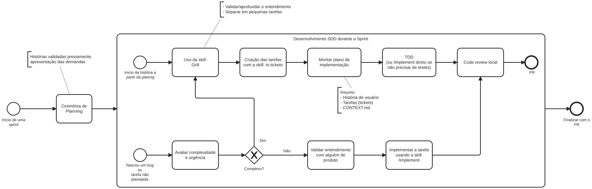

<h1 align="center">Fluxo de Desenvolvimento com IA</h1>

<strong>Mantenedores:</strong> Gustavo Henrique, Kauan Cardoso, Sophya Ribeiro, Brenno, Catarina, Eduardo

??? note "Histórico de Alterações"

    | Versão | Data | Justificativa | Responsável |
    | --- | --- | --- | --- |
    | 1.0 | 04/11/2026 | Documentação do fluxo SDD com skills usado no desenvolvimento, com o diagrama BPMN e os artefatos de cada etapa. | Sophya Ribeiro |
    | 1.1 | 04/11/2026 | Correção do fluxo: os requisitos não são levantados na sprint de desenvolvimento, e sim na sprint anterior; a sprint começa pelo handoff das histórias já validadas na planning. Diagrama atualizado. | Sophya Ribeiro |
    | 1.2 | 04/11/2026 | Detalhamento da estimativa na planning: Planning Poker em homem-hora por task. | Sophya Ribeiro |

## Sumário

- [1. Visão geral](#visao-geral)
- [2. Diagrama do fluxo](#diagrama)
- [3. Etapas](#etapas)
    - [3.1. Handoff na planning](#antes-sprint)
    - [3.2. História planejada](#historia-planejada)
    - [3.3. Bug ou tarefa não planejada](#nao-planejada)
- [4. Artefatos](#artefatos)

## 1. Visão geral

Os requisitos de uma história são levantados e validados com as proponentes **uma sprint antes** de ela ser desenvolvida. Assim, a sprint de desenvolvimento já começa com as histórias validadas, entregues ao time na planning (handoff).

No desenvolvimento, a equipe usa IA seguindo um fluxo de **SDD** (*Spec-Driven Development*, ou desenvolvimento orientado a especificação). A ideia é que a IA não comece a escrever código a partir de um pedido solto: antes, o entendimento da história é aprofundado, a história é quebrada em tarefas pequenas e é montado um plano de implementação com o contexto do domínio. Só então vem a implementação, de preferência com TDD, seguida de code review local antes do pull request.

Cada etapa usa uma *skill*, que é um conjunto de instruções reutilizável que o assistente de IA executa (no Claude Code, chamada por um comando como `/implement`). As skills deixam o uso de IA padronizado entre os membros da equipe.

## 2. Diagrama do fluxo

{ style="background:#fff; padding:8px; border-radius:8px" }

O arquivo editável do diagrama está em [`fluxo-desenvolvimento-sdd.bpmn`](../assets/uso-ia/fluxo-desenvolvimento-sdd.bpmn) e pode ser aberto no [bpmn.io](https://demo.bpmn.io).

## 3. Etapas

### 3.1. Handoff na planning

| Etapa | O que acontece | Uso de IA |
| --- | --- | --- |
| Sprint anterior: levantar e validar requisitos | Os requisitos são levantados com as proponentes e, nas features complexas, validados no protótipo funcional antes de entrar na [Especificação de Requisitos](../requisitos/especificacao-requisitos.md). Isso acontece na sprint anterior à do desenvolvimento, por isso fica fora do diagrama. | Apoio na construção do protótipo e na redação dos requisitos (ver [Tradeoffs](tradeoffs.md#requisitos-prototipo)). |
| Cerimônia de Planning | Handoff das histórias validadas previamente e apresentação das demandas da sprint. As histórias são quebradas em tasks, e o esforço de cada task é estimado em homem-hora com Planning Poker: cada membro vota sua estimativa, as divergências são discutidas e a equipe chega a um valor de consenso. | Sem uso de IA: a estimativa (Planning Poker em homem-hora) e a priorização são feitas pela equipe. |

### 3.2. História planejada

| Etapa | O que acontece | Saída |
| --- | --- | --- |
| Uso da skill **Grill** | A IA questiona o desenvolvedor sobre a história, os critérios de aceite, as regras de negócio e o estado atual do código, para validar e aprofundar o entendimento antes de qualquer implementação. | Dúvidas resolvidas, decisões registradas e a história pronta para ser quebrada em tarefas. |
| Criação das tarefas com a skill **to-tickets** | A história é separada em tarefas pequenas, que podem ser implementadas e revisadas uma a uma. | Tarefas (tickets). |
| Montar o plano de implementação | O plano é montado a partir da história de usuário, das tarefas e do `CONTEXT.md`. | Plano de implementação e, quando a mudança envolve decisões de arquitetura, especificação e ADRs. |
| TDD (ou `/implement` direto) | Os testes são escritos primeiro e o código é implementado até passar. Quando a tarefa não precisa de testes (por exemplo, um ajuste visual), a implementação é feita direto com a skill `/implement`. | Código e testes. |
| Code review local | A mudança é revisada antes de subir: aderência aos critérios de aceite, às regras de negócio e aos padrões do projeto. | Branch pronta para o PR. |
| PR | O pull request segue o padrão do GCS e precisa da aprovação de ao menos um membro da equipe. | Pull request. |

### 3.3. Bug ou tarefa não planejada

Quando surge um bug ou uma tarefa fora do planejamento, primeiro se avalia a complexidade e a urgência:

- **Se for complexo**, a tarefa entra no mesmo caminho da história planejada, a partir da skill Grill.
- **Se não for complexo**, o entendimento é validado com alguém de produto e a tarefa é implementada direto com a skill `/implement`, passando depois pelo code review local.

Validar com produto antes de implementar evita que a IA "conserte" algo com base em uma suposição sobre a regra de negócio.

## 4. Artefatos

O fluxo deixa artefatos nos repositórios, que servem de contexto para a IA e de registro para a equipe:

| Artefato | Para que serve | Exemplo |
| --- | --- | --- |
| `CLAUDE.md` | Instruções do projeto lidas pelo assistente em toda sessão: stack, estrutura, convenções de `data-testid` e padrões do GCS. | `notifica-saude-frontend/CLAUDE.md` |
| `CONTEXT.md` | Glossário do domínio (Incidente, Notificação, Notificante, NSP, Classificação, Encaminhamento etc.), com os termos a evitar, para que a IA e a equipe usem a mesma linguagem. | `notifica-saude-backend/CONTEXT.md` |
| Registro de design | Perguntas, decisões e desenho levantados na sessão de Grill, com erratas quando o escopo muda. | `notifica-saude-backend/docs/DESIGN-us5.1-plano-de-acao.md` |
| Especificações (SDD) | Mini especificação da mudança, com objetivo, escopo, cenários *Given/When/Then*, contratos e invariantes. | `notifica-saude-backend/docs/specs/SDD_TEMPLATE_MINI_SPEC.md` |
| ADRs | Decisões de arquitetura tomadas durante o plano. | `notifica-saude-backend/docs/adr/` |
| Comandos salvos | Prompts reutilizáveis para criar issues e PRs no padrão do GCS. | `.claude/commands/issue.md` e `.claude/commands/pr.md` |
