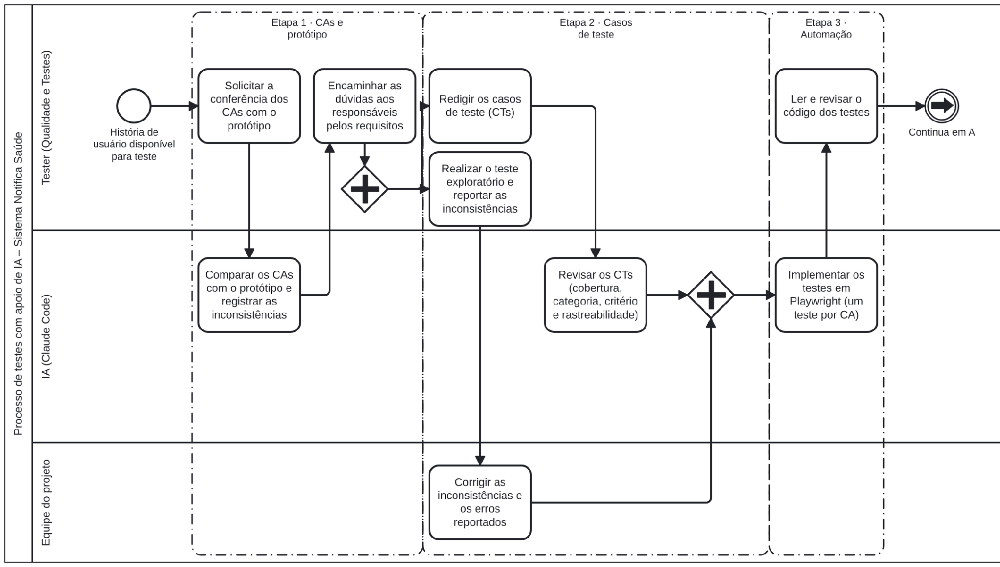
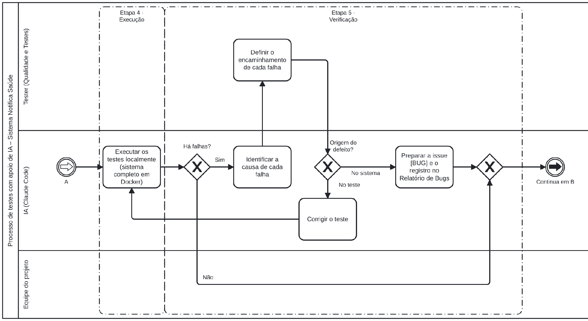
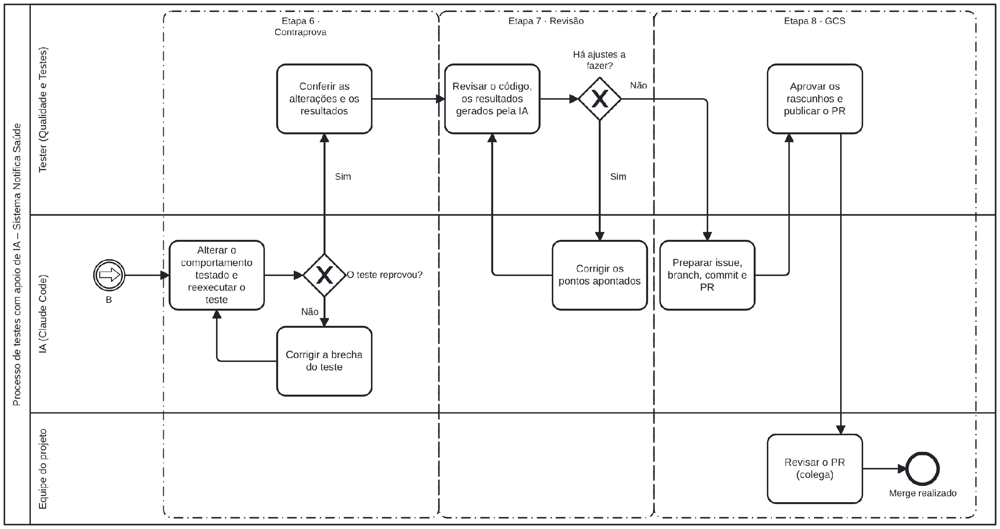
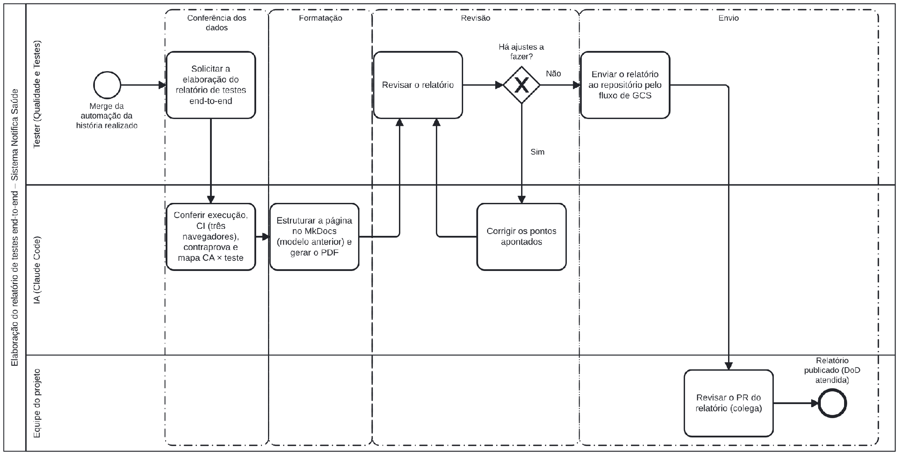
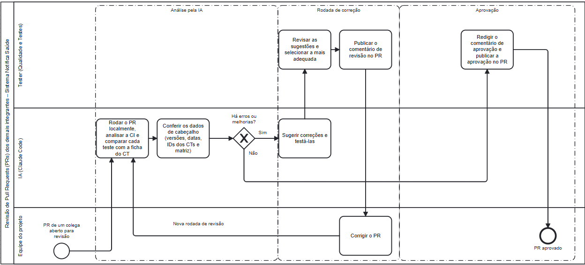

<h1 align="center">IA no Processo de Testes</h1>

<strong>Mantenedores:</strong> Gustavo Henrique, Kauan Cardoso, Sophya Ribeiro, Brenno, Catarina, Eduardo

??? note "Histórico de Alterações"

    | Versão | Data | Justificativa | Responsável |
    | --- | --- | --- | --- |
    | 1.0 | 27/10/2026 | Criação do documento (seções 1 e 2). | Catarina Freisleben |
    | 1.1 | 29/10/2026 | Continuidade na escrita do documento (seções 3 a 6). | Catarina Freisleben |
    | 1.2 | 04/11/2026 | Inserção dos diagramas BPMN. | Catarina Freisleben |
    | 1.3 | 05/11/2026 | Conclusão e referências. | Catarina Freisleben |
    | 1.4 | 05/11/2026 | Migração do documento para o site, na aba Uso de IA. | Sophya Ribeiro |

## Sumário

- [1. Apresentação](#apresentacao)
- [2. Integração da IA ao processo de testes](#integracao)
- [3. Relatórios de testes](#relatorios)
- [4. Revisão de Pull Requests (PRs)](#revisao-prs)
- [5. Lição aprendida: gestão do registro de defeitos](#licao-aprendida)
- [6. Prática de maior valor: a contraprova](#contraprova)
    - [6.1. Funcionamento](#funcionamento)
    - [6.2. Casos especiais](#casos-especiais)
    - [6.3. Resultados](#resultados)
- [7. Conclusão](#conclusao)
- [8. Referências](#referencias)

## 1. Apresentação

Este documento descreve a utilização de inteligência artificial (IA) no processo de testes do sistema NotificaSaúde, a partir do momento em que a equipe 2026.2 assumiu o projeto. São apresentados o fluxo de trabalho adotado, a elaboração dos relatórios de testes, a revisão de Pull Requests, a lição aprendida na gestão das atividades e a prática que mais agregou valor ao processo. A principal ferramenta utilizada foi o **Claude Code**, integrado ao VS Code, com acesso aos repositórios do projeto, ao GitHub e ao ambiente local em Docker.

## 2. Integração da IA ao processo de testes

Cada história de usuário a ser testada percorreu as etapas da Tabela 1, na ordem apresentada.

**Tabela 1 — Etapas do processo de testes com apoio de IA**

| Etapa | Atuação do tester | Atuação da IA |
| --- | --- | --- |
| 1. Validação dos CAs e do protótipo | Solicitou a conferência e encaminhou cada dúvida aos responsáveis pela redação dos requisitos. | Comparou os critérios de aceite (CAs) com o protótipo e registrou cada inconsistência. Exemplo: o campo 5 Porquês sem o contador de caracteres exigido pela US-4.2 (CA10). |
| 2. Elaboração dos casos de teste | Redigiu os casos de teste (CTs) e realizou o teste exploratório. | Revisou os CTs quanto à cobertura de cada CA, à categoria, ao critério de teste e à rastreabilidade na matriz. |
| 3. Automação | Leu e revisou o código produzido pela IA. | Implementou os testes em Playwright com base nas fichas dos CTs, um teste por CA. |
| 4. Execução | Acompanhou a execução. | Executou os testes localmente, com o sistema completo em ambiente Docker. |
| 5. Verificação dos resultados | Definiu o encaminhamento de cada falha. | Identificou a causa de cada falha: defeito do sistema (registrado como issue [BUG] e incluído no Relatório de Bugs) ou defeito do próprio teste (caso em que o teste é corrigido). |
| 6. Contraprova | Conferiu as alterações introduzidas e os resultados obtidos. | Alterou deliberadamente cada comportamento testado e confirmou que o teste correspondente reprovava ([seção 6](#contraprova)). |
| 7. Revisão | Revisou todo o material gerado pela IA: código, resultados e textos. | Corrigiu os pontos apontados pela tester. |
| 8. Gerência de configuração (GCS) | Aprovou cada rascunho. | Preparou issue, commit e PR, conforme o fluxo issue → branch → commit → PR → revisão por um colega → merge. |

**Teste exploratório:** em geral, a funcionalidade já estava completamente implementada quando era disponibilizada para testes. A equipe incorporou essa prática ao final do semestre, por sugestão de um dos integrantes, para agilizar a identificação de bugs e repassar o quanto antes aos desenvolvedores as inconsistências e os erros visíveis encontrados na exploração.

As Figuras 1, 2 e 3 representam esse fluxo. As raias identificam o responsável por cada atividade (tester, IA ou equipe do projeto), e os grupos tracejados correspondem às etapas da Tabela 1. Os eventos de ligação A e B indicam a continuidade do fluxo entre as figuras. O arquivo editável está em [`processo-testes-ia.bpmn`](../assets/uso-ia/testes/processo-testes-ia.bpmn).

**Figura 1 — Processo de testes com apoio de IA (parte 1: etapas 1 a 3)**

{ style="background:#fff; padding:8px; border-radius:8px" }

**Figura 2 — Processo de testes com apoio de IA (parte 2: etapas 4 e 5)**

{ style="background:#fff; padding:8px; border-radius:8px" }

**Figura 3 — Processo de testes com apoio de IA (parte 3: etapas 6 a 8)**

{ style="background:#fff; padding:8px; border-radius:8px" }

## 3. Relatórios de testes

Conforme a [Definição de Pronto (DoD)](../gcs/definicao-de-pronto.md) do projeto, uma história de usuário só é considerada pronta quando, além de testada e validada, possui os relatórios de testes que comprovam essa validação, feitos pelo desenvolvedor e pelo tester.

Os relatórios são publicados na aba "Qualidade e Testes" deste site. Nos relatórios end-to-end, a estrutura compreende: resumo da entrega; execução (testes executados, aprovados e com falha, e cenários adicionados ou alterados); critérios de aceite verificados; situação da suíte end-to-end como um todo; verificações complementares, como a CI nos três navegadores; pendências; e referências aos artefatos relacionados, como PRs e arquivos de teste. Após o merge da automação de cada história, o relatório foi elaborado nas etapas abaixo:

- **Conferência dos dados:** a IA verificou os números da execução (testes executados, aprovados, com falha e pendentes), o resultado da CI nos três navegadores (Chromium, Firefox e WebKit), a contraprova e o mapeamento entre critérios de aceite e testes, confrontando-os com os registros da execução e da CI.
- **Formatação:** a IA estruturou a página conforme o modelo padronizado dos relatórios de testes, tendo como referência o relatório anterior, e gerou a versão em PDF exigida pela DoD.
- **Revisão:** o tester revisou o conteúdo do relatório e solicitou os ajustes necessários antes do envio.
- **Envio:** o tester realizou o procedimento de GCS (issue, branch, commit e PR) para incluir o relatório no repositório da documentação, onde ele é revisado por outro integrante antes do merge e da publicação.

A Figura 4 representa esse fluxo, do merge da automação até a publicação no site. O arquivo editável está em [`relatorios-de-testes.bpmn`](../assets/uso-ia/testes/relatorios-de-testes.bpmn).

**Figura 4 — Elaboração do relatório de testes end-to-end**

{ style="background:#fff; padding:8px; border-radius:8px" }

## 4. Revisão de Pull Requests (PRs)

Conforme o [Gerenciamento de Pull Requests](../gcs/pull-requests.md), nenhuma alteração é incorporada às branches principais sem que o PR seja aprovado por ao menos um integrante da equipe, de preferência alguém que não tenha participado da alteração.

Nas revisões dos PRs de testes, tanto de automação (repositório `notifica-saude-e2e`) quanto de casos de teste (repositório da documentação), o revisor atuou com o apoio da IA, nas etapas abaixo:

- **Análise pela IA:** a IA rodou o PR localmente, analisou o resultado da CI, comparou cada teste com a ficha do CT correspondente e conferiu os dados de cabeçalho: histórico de versões, datas, identificadores dos CTs e painel da matriz de rastreabilidade.
- **Sugestões de correção:** a IA apontou erros e oportunidades de melhoria e propôs correções, testadas localmente antes de qualquer publicação.
- **Decisão e publicação:** o tester revisou as sugestões, selecionou a mais adequada e publicou o comentário de revisão no PR. Nenhum comentário foi publicado sem revisão prévia.
- **Novas rodadas:** após as correções do autor do PR, o ciclo se repetiu até não restarem solicitações de alteração em aberto.
- **Aprovação:** o tester redigiu o comentário de aprovação no mesmo formato das revisões anteriores, liberando o PR para o merge.

**Exemplo:** os PRs de automação do Gustavo (e2e#22, e2e#26 e e2e#28) passaram por até três rodadas de revisão; o PR de casos de teste docs#51 (US-4.7 a US-4.9), por duas.

O arquivo editável está em [`revisao-de-prs.bpmn`](../assets/uso-ia/testes/revisao-de-prs.bpmn).

**Figura 5 — Revisão de Pull Requests (PRs)**

{ style="background:#fff; padding:8px; border-radius:8px" }

## 5. Lição aprendida: gestão do registro de defeitos

O [Plano de Testes](../vvt/plano-de-testes.md) estabelece que as falhas identificadas na execução dos testes devem ser registradas no Relatório de Bugs, para garantir a rastreabilidade e a correção dos problemas. Na prática, o momento desse registro se mostrou determinante para a eficiência do processo.

No processo inicial, o teste exploratório era feito primeiro, e os defeitos encontrados só eram registrados após a conclusão do teste exploratório e da automação. Como o teste manual e a execução dos testes automatizados levavam tempo, os defeitos chegavam tarde à equipe de desenvolvimento, o que atrasava as correções. A ação corretiva foi registrar cada defeito para o desenvolvedor assim que identificado no teste exploratório (como issue no GitHub), em paralelo com a automação, para que a correção comece enquanto os testes automatizados ainda estão em elaboração.

## 6. Prática de maior valor: a contraprova

Um teste aprovado pode estar verificando corretamente o comportamento esperado ou pode não estar verificando nada; nos dois casos, o resultado exibido é o mesmo. A contraprova é a técnica adotada para distinguir essas situações: o comportamento verificado é alterado deliberadamente no sistema, e confirma-se que o teste passa a reprovar. A técnica segue o mesmo princípio do teste de mutação, em que pequenas alterações introduzidas no código, os mutantes, devem ser detectadas pela suíte de testes.

### 6.1. Funcionamento

1. Executar o teste com o sistema íntegro. O teste deve ser aprovado, o que estabelece a linha de base.
2. Alterar deliberadamente, no código do sistema, o comportamento verificado pelo teste, uma alteração por vez. Exemplo: aceitar 120 caracteres em um campo cujo limite é de 100.
3. Executar novamente o mesmo teste, sem modificar nenhuma de suas linhas. O teste deve reprovar, e pelo motivo esperado.
4. Desfazer a alteração e confirmar que o sistema voltou ao estado original.

Se o teste continuar aprovado com o sistema alterado, há uma brecha no teste: ele é corrigido e submetido novamente à contraprova.

### 6.2. Casos especiais

- **Regra validada só pelo servidor:** a alteração é feita no próprio backend. Quando isso não é possível, usa-se um teste de controle: o mesmo teste é executado com um perfil que tem permissão para ver o dado e, nesse caso, deve reprovar.
- **Falha conhecida:** em um teste marcado como falha esperada (associado a um defeito ainda em aberto), o defeito é corrigido de forma simulada, e o Playwright deve emitir o aviso "Expected to fail, but passed". Isso comprova que a suíte sinalizará quando o defeito for corrigido de fato.
- **Roteiro automatizado:** as alterações são descritas em um arquivo (`mutacoes.json`), e um roteiro (`contraprova.ps1`) aplica cada uma, executa os testes associados, registra a saída e desfaz a alteração, o que torna a contraprova reproduzível.

### 6.3. Resultados

**Tabela 2 — Resultados da contraprova**

| Entrega | Alterações realizadas | Detectadas pelo teste |
| --- | :---: | :---: |
| US-4.5 (cronologia e problemas na prestação do cuidado) | 14 | 14 |
| US-4.6 (fatores contribuintes e 5 Porquês) | 13 | 13 |

**Falhas identificadas pela contraprova:**

- O CT-E2E-011 era aprovado sem verificar nada: com a regra deliberadamente alterada, o resultado foi "4 passed" (08/09/2026). O teste buscava um botão com o nome incorreto e só fazia a verificação se o botão fosse exibido.
- No WebKit, uma etapa do CT-FUN-080 ("não diminuem abaixo de três linhas") era aprovada sem verificação efetiva. A correção foi validada por contraprova nos três navegadores.

**Relevância:** uma execução aprovada, sozinha, não comprova a eficácia do teste. O par "aprovado com o sistema íntegro, reprovado com o sistema alterado" demonstra que o teste de fato verifica a regra.

## 7. Conclusão

O uso da IA no processo de testes do NotificaSaúde se mostrou proveitoso. A IA contribuiu em todas as etapas do fluxo, da validação dos critérios de aceite à gerência de configuração, e práticas como a contraprova aumentaram a confiabilidade dos testes automatizados e dos relatórios entregues.

A adoção foi conduzida com cautela: todo artefato gerado pela IA foi revisado antes da publicação, as afirmações da IA passaram a ser conferidas com o estado real do código, e as decisões sobre defeitos, sugestões de revisão e aprovações permaneceram com o tester.

Por outro lado, a IA poderia ter sido mais explorada para reduzir o tempo de teste, que se mostrou bastante custoso. O teste exploratório manual, a automação, a execução nos três navegadores e a contraprova demandaram tempo considerável em cada história, e o registro tardio dos defeitos atrasou as correções ([seção 5](#licao-aprendida)). Em ciclos futuros, recomenda-se ampliar o uso da IA nas atividades repetitivas, como o registro imediato dos defeitos encontrados no teste exploratório e a execução da contraprova em paralelo à automação.

## 8. Referências

- AMMANN, P.; OFFUTT, J. *Introduction to software testing*. 2. ed. Cambridge: Cambridge University Press, 2016. DOI: <https://doi.org/10.1017/9781316771273>.
- DELAMARO, M. E.; MALDONADO, J. C.; JINO, M. *Introdução ao teste de software*. Rio de Janeiro: Elsevier, 2007. Disponível em: <https://repositorio.usp.br/item/001726007>.
- DEMILLO, R. A.; LIPTON, R. J.; SAYWARD, F. G. Hints on test data selection: help for the practicing programmer. *Computer*, v. 11, n. 4, p. 34-41, 1978. DOI: <https://doi.org/10.1109/C-M.1978.218136>.
- JIA, Y.; HARMAN, M. An analysis and survey of the development of mutation testing. *IEEE Transactions on Software Engineering*, v. 37, n. 5, p. 649-678, 2011. DOI: <https://doi.org/10.1109/TSE.2010.62>.
- NOTIFICA SAÚDE. *Documentação do projeto Notifica Saúde*: Plano de Testes, Definição de Pronto (DoD e DoR) e Gerenciamento de Pull Requests. 2026. Disponível em: <https://github.com/Notifica-Saude-2026-2/notifica-saude-docs>.
- PAPADAKIS, M. *et al*. Mutation testing advances: an analysis and survey. *Advances in Computers*, v. 112, p. 275-378, 2019. DOI: <https://doi.org/10.1016/bs.adcom.2018.03.015>.
- PLAYWRIGHT. *Annotations*. 2026. Disponível em: <https://playwright.dev/docs/test-annotations>.
