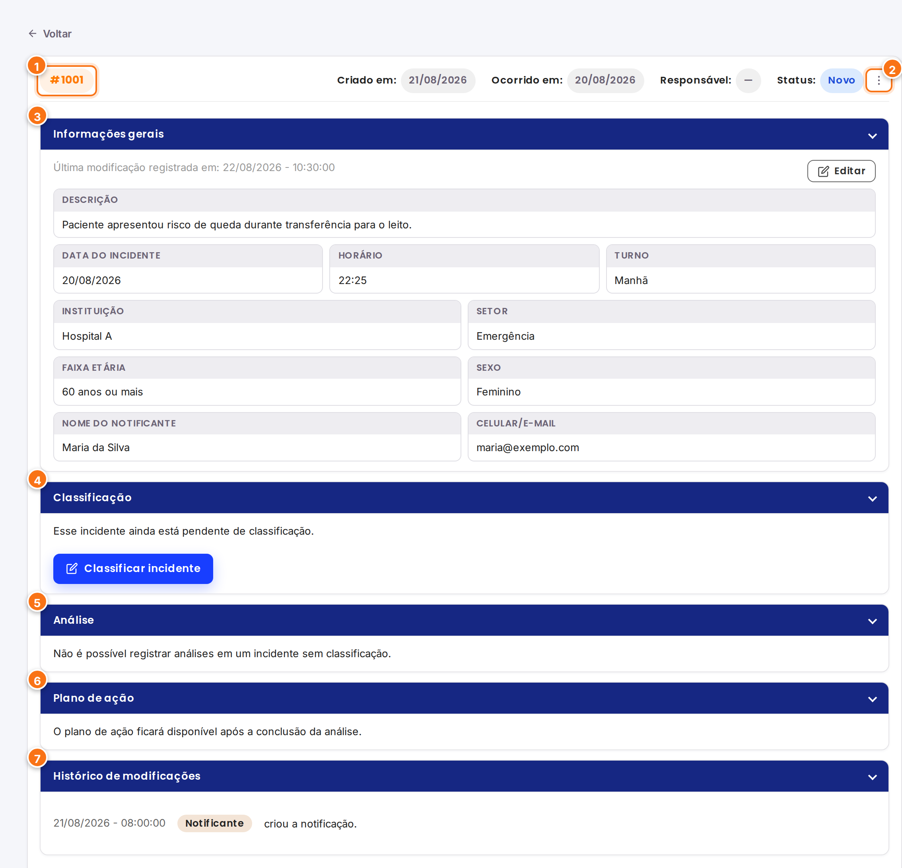
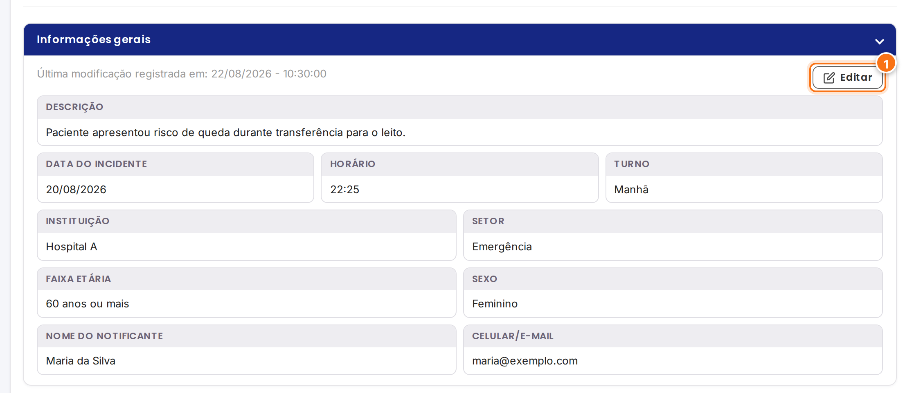
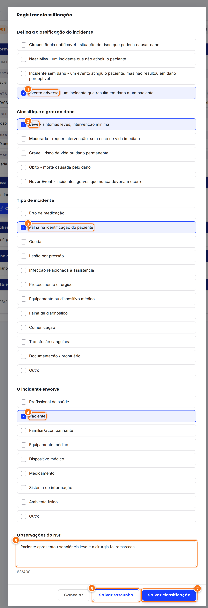
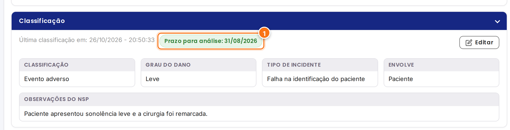
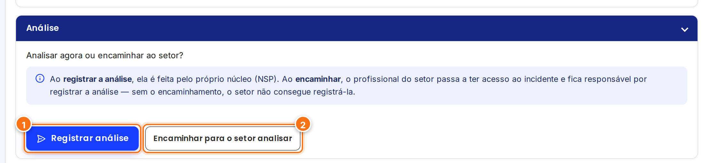
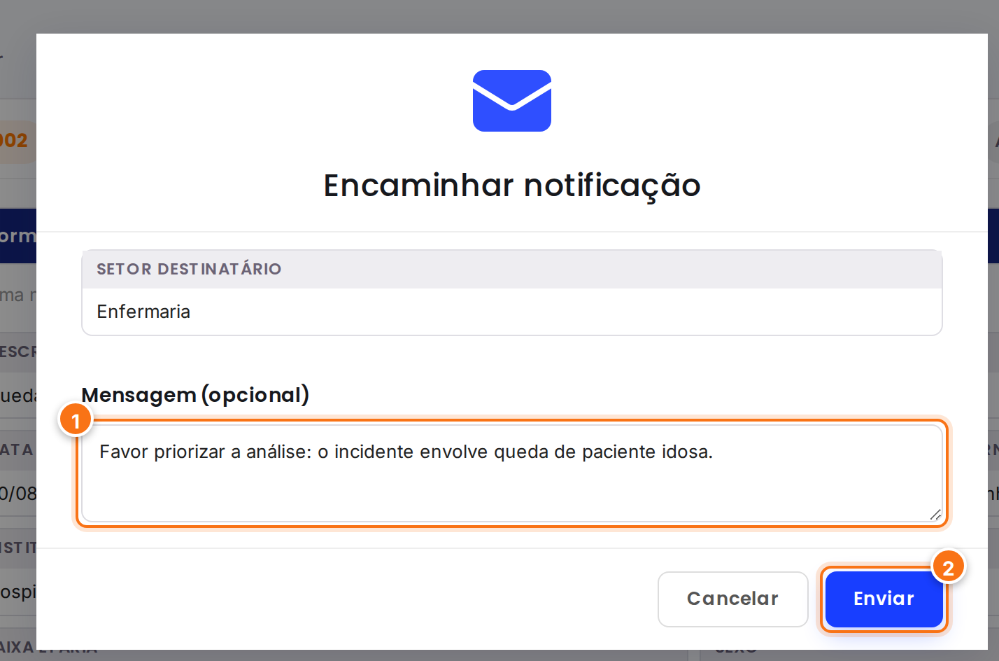
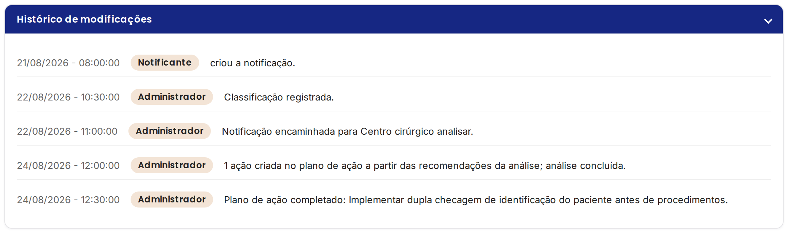

<h1 align="center">Classificar e encaminhar</h1>

<strong>Mantenedores:</strong> Gustavo Henrique, Kauan Cardoso, Sophya Ribeiro, Brenno, Catarina, Eduardo

??? note "Histórico de Alterações"

    | Versão | Data | Justificativa | Responsável |
    | --- | --- | --- | --- |
    | 1.0 | 26/10/2026 | Criação da página. | Sophya Ribeiro |

NSP

Toda notificação nova precisa ser **lida e classificada** pelo Núcleo de Segurança do Paciente. É a classificação que define o **prazo para análise** e libera a próxima etapa: o próprio NSP **registra a análise** ou **encaminha** o incidente ao setor onde ele ocorreu.

## O detalhe da notificação

Na fila **Novos incidentes**, clique no cartão de um incidente para abrir o detalhe. Todas as etapas do incidente ficam nesta mesma tela, organizadas em seções que podem ser recolhidas pela seta à direita do título.

[{ .ns-print }](../assets/manual-sistema/classificacao/detalhe-novo.png){ target="_blank" }

1. **Cabeçalho**: número do incidente, datas de criação e de ocorrência, responsável e status atual.
2. **Opções de status** (⋮): concluir ou arquivar o incidente. Veja [Concluir e arquivar](concluir-e-arquivar.md).
3. **Informações gerais**: o que o notificante registrou.
4. **Classificação**: preenchida pelo NSP.
5. **Análise**: disponível depois da classificação.
6. **Plano de ação**: disponível depois da conclusão da análise.
7. **Histórico de modificações**: tudo o que já foi feito no incidente, com data, hora e autor.

## Corrigir as informações gerais

Se o notificante registrou algo errado (por exemplo, o setor ou o horário), o NSP pode corrigir antes de seguir com o fluxo.

[{ .ns-print }](../assets/manual-sistema/classificacao/botao-editar.png){ target="_blank" }

1. Clique em **Editar**, no canto da seção **Informações gerais**.
2. Altere os campos necessários e clique em **Salvar alterações**.

Cada alteração fica registrada no **histórico**, com o valor anterior e o novo (RN-02).

!!! warning "Atenção"
    Depois que o incidente é **encaminhado ao setor** ou que a **análise começa**, as informações gerais e a classificação ficam **bloqueadas** e passam a exibir o selo **Edição bloqueada** (RN-06 e RN-15).

## Classificar o incidente

1. Na seção **Classificação**, clique em **Classificar incidente**.
2. Preencha o formulário. As perguntas seguintes aparecem conforme as respostas anteriores:

[{ .ns-print }](../assets/manual-sistema/classificacao/modal-classificacao.png){ target="_blank" }

1. **Classificação do incidente**: escolha uma das quatro opções.

    | Opção | Quando usar |
    | --- | --- |
    | **Circunstância notificável** | Situação de risco que poderia causar dano, sem que um incidente tenha acontecido. |
    | **Near Miss** | O incidente aconteceu, mas foi interceptado antes de atingir o paciente. |
    | **Incidente sem dano** | O incidente atingiu o paciente, mas não causou dano perceptível. |
    | **Evento adverso** | O incidente causou dano ao paciente. |

2. **Grau do dano** (para evento adverso): **Leve**, **Moderado**, **Grave**, **Óbito** ou **Never Event**. Ao escolher **Never Event**, o sistema pede o **tipo específico** de Never Event.
3. **Tipo de incidente**: erro de medicação, falha na identificação do paciente, queda, lesão por pressão etc.
4. **O incidente envolve**: marque tudo o que se aplica (paciente, profissional, medicamento, equipamento...). Em **Outro**, descreva em até 30 caracteres.
5. **Observações do NSP**: informações relevantes para quem vai analisar (até 400 caracteres).
6. **Salvar rascunho**: guarda o que foi preenchido para terminar depois.
7. **Salvar classificação**: finaliza a classificação.

!!! info "Rascunho × classificação finalizada"
    Um **rascunho** guarda o seu progresso, mas **não muda o status** do incidente nem libera a análise. Somente a classificação **finalizada** muda o status para **Classificado**, calcula o prazo e define você como **responsável pelo incidente** (RN-05 e RN-11).

### Depois de classificar

[{ .ns-print }](../assets/manual-sistema/classificacao/classificacao-registrada.png){ target="_blank" }

1. O **prazo para análise** passa a aparecer na seção.

| Grau do dano | Prazo para análise |
| --- | :---: |
| Sem dano (circunstância notificável, near miss ou incidente sem dano) ou dano leve | 10 dias |
| Dano moderado | 7 dias |
| Dano grave | 4 dias |
| Óbito ou Never Event | 2 dias |

O prazo conta a partir da data de registro da notificação e é recalculado se o grau do dano mudar (RN-14).

!!! abstract "Regra do sistema"
    O **responsável pelo incidente** é só uma referência de quem iniciou o tratamento. Ele **não** restringe nada: qualquer profissional do NSP pode atuar sobre o incidente (RN-11).

## Analisar agora ou encaminhar ao setor?

Com o incidente classificado, a seção **Análise** pergunta quem vai fazer a investigação:

[{ .ns-print }](../assets/manual-sistema/classificacao/analisar-ou-encaminhar.png){ target="_blank" }

1. **Registrar análise**: o próprio NSP faz a análise. Siga para [Registrar a análise](registrar-analise.md).
2. **Encaminhar para o setor analisar**: o gestor do setor onde o incidente ocorreu passa a ter acesso a ele e fica responsável pela análise.

!!! tip "Como decidir"
    Encaminhe quando o setor tiver condições de conduzir a investigação e quando a participação dele for importante para entender o que aconteceu. Se o setor não receber o encaminhamento, ele **não consegue** ver o incidente nem registrar a análise (RN-16 e RN-26).

### Encaminhar ao setor

1. Clique em **Encaminhar para o setor analisar**.
2. Confira o **setor destinatário**, que é o setor onde o incidente ocorreu.
3. Se quiser, escreva uma **mensagem** para o gestor (opcional, até 400 caracteres).
4. Clique em **Enviar**.

[{ .ns-print }](../assets/manual-sistema/classificacao/modal-encaminhamento.png){ target="_blank" }

Ao enviar:

- o status muda para **Encaminhado** e o encaminhamento fica no histórico;
- o gestor do setor recebe um **e-mail** com o número da notificação e as instruções de acesso;
- o incidente passa a aparecer na fila do gestor, que pode [registrar a análise](gestor-da-area.md);
- as informações gerais e a classificação ficam **bloqueadas** para edição.

## Histórico de modificações

No fim da página, a seção **Histórico de modificações** mostra, em ordem, tudo o que aconteceu com o incidente: quem criou, quem classificou, encaminhamentos, conclusão da análise, ações do plano e mudanças de status.

[{ .ns-print }](../assets/manual-sistema/classificacao/historico.png){ target="_blank" }

!!! abstract "Regra do sistema"
    Notificações nunca são excluídas, e todo o histórico é preservado para auditoria (RN-02 e RN-09).
