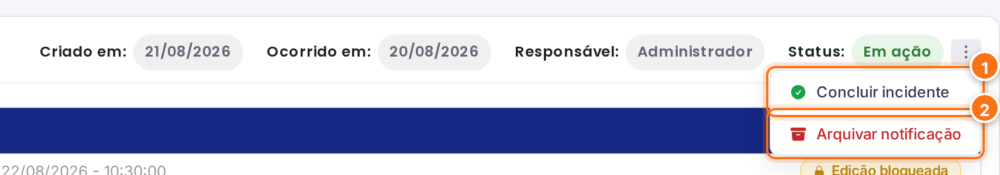
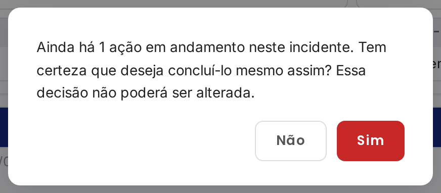
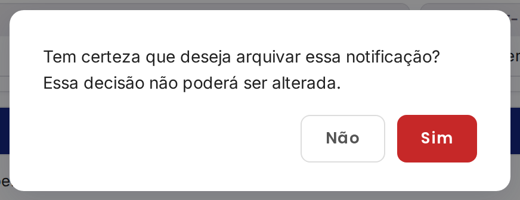
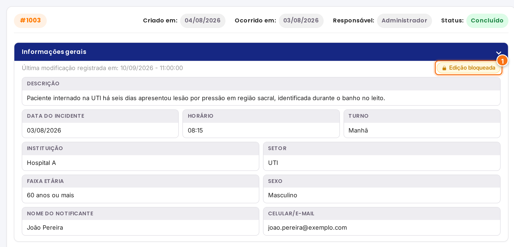

<h1 align="center">Concluir e arquivar</h1>

<strong>Mantenedores:</strong> Gustavo Henrique, Kauan Cardoso, Sophya Ribeiro, Brenno, Catarina, Eduardo

??? note "Histórico de Alterações"

    | Versão | Data | Justificativa | Responsável |
    | --- | --- | --- | --- |
    | 1.0 | 26/10/2026 | Criação da página. | Sophya Ribeiro |

NSP

Um incidente pode ser encerrado de duas formas:

| | **Concluir** | **Arquivar** |
| --- | --- | --- |
| **Quando usar** | O incidente foi tratado: a análise foi feita e o plano de ação foi executado. | O incidente não vai seguir o fluxo. Ex.: um relato que não é incidente de segurança do paciente (uma reclamação de atendimento, por exemplo) ou uma notificação duplicada. |
| **Em quais status** | **Analisado** ou **Em ação** | Qualquer status, exceto Concluído e Arquivado |
| **Status final** | Concluído | Arquivado |
| **Pode ser desfeito?** | Não | Não |

Somente o **NSP** pode concluir ou arquivar incidentes (RN-01).

## Onde ficam as opções

No cabeçalho do detalhe da notificação, ao lado do status, clique em **⋮ (Opções de status)**:

[{ .ns-print }](../assets/manual-sistema/conclusao/menu-status.png){ target="_blank" }

1. **Concluir incidente**: aparece quando o incidente está **Analisado** ou **Em ação**.
2. **Arquivar notificação**.

## Concluir o incidente

1. Clique em **⋮** e em **Concluir incidente**.
2. Leia a confirmação e clique em **Sim**.

[{ .ns-print .ns-print--estreito }](../assets/manual-sistema/conclusao/confirmar-conclusao.png){ target="_blank" }

!!! info "Ações ainda em andamento"
    Ações pendentes **não impedem** a conclusão. Mas, se houver ações **em andamento**, a confirmação avisa quantas são, para que a decisão seja consciente (RN-22).

!!! tip "O sistema sugere a conclusão"
    Ao salvar a última ação como **Concluído** no plano de ação, se todas as ações estiverem finalizadas, o sistema já **sugere concluir o incidente**. Ações canceladas contam como finalizadas (RN-23).

## Arquivar a notificação

1. Clique em **⋮** e em **Arquivar notificação**.
2. Confirme em **Sim**.

[{ .ns-print .ns-print--estreito }](../assets/manual-sistema/conclusao/confirmar-arquivamento.png){ target="_blank" }

!!! warning "Atenção"
    Concluir e arquivar são decisões **definitivas**: depois de confirmadas, não podem ser alteradas (RN-13 e RN-22).

## Depois de encerrado

Incidentes **concluídos** e **arquivados** ficam disponíveis nas filas **Concluídos** e **Arquivados**, **somente para consulta**: nenhuma informação, classificação, análise ou ação pode ser editada, adicionada ou excluída. As seções mostram o selo **Edição bloqueada**.

[{ .ns-print }](../assets/manual-sistema/conclusao/somente-leitura.png){ target="_blank" }

1. Selo **Edição bloqueada**.

O histórico completo continua disponível para auditoria e relatórios (RN-09 e RN-12).
