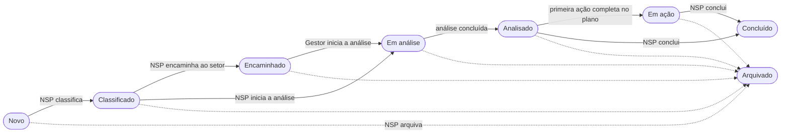

<h1 align="center">Manual do Sistema</h1>

<strong>Mantenedores:</strong> Gustavo Henrique, Kauan Cardoso, Sophya Ribeiro, Brenno, Catarina, Eduardo

??? note "Histórico de Alterações"

    | Versão | Data | Justificativa | Responsável |
    | --- | --- | --- | --- |
    | 1.0 | 26/10/2026 | Criação do manual do sistema, com o passo a passo de cada perfil e prints do protótipo funcional. | Sophya Ribeiro |

Este manual ensina a usar o **NotificaSaúde** no dia a dia, tela a tela. Ele foi escrito para quem vai usar o sistema, e não para quem vai desenvolvê-lo: não é preciso conhecer os requisitos para acompanhar.

!!! info "De onde vêm as telas deste manual"
    Os prints foram feitos no [protótipo funcional](https://notifica-saude-2026-2.github.io/notifica-saude-prototipo-funcional/){ target="_blank" }, que tem o fluxo completo do sistema. Todos os dados que aparecem (pacientes, profissionais, hospitais) são **fictícios**. Pequenos detalhes visuais podem variar no [ambiente de homologação](../desenvolvimento/implantacao/index.md).

## O que é o NotificaSaúde

O NotificaSaúde é uma plataforma web para a **gestão de incidentes de segurança do paciente**. Ele substitui fichas em papel, e-mails e planilhas por um fluxo único e rastreável: o incidente é **notificado**, **classificado** pelo Núcleo de Segurança do Paciente (NSP), **analisado** para encontrar suas causas e **tratado** por um plano de ação acompanhado até a conclusão.

## Quem usa o sistema

| Perfil | O que faz | Precisa de login? |
| --- | --- | :---: |
| Notificante | Qualquer pessoa que presenciou ou soube de um incidente: profissional de saúde, paciente, acompanhante. Registra a notificação, de forma identificada ou anônima. | Não |
| NSP | Profissional do Núcleo de Segurança do Paciente. Classifica, encaminha, analisa, acompanha o plano de ação e encerra os incidentes da instituição. | Sim |
| Gestor da área | Responsável por um setor. Recebe do NSP os incidentes do seu setor, registra a análise e conduz o plano de ação. | Sim |

Em cada tarefa deste manual há um selo indicando **quem pode fazer aquilo**.

## O caminho de um incidente

Todo incidente passa por uma sequência de **status**. O status muda sozinho, conforme as ações feitas no sistema; ninguém altera o status manualmente.

| Status | O que significa | Quem age agora |
| --- | --- | --- |
| **Novo** | A notificação foi registrada e ainda não foi classificada. | NSP |
| **Classificado** | O NSP classificou o incidente e definiu o prazo para análise. Falta decidir quem vai analisar. | NSP |
| **Encaminhado** | O NSP enviou o incidente ao setor onde ele ocorreu, para que o gestor faça a análise. | Gestor da área |
| **Em análise** | Alguém começou a preencher a análise. Se foi o NSP, o incidente continua aqui até o núcleo decidir se envia o resultado ao setor. | Quem iniciou a análise |
| **Analisado** | A análise foi concluída. Já é possível montar o plano de ação. | NSP ou gestor |
| **Em ação** | Há ao menos uma ação completa no plano de ação, sendo executada e acompanhada. | NSP ou gestor |
| **Concluído** | O incidente foi encerrado depois do tratamento. Fica somente para consulta. | — |
| **Arquivado** | O incidente foi encerrado sem seguir o fluxo (por exemplo, um relato que não é um incidente). Fica somente para consulta. | — |

## Como usar este manual

Siga as páginas na ordem do fluxo, ou vá direto à tarefa que precisa fazer:

-   :material-login:{ .lg .middle } **Primeiros passos**

    ---

    Acessar o sistema, recuperar a senha e se localizar no painel.

    [:octicons-arrow-right-24: Acessar](primeiros-passos.md)

-   :material-bullhorn-outline:{ .lg .middle } **Registrar uma notificação**

    ---

    O formulário público, passo a passo, no celular e no computador.

    [:octicons-arrow-right-24: Acessar](registrar-notificacao.md)

-   :material-shield-check-outline:{ .lg .middle } **Classificar e encaminhar**

    ---

    Ler a notificação, classificar o incidente e decidir quem faz a análise.

    [:octicons-arrow-right-24: Acessar](classificar-e-encaminhar.md)

-   :material-magnify:{ .lg .middle } **Registrar a análise**

    ---

    O guia de investigação e as cinco seções da análise de causa.

    [:octicons-arrow-right-24: Acessar](registrar-analise.md)

-   :material-clipboard-check-outline:{ .lg .middle } **Plano de ação**

    ---

    Transformar as recomendações em ações, acompanhar prazos e avaliar a efetividade.

    [:octicons-arrow-right-24: Acessar](plano-de-acao.md)

-   :material-flag-checkered:{ .lg .middle } **Concluir e arquivar**

    ---

    Encerrar o incidente depois do tratamento ou arquivá-lo.

    [:octicons-arrow-right-24: Acessar](concluir-e-arquivar.md)

-   :material-account-tie-outline:{ .lg .middle } **Gestor da área**

    ---

    O que muda para quem é gestor de um setor.

    [:octicons-arrow-right-24: Acessar](gestor-da-area.md)

-   :material-help-circle-outline:{ .lg .middle } **Dúvidas frequentes**

    ---

    Respostas rápidas para as situações mais comuns.

    [:octicons-arrow-right-24: Acessar](duvidas-frequentes.md)

### Como ler as imagens

Os prints têm **marcadores numerados** em laranja. Cada número corresponde a um passo ou a um item da lista logo abaixo da imagem. Clique em qualquer imagem para abri-la em tamanho real.

Ao longo do manual, você também vai encontrar estas caixas:

!!! tip "Dica"
    Atalhos e boas práticas para usar o sistema com mais facilidade.

!!! warning "Atenção"
    Ações que não podem ser desfeitas ou que bloqueiam outras etapas.

!!! abstract "Regra do sistema"
    O motivo de o sistema se comportar de determinada forma, com o link para a regra de negócio na [Especificação de Requisitos](../requisitos/especificacao-requisitos.md).
