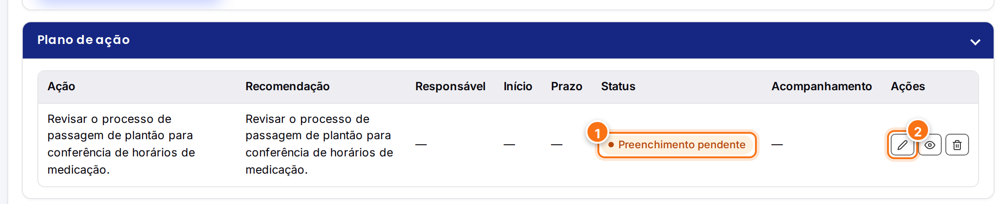
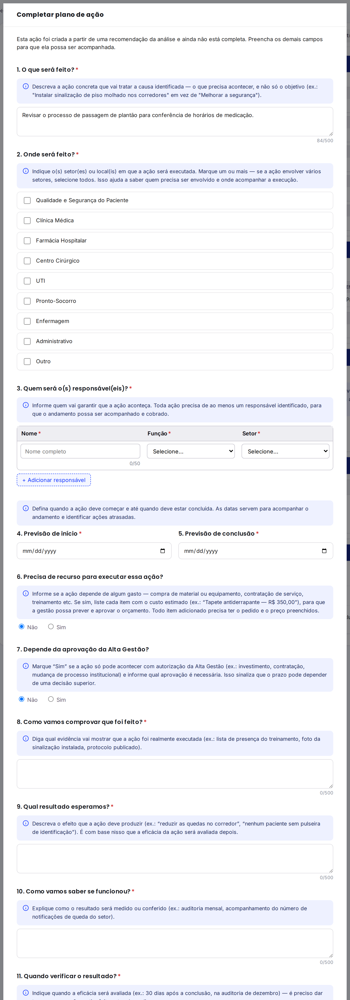
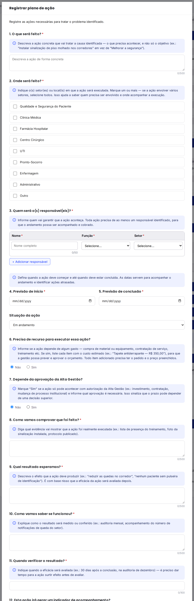
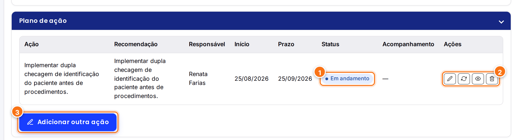
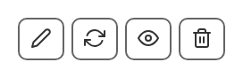
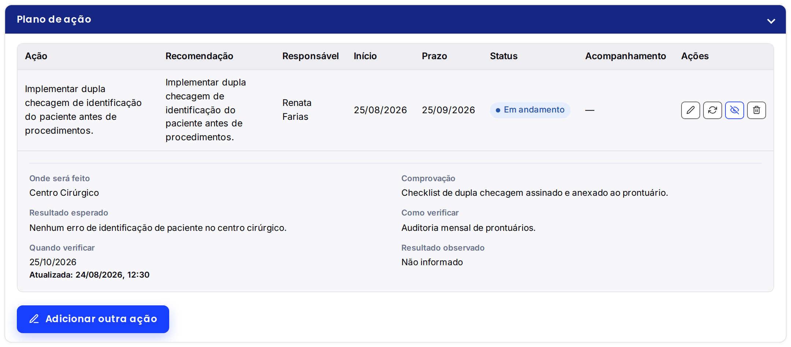
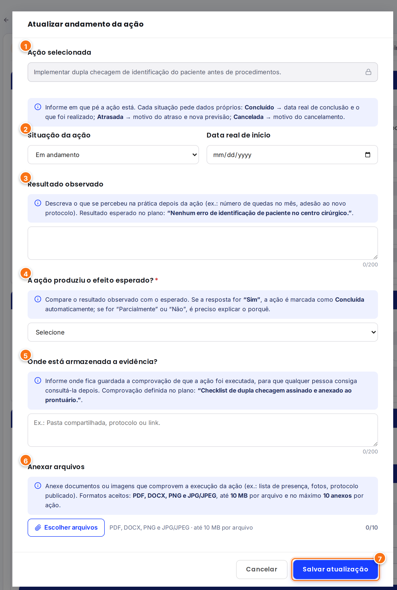
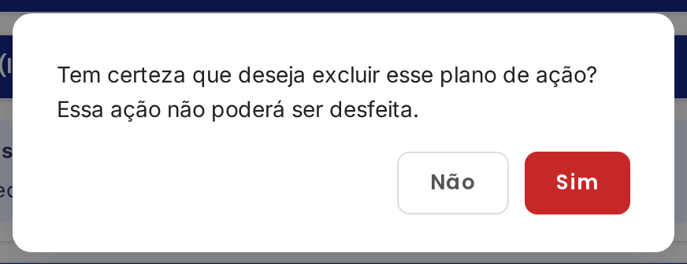

<h1 align="center">Plano de ação</h1>

<strong>Mantenedores:</strong> Gustavo Henrique, Kauan Cardoso, Sophya Ribeiro, Brenno, Catarina, Eduardo

??? note "Histórico de Alterações"

    | Versão | Data | Justificativa | Responsável |
    | --- | --- | --- | --- |
    | 1.0 | 26/10/2026 | Criação da página. | Sophya Ribeiro |

NSP Gestor da área (incidentes encaminhados ao seu setor)

O plano de ação transforma as **recomendações da análise** em **ações concretas**, com responsável, prazo e forma de comprovação, e acompanha cada uma até ela ser concluída e ter a **efetividade** avaliada. Ele fica na seção **Plano de ação** do detalhe da notificação e é liberado quando a **análise é concluída**.

## Sumário

- [Completar as ações vindas das recomendações](#completar-acoes)
- [Os campos de uma ação](#campos)
- [Adicionar outra ação](#adicionar)
- [A tabela do plano de ação](#tabela)
- [Atualizar o andamento de uma ação](#andamento)
- [Avaliar a efetividade](#efetividade)
- [Editar ou excluir uma ação](#editar-excluir)

## Completar as ações vindas das recomendações { #completar-acoes }

Quando a análise é concluída, o sistema cria **uma ação para cada recomendação**, com apenas o *"O que será feito?"* preenchido. Essas ações precisam ser **completadas** antes de serem acompanhadas.

[{ .ns-print }](../assets/manual-sistema/plano/acao-pendente.png){ target="_blank" }

1. O selo laranja **Preenchimento pendente** aparece no lugar do status. Passe o mouse sobre ele para ver quantos campos faltam.
2. Clique no **lápis (Completar preenchimento)** para abrir o formulário.

[{ .ns-print }](../assets/manual-sistema/plano/completar-acao.png){ target="_blank" }

Preencha os campos obrigatórios (veja a [lista completa](#campos)) e clique em **Salvar alterações**. A ação passa a mostrar o status **Em andamento** e, se o incidente estava **Analisado**, ele muda para **Em ação**.

!!! abstract "Regra do sistema"
    Uma ação incompleta **não pode ter o andamento atualizado**. Isso garante que toda ação acompanhada tenha responsável, prazo e forma de comprovação definidos (RN-20).

!!! tip "Dica"
    Você pode completar as ações assim que a análise for concluída, mesmo antes de o NSP decidir se encaminha o resultado ao setor.

## Os campos de uma ação { #campos }

O formulário segue o modelo **SMART** (específica, mensurável, atingível, relevante e com prazo). Cada pergunta tem uma caixa azul (ⓘ) com orientações e exemplos.

| # | Pergunta | Como preencher |
| :---: | --- | --- |
| 1 | **O que será feito?** \* | A ação concreta, e não só o objetivo. Ex.: *"Instalar sinalização de piso molhado nos corredores"*, em vez de *"Melhorar a segurança"*. Até 500 caracteres. |
| 2 | **Onde será feito?** \* | Marque um ou mais setores. Em **Outro**, descreva o local (até 50 caracteres). |
| 3 | **Quem será o(s) responsável(eis)?** \* | Ao menos uma pessoa, com nome, função e setor. Use **+ Adicionar responsável** para incluir mais. |
| 4 e 5 | **Previsão de início** e **Previsão de conclusão** \* | A previsão de início não pode ser depois da previsão de conclusão. |
| 6 | **Precisa de recurso para executar essa ação?** | Com **Sim**, liste cada item e o preço estimado. |
| 7 | **Depende da aprovação da Alta Gestão?** | Com **Sim**, informe qual aprovação é necessária. |
| 8 | **Como vamos comprovar que foi feito?** \* | A evidência da execução. Ex.: *"Checklist assinado e anexado ao prontuário"*. |
| 9 | **Qual resultado esperamos?** \* | O efeito esperado da ação. Ex.: *"Nenhum erro de identificação de paciente no centro cirúrgico"*. |
| 10 e 11 | **Como vamos saber se funcionou?** e **Quando verificar o resultado?** \* | A forma e o momento da verificação. Ex.: *"Auditoria mensal de prontuários"*, *"em 30 dias"*. |
| 12 | **Esta ação irá gerar um indicador de acompanhamento?** | Com **Sim**, informe qual indicador. |

\* Campos obrigatórios.

!!! warning "Antes de salvar"
    Se faltar algo, o sistema não salva, destaca em vermelho os campos vazios (inclusive células das tabelas) e mostra um aviso listando o que falta.

## Adicionar outra ação { #adicionar }

Um mesmo problema pode precisar de várias ações. Clique em **Adicionar outra ação**, abaixo da tabela, preencha o formulário **Registrar plano de ação** e clique em **Salvar plano de ação**.

[{ .ns-print }](../assets/manual-sistema/plano/nova-acao.png){ target="_blank" }

!!! tip "Dica"
    Se ainda houver recomendações da análise sem ação vinculada, o *"O que será feito?"* da nova ação já vem preenchido com a próxima recomendação.

## A tabela do plano de ação { #tabela }

Todas as ações do incidente ficam em uma tabela, uma por linha, na ordem em que foram registradas.

[{ .ns-print }](../assets/manual-sistema/plano/tabela-acoes.png){ target="_blank" }

1. **Status** da ação: Em andamento, Parcialmente concluído, Concluído, Atrasada ou Cancelada.
2. **Botões de cada ação** (veja abaixo).
3. **Adicionar outra ação**.

[{ .ns-print .ns-print--estreito }](../assets/manual-sistema/plano/icones-acoes.png){ target="_blank" }

| Botão | O que faz |
| --- | --- |
| :material-pencil-outline: **Lápis** | Editar a ação ou completar o preenchimento. |
| :material-sync: **Setas** | Atualizar o andamento (só em ações completas). |
| :material-eye-outline: **Olho** | Ver os detalhes da ação. |
| :material-trash-can-outline: **Lixeira** | Excluir a ação. |

Ao clicar no **olho**, os detalhes aparecem logo abaixo da linha: onde será feito, comprovação, resultado esperado, como e quando verificar, resultado observado, anexos e a data da última atualização.

[{ .ns-print }](../assets/manual-sistema/plano/detalhes-acao.png){ target="_blank" }

!!! info "Campos vazios"
    Informações não preenchidas aparecem como **"—"** na tabela e **"Não informado"** nos detalhes.

## Atualizar o andamento de uma ação { #andamento }

Sempre que houver novidade na execução de uma ação, registre o andamento. Clique nas **setas** da ação e preencha a tela **Atualizar andamento da ação**:

[{ .ns-print }](../assets/manual-sistema/plano/atualizar-andamento.png){ target="_blank" }

1. **Ação selecionada**: vem preenchida e travada (ícone de cadeado).
2. **Situação da ação** e **Data real de início**. Cada situação pede informações próprias:

    | Situação | O sistema pede |
    | --- | --- |
    | **Em andamento** | — |
    | **Parcialmente concluído** | — |
    | **Concluído** | Data real de conclusão e o que foi realizado. |
    | **Atrasada** | Motivo do atraso e nova previsão de finalização. A nova data aparece em vermelho na coluna **Prazo**. |
    | **Cancelada** | Motivo do cancelamento. |

3. **Resultado observado**: o que se percebeu na prática. A caixa azul mostra o **resultado esperado** definido no plano, para comparação.
4. **A ação produziu o efeito esperado?** (obrigatório). Veja [Avaliar a efetividade](#efetividade).
5. **Onde está armazenada a evidência?**: o local da comprovação (pasta compartilhada, protocolo ou link).
6. **Anexar arquivos**: documentos ou imagens que comprovam a execução.
7. Clique em **Salvar atualização**.

!!! abstract "Regra do sistema"
    Os anexos aceitam somente **PDF, DOCX, PNG e JPG/JPEG**, com até **10 MB por arquivo** e **10 anexos por ação**, somando todas as atualizações (RN-25). Os campos de texto da atualização aceitam até 200 caracteres.

## Avaliar a efetividade { #efetividade }

Concluir uma ação não significa que ela resolveu o problema. Por isso, toda atualização pergunta: **"A ação produziu o efeito esperado?"**

| Resposta | O que acontece |
| --- | --- |
| **Sim** | A ação é marcada automaticamente como **Concluído**, qualquer que seja a situação escolhida. |
| **Parcialmente** | O sistema pede *"Por que o efeito foi parcial?"* e mantém a situação que você escolheu. |
| **Não** | O sistema pede *"Por que a ação não foi efetiva?"* e mantém a situação que você escolheu. |

!!! tip "Sugestão de conclusão do incidente"
    Ao salvar uma ação como **Concluído**, se todas as ações do incidente estiverem finalizadas, o sistema **sugere concluir o incidente**. Veja [Concluir e arquivar](concluir-e-arquivar.md) (RN-21 e RN-23).

## Editar ou excluir uma ação { #editar-excluir }

- **Editar** (lápis): abre o formulário **Editar plano de ação** com os dados atuais. A **situação** da ação não aparece aqui; ela só muda pela [atualização de andamento](#andamento).
- **Excluir** (lixeira): pede confirmação. A exclusão não pode ser desfeita e fica registrada no histórico (RN-09).

[{ .ns-print .ns-print--estreito }](../assets/manual-sistema/plano/confirmar-exclusao.png){ target="_blank" }

!!! warning "Incidente concluído"
    Depois que o incidente é **concluído**, as ações ficam somente para consulta: não é possível editar, atualizar o andamento ou excluir (RN-12).
