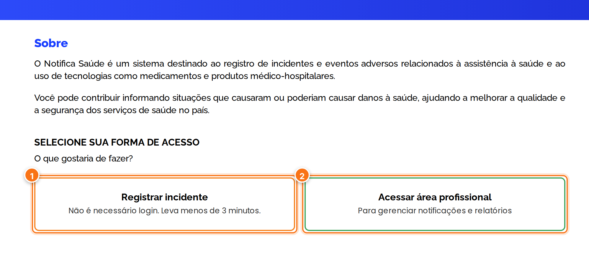
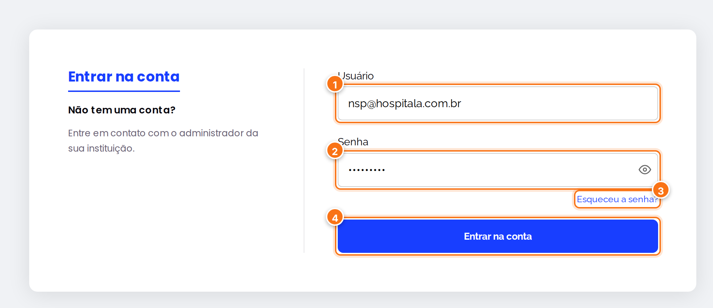
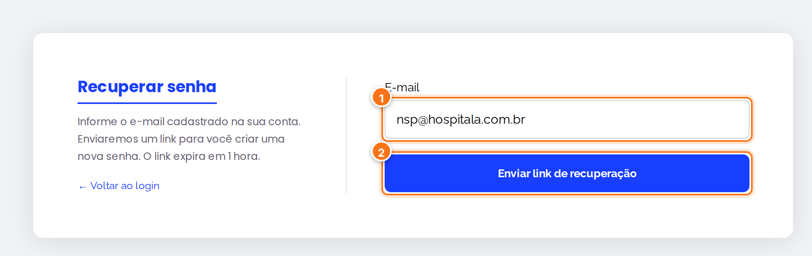
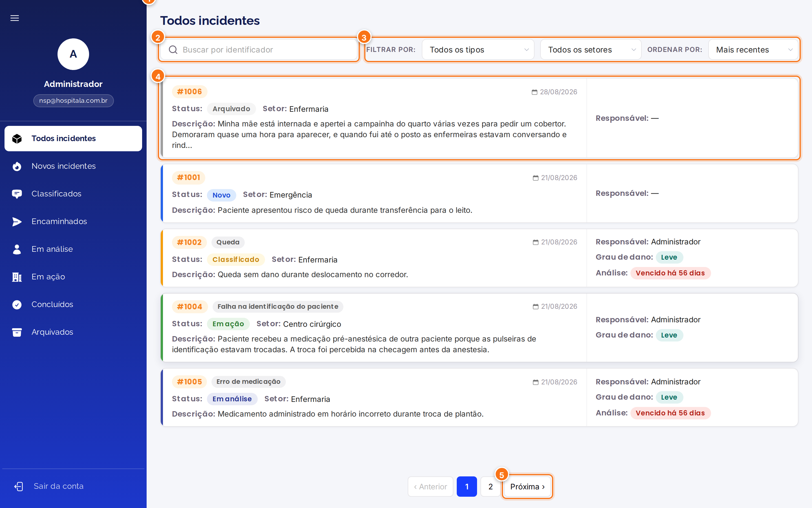
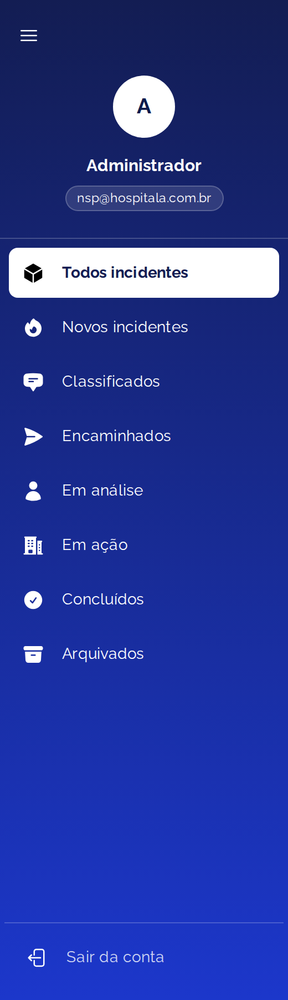
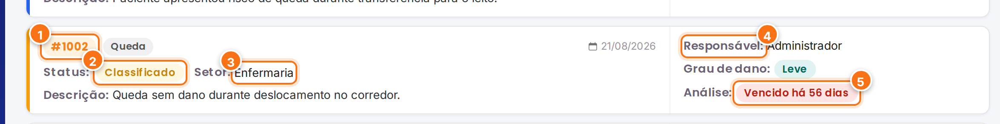
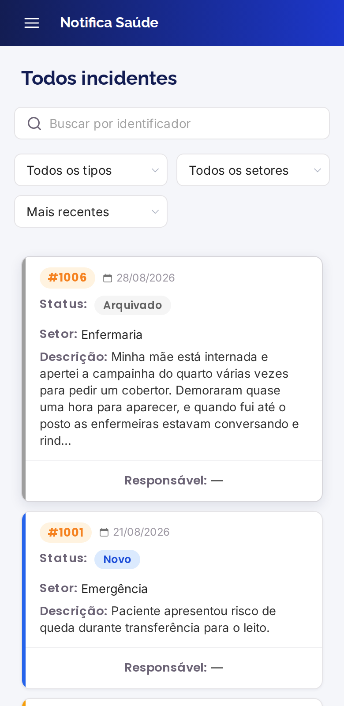
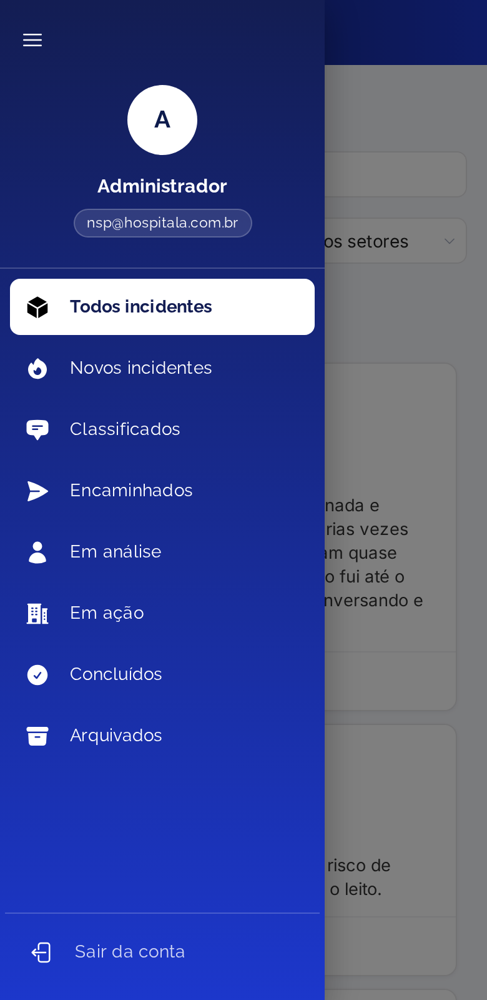
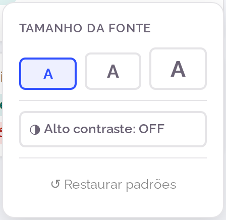

<h1 align="center">Primeiros passos</h1>

<strong>Mantenedores:</strong> Gustavo Henrique, Kauan Cardoso, Sophya Ribeiro, Brenno, Catarina, Eduardo

??? note "Histórico de Alterações"

    | Versão | Data | Justificativa | Responsável |
    | --- | --- | --- | --- |
    | 1.0 | 26/10/2026 | Criação da página. | Sophya Ribeiro |

Nesta página você aprende a entrar no sistema, recuperar a senha e se localizar no painel de incidentes.

## Página inicial

Todos os perfis

Ao abrir o endereço do NotificaSaúde, a página inicial mostra duas formas de acesso:

[{ .ns-print }](../assets/manual-sistema/primeiros-passos/inicio.png){ target="_blank" }

1. **Registrar incidente**: abre o formulário de notificação. **Não precisa de login** e leva menos de 3 minutos. Veja [Registrar uma notificação](registrar-notificacao.md).
2. **Acessar área profissional**: leva à tela de login, para o NSP e os gestores de área.

## Entrar no sistema

NSP Gestor da área

[{ .ns-print }](../assets/manual-sistema/primeiros-passos/login.png){ target="_blank" }

1. Em **Usuário**, digite o seu e-mail institucional.
2. Em **Senha**, digite a sua senha. O ícone de olho mostra o que foi digitado.
3. Esqueceu a senha? Clique em **Esqueceu a senha?** (veja abaixo).
4. Clique em **Entrar na conta**. Você será levado ao painel de incidentes.

!!! info "Não tem uma conta?"
    As contas são criadas pela própria instituição. Se você ainda não tem acesso, fale com o administrador do sistema na sua instituição.

!!! abstract "Regra do sistema"
    Por segurança, depois de **15 tentativas de login erradas em até 5 minutos**, o acesso fica bloqueado por **60 segundos** (requisito não-funcional 6.2.5).

## Recuperar a senha

[{ .ns-print }](../assets/manual-sistema/primeiros-passos/esqueceu-senha.png){ target="_blank" }

1. Digite o **e-mail cadastrado** na sua conta.
2. Clique em **Enviar link de recuperação**.
3. Abra o e-mail recebido e clique no link para criar uma nova senha.

!!! warning "Atenção"
    O link vale por **1 hora** e só pode ser usado **uma vez**. Se ele expirar, peça um novo.

A nova senha precisa ter **no mínimo 8 caracteres**, com pelo menos **uma letra maiúscula**, **uma minúscula**, **um número** e **um caractere especial** (por exemplo, `Seguranca@2026`).

## Conhecendo o painel

Depois do login, você chega ao painel **Todos incidentes**.

[{ .ns-print }](../assets/manual-sistema/primeiros-passos/painel.png){ target="_blank" }

1. **Menu lateral**: dá acesso às filas de incidentes por status (veja abaixo) e ao botão **Sair da conta**.
2. **Busca**: encontre um incidente pelo número dele (por exemplo, `1002`).
3. **Filtros e ordenação**: filtre pela **classificação** (Circunstância notificável, Near Miss, Incidente sem dano ou Evento adverso) e pelo **setor**, e ordene por **mais recentes** ou **mais antigos**. Ao escolher **Evento adverso**, aparece também o filtro por **grau do dano**.
4. **Cartão do incidente**: clique em qualquer cartão para abrir o detalhe da notificação.
5. **Paginação**: os incidentes aparecem em páginas; use **Próxima** e **Anterior** para navegar.

### As filas do menu lateral

[{ .ns-print .ns-print--estreito }](../assets/manual-sistema/primeiros-passos/menu-filas.png){ target="_blank" }

Cada item do menu mostra somente os incidentes de um status. Use as filas como a sua **lista de tarefas**:

| Fila | Para que serve |
| --- | --- |
| **Todos incidentes** | Visão geral de todos os incidentes a que você tem acesso. |
| **Novos incidentes** | Notificações que ainda precisam ser classificadas. |
| **Classificados** | Incidentes que aguardam a decisão de analisar ou encaminhar. |
| **Encaminhados** | Incidentes enviados ao setor, aguardando a análise do gestor. |
| **Em análise** | Análises em andamento. |
| **Em ação** | Incidentes com plano de ação em execução. |
| **Concluídos** | Incidentes encerrados após o tratamento. |
| **Arquivados** | Incidentes encerrados sem seguir o fluxo. |

### Lendo um cartão de incidente

[{ .ns-print }](../assets/manual-sistema/primeiros-passos/cartao-incidente.png){ target="_blank" }

1. **Número do incidente** (identificador único) e, ao lado, o **tipo de incidente**, quando já classificado.
2. **Status** atual.
3. **Setor** onde o incidente ocorreu.
4. **Responsável pelo incidente**: o profissional do NSP que finalizou a classificação. Aparece "—" enquanto o incidente não é classificado.
5. **Prazo da análise**: mostra quanto tempo falta ou, em vermelho, há quantos dias o prazo venceu.

!!! abstract "Regra do sistema"
    O **prazo para análise** é calculado automaticamente a partir da data da notificação e do **grau do dano** definido na classificação: **10 dias** para sem dano ou dano leve, **7 dias** para dano moderado, **4 dias** para dano grave e **2 dias** para óbito ou Never Event (RN-14).

## No celular

O sistema funciona no navegador do celular. O menu lateral fica recolhido e abre pelo ícone **☰** no canto superior esquerdo.

[{ .ns-print .ns-print--celular }](../assets/manual-sistema/primeiros-passos/celular-painel.png){ target="_blank" }

[{ .ns-print .ns-print--celular }](../assets/manual-sistema/primeiros-passos/celular-menu.png){ target="_blank" }

## Acessibilidade

O botão redondo azul com o ícone de acessibilidade, no canto inferior direito de todas as telas, abre as opções de acessibilidade:

[{ .ns-print .ns-print--estreito }](../assets/manual-sistema/primeiros-passos/acessibilidade.png){ target="_blank" }

- **Tamanho da fonte**: três botões **A**, do menor para o maior (normal, médio e grande), que mudam o tamanho do texto em todo o sistema.
- **Alto contraste**: liga ou desliga o modo de alto contraste.
- **Restaurar padrões**: volta tudo como estava.

!!! tip "Dica"
    As suas escolhas de acessibilidade ficam guardadas no navegador e continuam valendo da próxima vez que você entrar.
