<h1 align="center">Registrar a análise</h1>

<strong>Mantenedores:</strong> Gustavo Henrique, Kauan Cardoso, Sophya Ribeiro, Brenno, Catarina, Eduardo

??? note "Histórico de Alterações"

    | Versão | Data | Justificativa | Responsável |
    | --- | --- | --- | --- |
    | 1.0 | 26/10/2026 | Criação da página. | Sophya Ribeiro |

NSP Gestor da área

A análise é a investigação do incidente: o que aconteceu, quais **problemas na prestação do cuidado** houve e **por que** eles aconteceram. O formulário guia você em **cinco seções**, e ao final as causas encontradas viram **recomendações de melhoria**, que dão origem ao plano de ação.

## Sumário

- [Quem pode registrar a análise](#quem-pode-registrar)
- [Guia de investigação](#guia)
- [Como o formulário funciona](#como-funciona)
- [Seção 1 — Informações da notificação](#secao-1)
- [Seção 2 — Informações da análise](#secao-2)
- [Seção 3 — Cronologia do incidente](#secao-3)
- [Seção 4 — Fatores contribuintes](#secao-4)
- [Seção 5 — Resultado (Ishikawa + Recomendações)](#secao-5)
- [Finalizar a análise](#finalizar)
- [Decidir o encaminhamento do resultado (NSP)](#decisao)

!!! example "O caso usado nesta página"
    A partir da Seção 2, os prints mostram um caso fictício: **uma paciente recebeu a medicação pré-anestésica de outra paciente porque as pulseiras de identificação estavam trocadas**. A troca foi percebida na checagem antes da anestesia. Acompanhe como cada seção ajuda a chegar das evidências às causas e às recomendações.

!!! abstract "Cultura justa"
    A análise **não busca culpados**. O objetivo é encontrar as **fragilidades do processo e do sistema** que permitiram o incidente, e não punir profissionais da ponta assistencial. Esse aviso fica fixo no topo do formulário durante toda a análise (RN-17).

## Quem pode registrar a análise { #quem-pode-registrar }

| Situação do incidente | Quem vê o botão **Registrar análise** |
| --- | --- |
| **Classificado** (não encaminhado) | Qualquer profissional do NSP |
| **Encaminhado** ao setor | O gestor da área do setor que recebeu o encaminhamento |

!!! warning "A análise pertence a quem a começou"
    A partir do momento em que a **primeira seção é salva**, somente quem iniciou a análise pode continuá-la e concluí-la. Para as demais pessoas, a seção **Análise** mostra apenas *"Análise em andamento. Aguarde a finalização para visualizar os detalhes."* Se duas pessoas começarem ao mesmo tempo, vale o primeiro salvamento (RN-28).

## Guia de investigação { #guia }

Ao clicar em **Registrar análise**, o sistema abre o **Guia de investigação**, que mostra o percurso completo antes de você começar.

[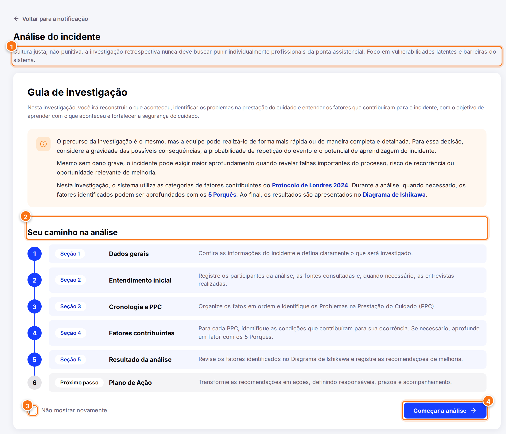{ .ns-print }](../assets/manual-sistema/analise/guia.png){ target="_blank" }

1. **Aviso de cultura justa**, fixo em todas as seções.
2. **Seu caminho na análise**: as cinco seções e o próximo passo, o plano de ação.
3. **Não mostrar novamente**: marque para, nas próximas análises, abrir direto na Seção 1.
4. **Começar a análise →**: abre a Seção 1.

## Como o formulário funciona { #como-funciona }

- A **barra de progresso** no topo mostra em qual das cinco seções você está.
- **Próximo** valida a seção e avança. **Voltar** retorna sem perder o que foi preenchido.
- A cada avanço, o sistema **salva um rascunho automaticamente** e mostra *"Rascunho salvo"*. Você pode fechar e voltar depois pelo botão **Continuar análise**, no detalhe da notificação.
- Quando o primeiro rascunho é salvo, o status do incidente muda para **Em análise**.
- As **caixas azuis (ⓘ)** explicam cada seção e campo. Os blocos cinza com seta (**Como preencher**, **Exemplos**) podem ser recolhidos; o sistema lembra a sua escolha nas próximas análises.
- Campos obrigatórios têm **asterisco (\*)**. Campos com limite mostram um **contador** (por exemplo, `45/100`).

!!! tip "Se algo estiver faltando"
    O botão **Próximo** está sempre clicável. Se houver pendências, o sistema **não avança**, destaca em vermelho cada campo com problema, escreve embaixo dele o que falta e rola a tela até o primeiro campo pendente. Os destaques somem conforme você corrige.

## Seção 1 — Informações da notificação { #secao-1 }

Confira os dados já registrados e diga, em poucas palavras, **o que está sendo investigado**.

[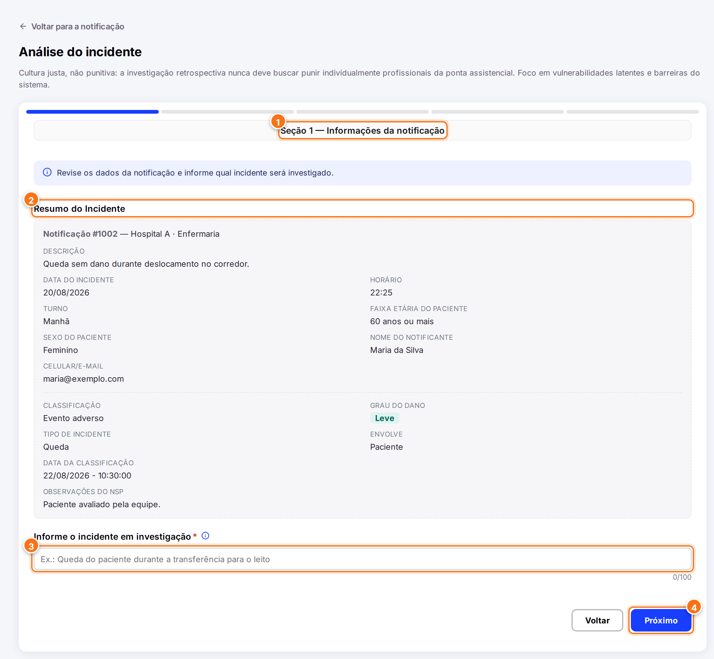{ .ns-print }](../assets/manual-sistema/analise/secao-1.png){ target="_blank" }

1. **Título da seção** e barra de progresso.
2. **Resumo do incidente**: os dados da notificação e da classificação, somente para leitura.
3. **Informe o incidente em investigação**: uma frase curta, de até **100 caracteres**. Esse texto aparece no topo de todas as seções seguintes e vira a "cabeça" do Diagrama de Ishikawa.
4. **Próximo**: valida e avança para a Seção 2.

??? example "Exemplos de incidente em investigação"
    - *Medicação pré-anestésica administrada a paciente com pulseira trocada*
    - *Queda de paciente idosa durante deslocamento no corredor da enfermaria*

O campo é obrigatório. Se ficar vazio, ou se passar de 100 caracteres, o sistema avisa e não avança:

[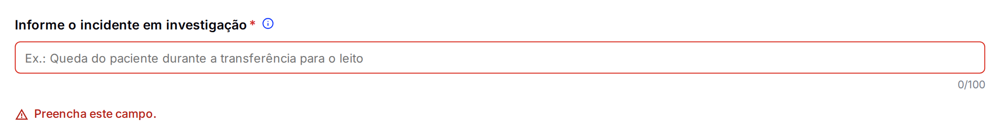{ .ns-print }](../assets/manual-sistema/analise/secao-1-validacao.png){ target="_blank" }

[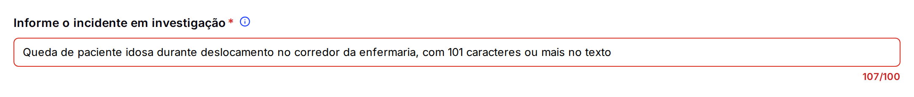{ .ns-print }](../assets/manual-sistema/analise/secao-1-limite.png){ target="_blank" }

!!! info "O texto não é cortado"
    Quando o texto passa do limite, o contador fica vermelho e aparece um aviso, mas o sistema **não apaga** o que você escreveu: é você quem decide como resumir.

## Seção 2 — Informações da análise { #secao-2 }

Registre **quem conduziu a análise**, **quem participou**, **quais fontes foram consultadas** e as **entrevistas** realizadas.

[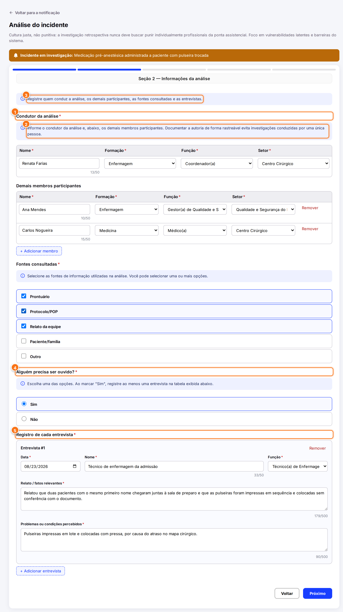{ .ns-print }](../assets/manual-sistema/analise/secao-2.png){ target="_blank" }

1. **Condutor da análise** (obrigatório): nome (até 50 caracteres), formação, função e setor.
2. **Demais membros participantes** (opcional): use **+ Adicionar membro** para cada pessoa da equipe. Todo membro adicionado precisa ter todos os campos preenchidos.
3. **Fontes consultadas** (obrigatório): marque uma ou mais entre prontuário, protocolo/POP, relato da equipe, paciente/família e outro.
4. **Alguém precisa ser ouvido?** (obrigatório): com **Não**, a tabela de entrevistas não aparece.
5. **Registro de cada entrevista**: com **Sim**, registre ao menos uma entrevista com data, nome, função, relato/fatos relevantes e problemas ou condições percebidos (até 500 caracteres cada).

!!! tip "Por que registrar a equipe"
    Documentar quem participou torna a autoria rastreável e evita investigações conduzidas por uma única pessoa.

!!! info "Opção “Outro”"
    Em todos os menus com a opção **Outro**, o sistema abre um campo para você especificar, com até 30 caracteres (RN-24).

## Seção 3 — Cronologia do incidente { #secao-3 }

Monte a **linha do tempo** do incidente e identifique os **Problemas na Prestação do Cuidado (PPC)**.

[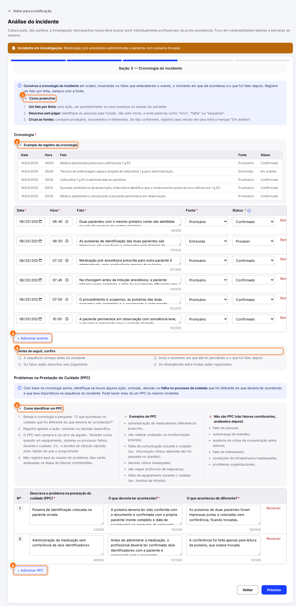{ .ns-print }](../assets/manual-sistema/analise/secao-3.png){ target="_blank" }

1. **Como preencher**: as três regras da cronologia — um fato por linha, descreva sem julgar e cruze as fontes.
2. **Exemplo de registro da cronologia**: uma mini tabela de exemplo, igual à tabela real.
3. **+ Adicionar evento**: cada linha é um fato, com **Data**, **Hora**, **Fato** (até 500 caracteres), **Fonte** (prontuário, inspeção no local, entrevista ou outro) e **Status**. É preciso registrar ao menos um evento.
4. **Antes de seguir, confira**: uma lista de conferência. Ela orienta, mas não bloqueia o avanço.
5. **Como identificar um PPC**: passo a passo e exemplos do que é e do que **não** é um PPC.
6. **+ Adicionar PPC**: cada PPC tem **o problema**, **o que deveria ter acontecido** e **o que aconteceu de diferente** (até 500 caracteres cada). Os PPCs são numerados automaticamente.

| Status do fato | Quando usar |
| --- | --- |
| **Confirmado** | Há fonte documental direta (por exemplo, o prontuário). |
| **Provável** | Vem de relato ou entrevista, sem confirmação documental. |
| **Em análise** | A informação ainda precisa ser validada, inclusive quando duas fontes não batem. Nesse caso, registre **cada versão em uma linha**. |

!!! tip "PPC × fator contribuinte"
    O **PPC** é o que deu errado no cuidado (por exemplo, *"pulseira de identificação colocada na paciente errada"*). As **condições** que favoreceram isso (falta de pessoal, sobrecarga, ausência de protocolo) **não** são PPC: elas entram na Seção 4, como fatores contribuintes.

## Seção 4 — Fatores contribuintes { #secao-4 }

Para **cada PPC**, identifique as condições que contribuíram para ele acontecer e, se quiser, aprofunde com os **5 Porquês**.

[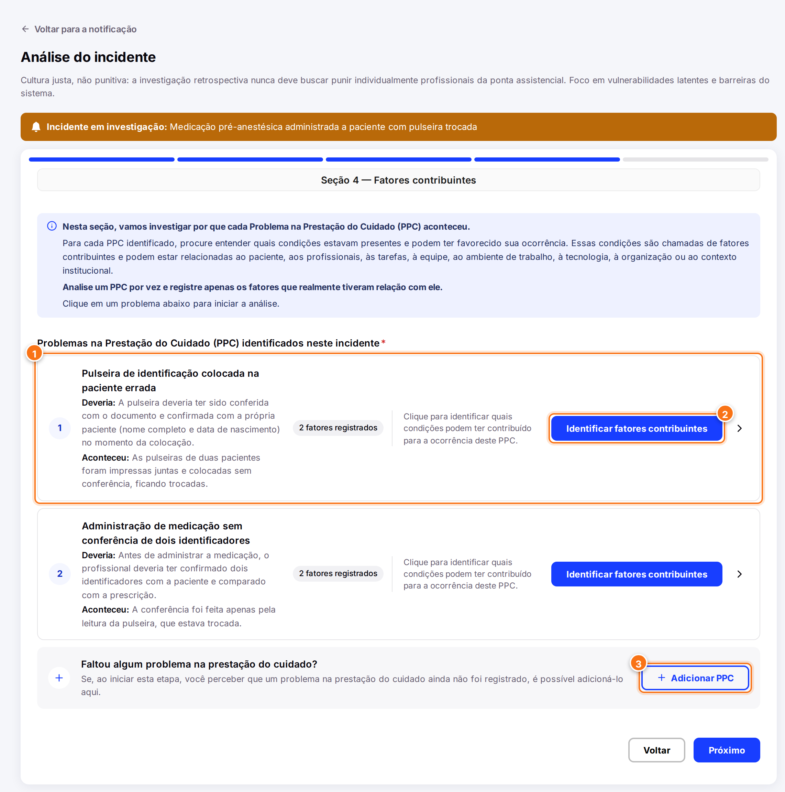{ .ns-print }](../assets/manual-sistema/analise/secao-4.png){ target="_blank" }

1. **Cartão do PPC**: um cartão para cada PPC registrado na Seção 3, com o que deveria ter acontecido e o que aconteceu.
2. **Identificar fatores contribuintes**: abre a análise daquele PPC. Analise **um PPC por vez**.
3. **Faltou algum problema na prestação do cuidado?**: se perceber agora um PPC que não foi registrado, use **+ Adicionar PPC** aqui mesmo.

### Marcar os fatores contribuintes

Os fatores seguem as **oito categorias do Protocolo de Londres 2024**:

[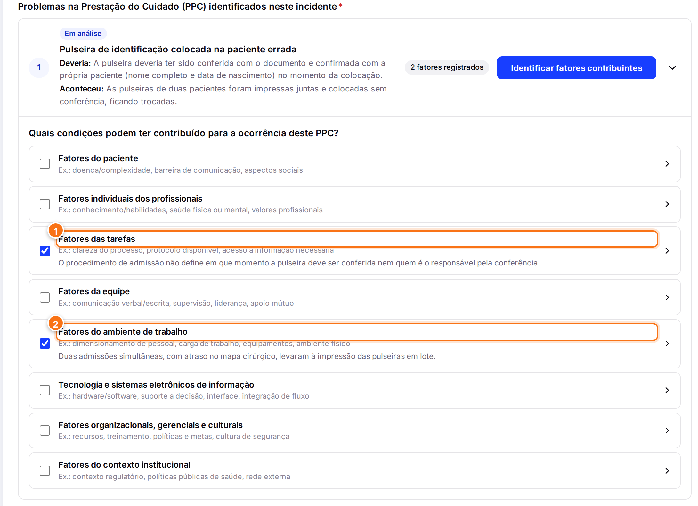{ .ns-print }](../assets/manual-sistema/analise/secao-4-fatores.png){ target="_blank" }

Os marcadores **1** e **2** mostram duas categorias já marcadas neste PPC (*Fatores das tarefas* e *Fatores do ambiente de trabalho*). Abaixo do título de cada uma aparece um resumo do fator registrado.

Para registrar um fator:

1. Marque a categoria, pela caixa de seleção ou clicando na linha.
2. Em **Descreva o fator identificado e como ele contribuiu para este PPC**, explique o fator (obrigatório).
3. Se quiser, marque a **fonte/evidência**: prontuário, entrevista, observação, protocolo/documento, sistema eletrônico ou outro.
4. Clique em **Salvar fator**.

??? info "As oito categorias do Protocolo de Londres 2024"
    | Categoria | Exemplos |
    | --- | --- |
    | Fatores do paciente | Doença/complexidade, barreira de comunicação, aspectos sociais |
    | Fatores individuais dos profissionais | Conhecimento/habilidades, saúde física ou mental, valores profissionais |
    | Fatores das tarefas | Clareza do processo, protocolo disponível, acesso à informação necessária |
    | Fatores da equipe | Comunicação verbal/escrita, supervisão, liderança, apoio mútuo |
    | Fatores do ambiente de trabalho | Dimensionamento de pessoal, carga de trabalho, equipamentos, ambiente físico |
    | Tecnologia e sistemas eletrônicos de informação | Hardware/software, suporte à decisão, interface, integração de fluxo |
    | Fatores organizacionais, gerenciais e culturais | Recursos, treinamento, políticas e metas, cultura de segurança |
    | Fatores do contexto institucional | Contexto regulatório, políticas públicas de saúde, rede externa |

### Aprofundar com os 5 Porquês

O **5 Porquês** é opcional e vem **fechado**: abaixo de cada fator aparece apenas um convite com o botão **Usar os 5 Porquês**. Clique nele para abrir o bloco. Comece pelo fator e pergunte *"Por que isso aconteceu?"*; use cada resposta para formular o próximo "por quê?".

[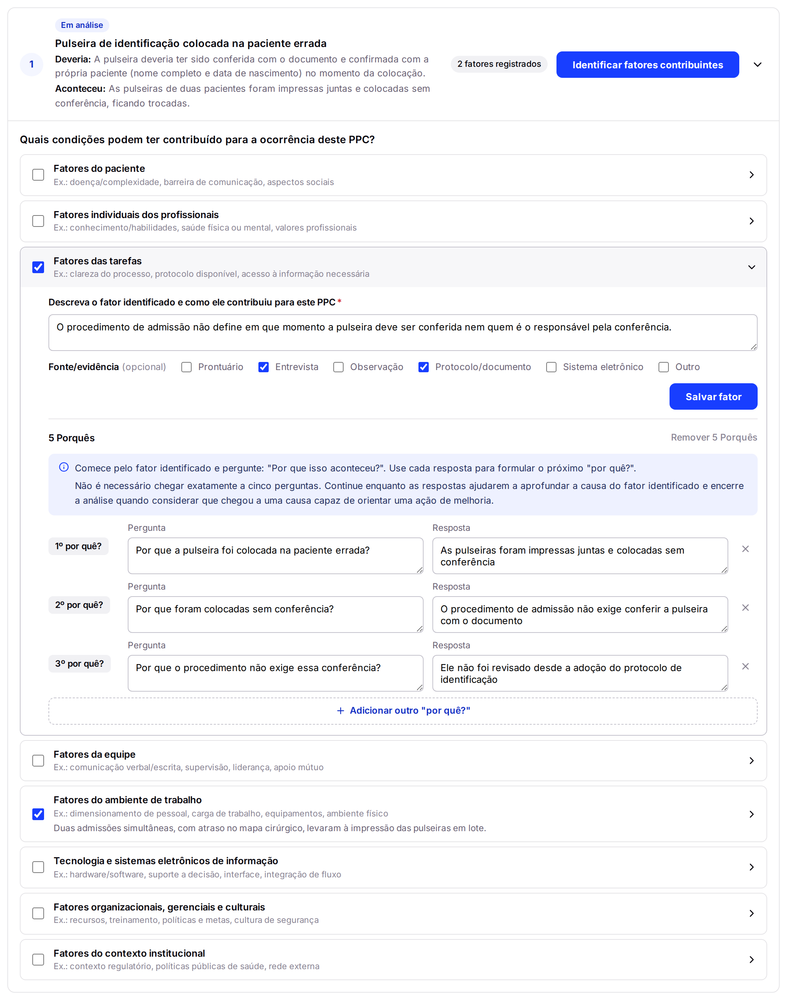{ .ns-print }](../assets/manual-sistema/analise/secao-4-porques.png){ target="_blank" }

- Cada nível tem **Pergunta** e **Resposta**, de até 100 caracteres cada.
- **+ Adicionar outro "por quê?"** cria o próximo nível com a pergunta já sugerida a partir da resposta anterior, e você pode editá-la.
- Não é preciso chegar exatamente a cinco: pare quando chegar a uma causa que permita definir uma ação de melhoria. O limite é de 15 níveis.
- Abriu sem querer? Enquanto estiver vazio, **Não usar os 5 Porquês** fecha o bloco. Depois de preenchido, o botão vira **Remover 5 Porquês**, que pede confirmação antes de apagar o que foi escrito.

!!! warning "Para avançar da Seção 4"
    É preciso ter **ao menos 1 PPC**, **ao menos um fator em cada PPC**, a **descrição de todo fator marcado** e **pergunta e resposta** em todo nível de 5 Porquês começado. O PPC com pendência aparece com o selo **Pendências** em vermelho.

## Seção 5 — Resultado (Ishikawa + Recomendações) { #secao-5 }

O sistema monta o **Diagrama de Ishikawa** (espinha de peixe) automaticamente, e você registra as **recomendações de melhoria**.

[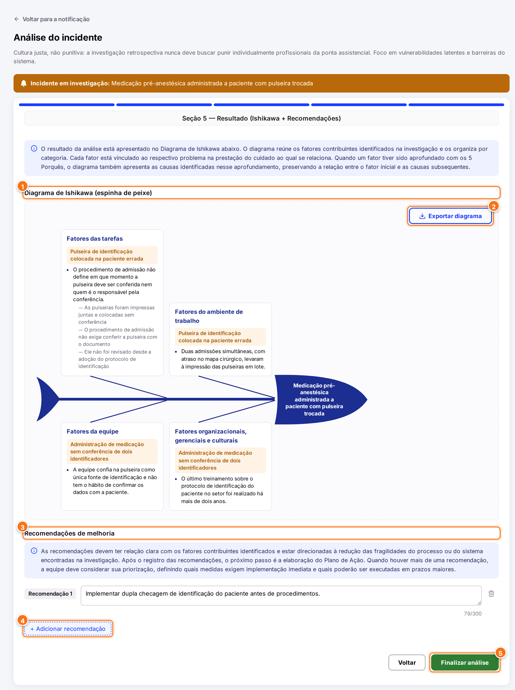{ .ns-print }](../assets/manual-sistema/analise/secao-5.png){ target="_blank" }

1. **Diagrama de Ishikawa**: a "cabeça" é o incidente em investigação, e cada espinha é uma categoria de fator, com os fatores agrupados pelo PPC a que se referem e as respostas dos 5 Porquês.
2. **Exportar diagrama**: baixa o diagrama completo como imagem PNG, pronta para apresentações.
3. **Recomendações de melhoria**: o que precisa ser feito para tratar as causas encontradas.
4. **+ Adicionar recomendação**: uma recomendação por linha, com até 300 caracteres.
5. **Finalizar análise**: conclui a investigação.

!!! tip "Boas recomendações"
    Cada recomendação deve ter **relação clara com um fator contribuinte** e atacar uma fragilidade do processo. Quando houver várias, priorize as que tratam as causas mais importantes. No caso do exemplo: *"Implementar dupla checagem de identificação do paciente antes de procedimentos."*

## Finalizar a análise { #finalizar }

Ao clicar em **Finalizar análise**, o sistema confere se todas as seções estão completas e, se estiver tudo certo:

- registra a **data, a hora e o autor** da conclusão no histórico;
- cria **uma ação no plano de ação para cada recomendação**, com o campo *"O que será feito?"* já preenchido. Essas ações aparecem como **Preenchimento pendente** até serem completadas (veja [Plano de ação](plano-de-acao.md#completar-acoes));
- muda o status:
    - análise feita **pelo setor** (incidente encaminhado) → **Analisado**;
    - análise feita **pelo NSP** → continua **Em análise** até o NSP decidir se envia o resultado ao setor (próximo passo).

Depois de concluída, a análise fica disponível **somente para leitura** na seção **Análise** do detalhe, organizada pelas mesmas seções. Ela pode ser consultada por todos que têm acesso ao incidente.

[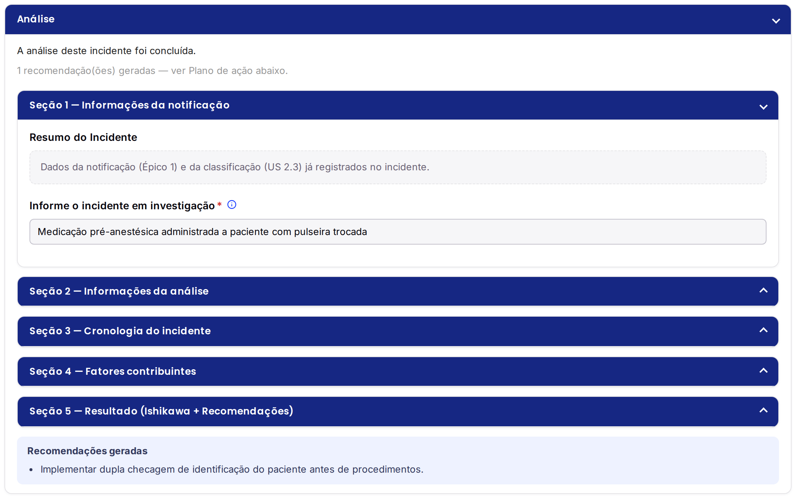{ .ns-print }](../assets/manual-sistema/analise/analise-concluida.png){ target="_blank" }

## Decidir o encaminhamento do resultado (NSP) { #decisao }

NSP

Quando o **próprio NSP** fez a análise, o setor **não tem acesso** automático ao resultado. Depois de finalizar, o núcleo decide se compartilha a análise com o setor:

[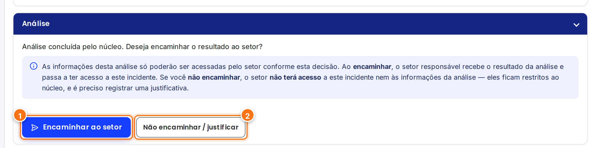{ .ns-print }](../assets/manual-sistema/analise/decisao-encaminhamento.png){ target="_blank" }

1. **Encaminhar ao setor**: o gestor do setor passa a ver o incidente e a análise. A mensagem é opcional.
2. **Não encaminhar / justificar**: o incidente e a análise ficam **restritos ao núcleo**. A justificativa é obrigatória e fica no histórico.

[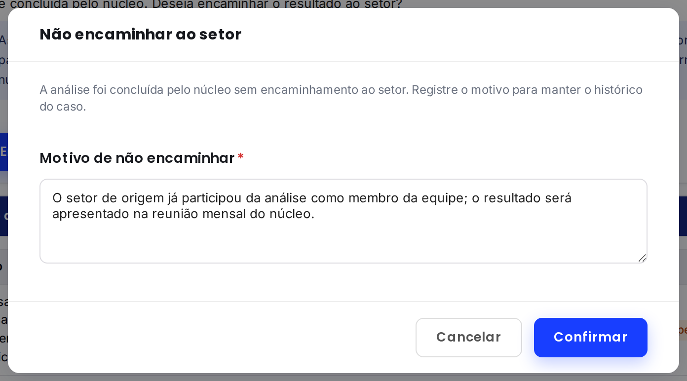{ .ns-print }](../assets/manual-sistema/analise/modal-nao-encaminhar.png){ target="_blank" }

Nos dois casos, o status muda para **Analisado** e o [plano de ação](plano-de-acao.md) fica liberado (RN-18).
