<h1 align="center">Registrar uma notificação</h1>

<strong>Mantenedores:</strong> Gustavo Henrique, Kauan Cardoso, Sophya Ribeiro, Brenno, Catarina, Eduardo

??? note "Histórico de Alterações"

    | Versão | Data | Justificativa | Responsável |
    | --- | --- | --- | --- |
    | 1.0 | 26/10/2026 | Criação da página. | Sophya Ribeiro |

Notificante Qualquer pessoa

Qualquer pessoa que presenciou ou soube de um incidente pode notificá-lo: profissionais de saúde, pacientes, acompanhantes ou terceiros. **Não é preciso ter conta nem fazer login**, e o registro leva menos de 3 minutos.

!!! info "Notifique mesmo quando não houve dano"
    Situações de risco e incidentes que **quase aconteceram** (near miss) também devem ser notificados. São eles que ajudam a instituição a corrigir falhas **antes** que alguém se machuque (RN-03).

## Antes de começar

- Tenha em mente **quando** e **onde** o incidente aconteceu (data, horário aproximado, instituição e setor).
- Você **não precisa se identificar**: a última etapa do formulário é opcional (RN-04).
- Descreva **o que aconteceu**, sem procurar culpados. O objetivo é melhorar a segurança, não punir pessoas.

## Passo a passo

Na [página inicial](primeiros-passos.md#pagina-inicial), clique em **Registrar incidente**. O formulário tem **cinco etapas**, e a barra azul no topo mostra em qual delas você está.

!!! tip "Dica"
    O botão **Próximo** só fica disponível depois que todos os campos obrigatórios da etapa forem preenchidos. Os campos obrigatórios têm um **asterisco vermelho (\*)**. Para corrigir algo de uma etapa anterior, use **Voltar**; o que você já preencheu não se perde.

### Etapa 1 — Informações iniciais

Responda se o incidente **envolve um paciente**. Se a resposta for **Não** (por exemplo, um equipamento que falhou sem atingir ninguém), o formulário pula as perguntas sobre o paciente.

=== "Celular"

    [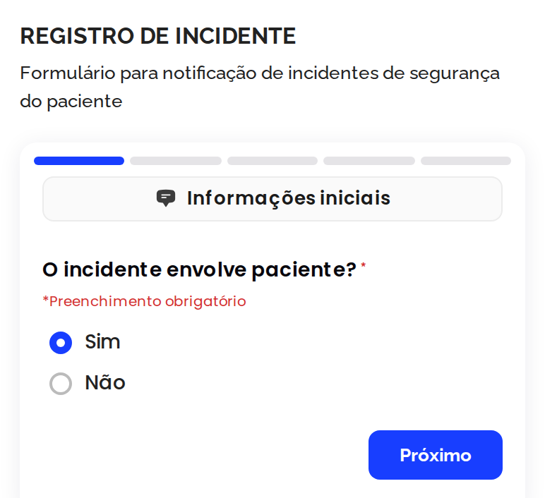{ .ns-print .ns-print--celular }](../assets/manual-sistema/notificacao/celular-1-informacoes-iniciais.png){ target="_blank" }

=== "Computador"

    [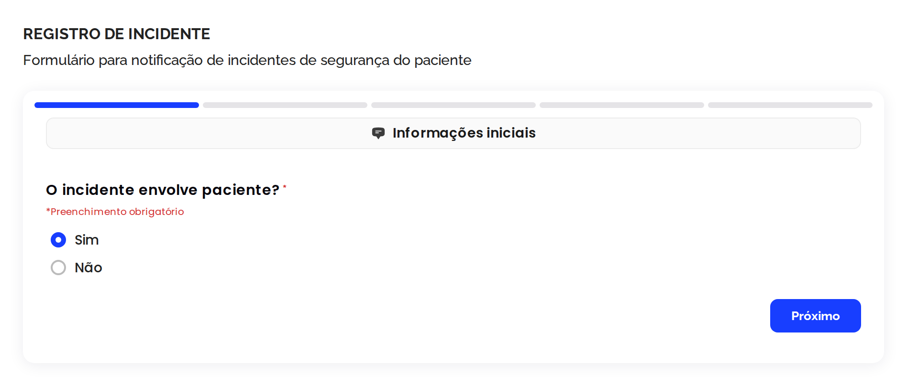{ .ns-print }](../assets/manual-sistema/notificacao/computador-1-informacoes-iniciais.png){ target="_blank" }

### Etapa 2 — Informações sobre o paciente envolvido

Informe a **faixa etária** (0 a 17 anos, 18 a 59 anos ou 60 anos ou mais) e o **sexo** do paciente. O nome do paciente **não** é pedido.

=== "Celular"

    [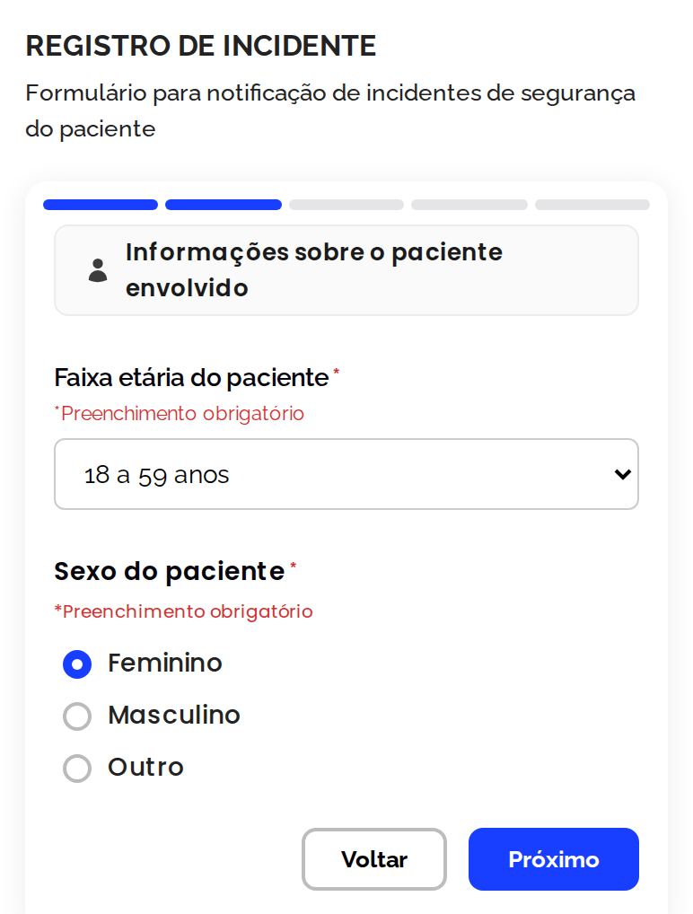{ .ns-print .ns-print--celular }](../assets/manual-sistema/notificacao/celular-2-paciente.png){ target="_blank" }

=== "Computador"

    [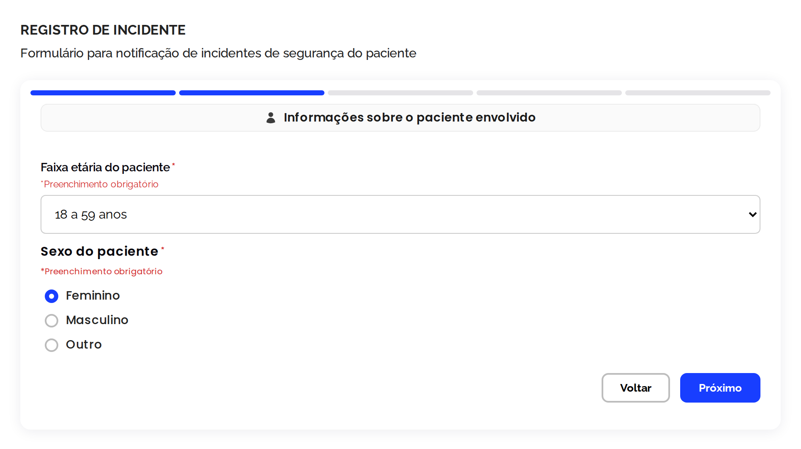{ .ns-print }](../assets/manual-sistema/notificacao/computador-2-paciente.png){ target="_blank" }

### Etapa 3 — Momento e local do incidente

Informe a **data**, o **turno** (manhã, tarde ou noite) e o **horário** em que o incidente aconteceu, a **instituição** e o **setor** onde ele ocorreu.

=== "Celular"

    [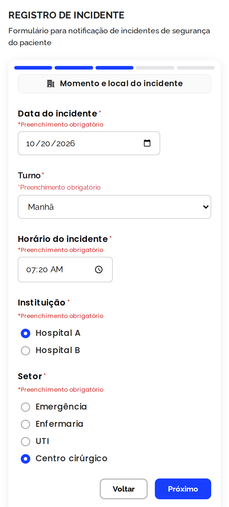{ .ns-print .ns-print--celular }](../assets/manual-sistema/notificacao/celular-3-momento-e-local.png){ target="_blank" }

=== "Computador"

    [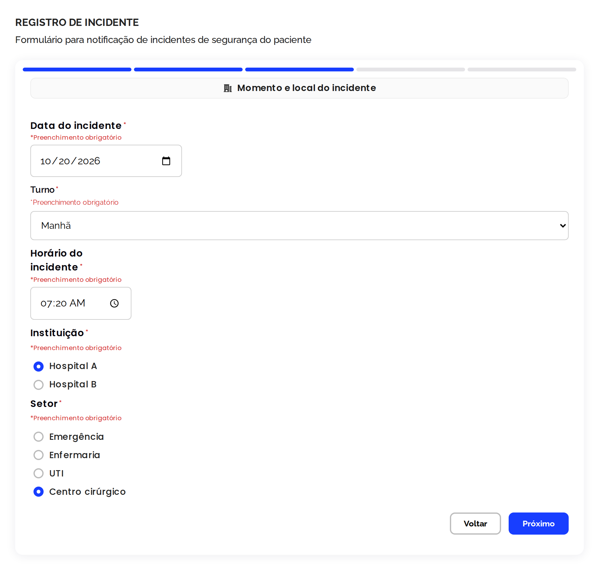{ .ns-print }](../assets/manual-sistema/notificacao/computador-3-momento-e-local.png){ target="_blank" }

!!! warning "Atenção"
    A data do incidente não pode ser uma data futura: nesse caso, o formulário mostra **"Data inválida!"** e não deixa avançar.

### Etapa 4 — Descrição do incidente

Conte **o que aconteceu**, com suas palavras, e informe o seu **papel**: profissional de saúde, familiar/acompanhante ou outro.

=== "Celular"

    [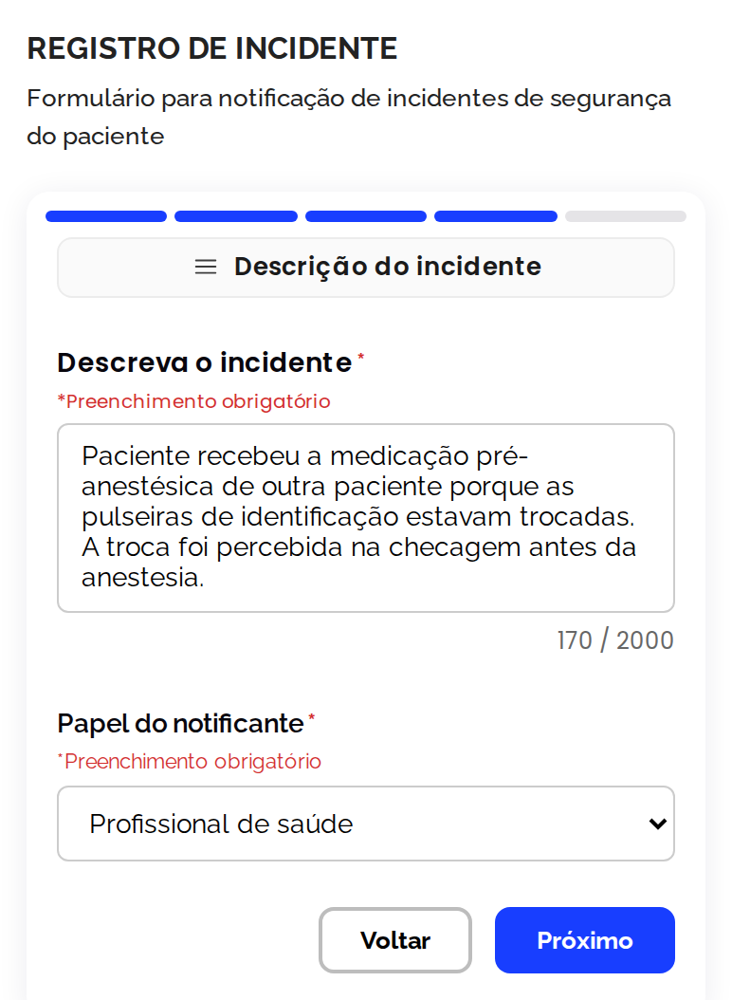{ .ns-print .ns-print--celular }](../assets/manual-sistema/notificacao/celular-4-descricao.png){ target="_blank" }

=== "Computador"

    [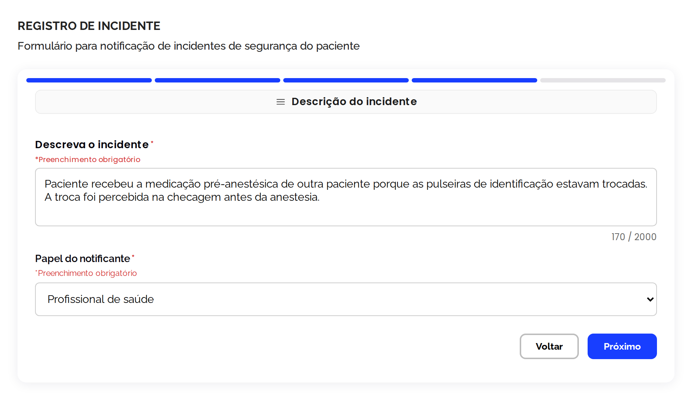{ .ns-print }](../assets/manual-sistema/notificacao/computador-4-descricao.png){ target="_blank" }

??? example "Exemplo de uma boa descrição"
    > Paciente recebeu a medicação pré-anestésica de outra paciente porque as pulseiras de identificação estavam trocadas. A troca foi percebida na checagem antes da anestesia.

    Uma boa descrição diz **o que aconteceu**, **com quem** (pela função, não pelo nome) e **como foi percebido**, sem julgamentos como "descuido" ou "erro de fulano".

### Etapa 5 — Informações opcionais do notificante

Esta etapa é **opcional**. Se quiser que o NSP possa entrar em contato com você, informe seu **nome** e um **celular ou e-mail**. Para notificar de forma **anônima**, deixe os campos em branco. Depois, clique em **Enviar notificação**.

=== "Celular"

    [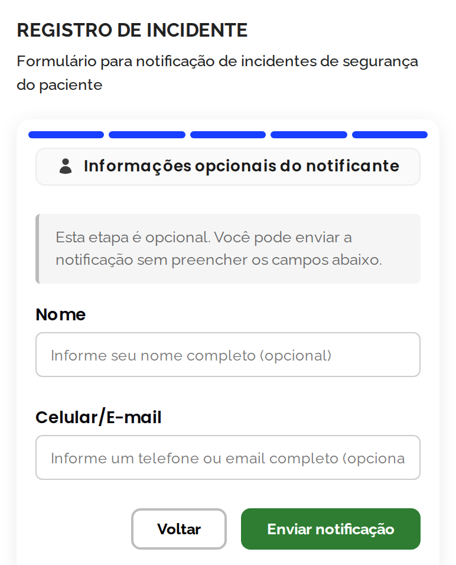{ .ns-print .ns-print--celular }](../assets/manual-sistema/notificacao/celular-5-notificante.png){ target="_blank" }

=== "Computador"

    [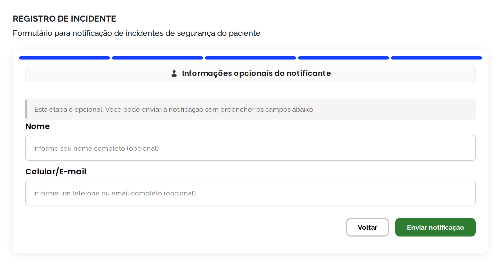{ .ns-print }](../assets/manual-sistema/notificacao/computador-5-notificante.png){ target="_blank" }

!!! abstract "Regra do sistema"
    Os dados de identificação do notificante só são vistos pelo **NSP** e pelo **administrador**. O gestor do setor **nunca** vê quem notificou, nem se a notificação foi anônima (RN-27).

## Notificação enviada

Pronto! A notificação foi registrada e já aparece para o NSP na fila **Novos incidentes**. Você pode **voltar ao início** ou **enviar outra notificação**.

=== "Celular"

    [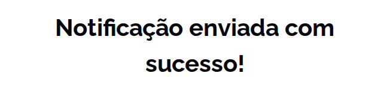{ .ns-print .ns-print--celular }](../assets/manual-sistema/notificacao/celular-6-enviada.png){ target="_blank" }

=== "Computador"

    [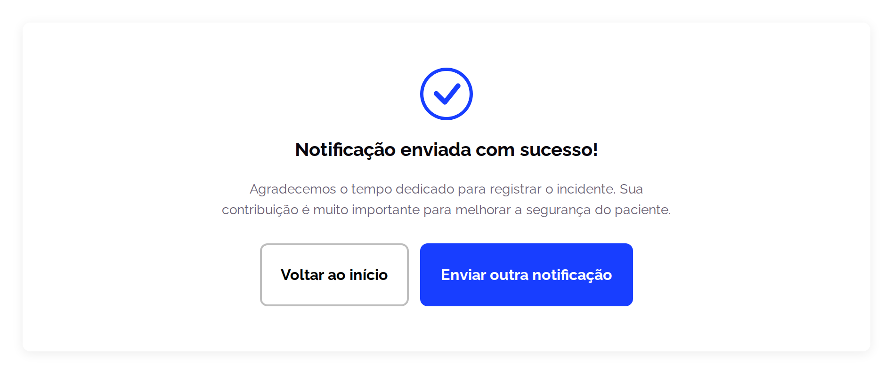{ .ns-print }](../assets/manual-sistema/notificacao/computador-6-enviada.png){ target="_blank" }

## O que acontece depois

1. O NSP lê a notificação e a **classifica** (tipo de incidente e grau do dano).
2. O incidente é **analisado** para encontrar as causas, pelo próprio NSP ou pelo setor onde aconteceu.
3. As causas encontradas viram **ações de melhoria**, acompanhadas até a conclusão.

Veja o caminho completo na [visão geral do manual](index.md#o-caminho-de-um-incidente).
